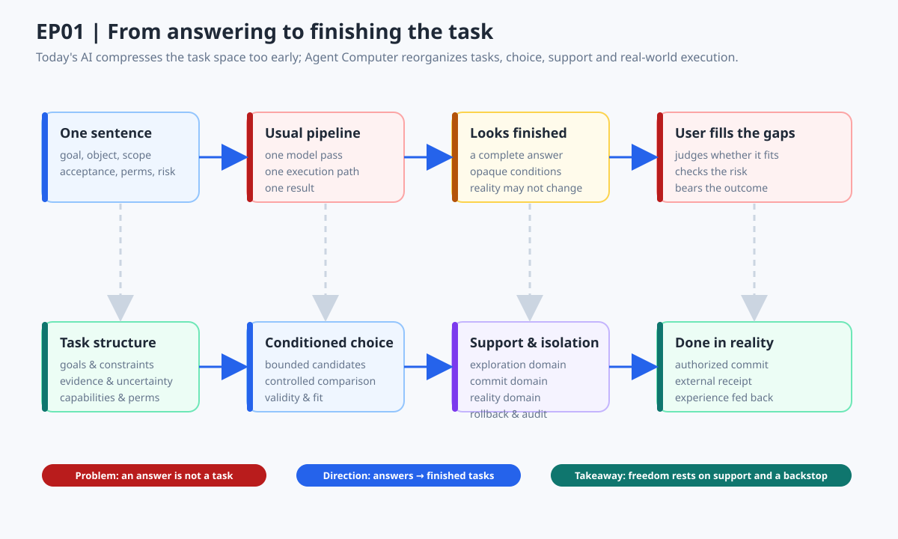

# Agent Computer 01: AI keeps getting better at answers. Why is getting things done getting harder?

> This is part 1 of 12 in the **Agent Computer** series, adapted from the Agent Computer live-stream series.
> The series is about a methodology and a target architecture, based on the Agent Computer methodology white paper. It is not a feature list of a shipped product. The text says which statements are methodological principles, which are target architecture and which are still hypotheses to be verified.

The same agent, facing similar problems, sometimes acts like an expert and sometimes like an intern on day one. Our first instinct is to blame the model: maybe it is too small, the prompt too short, the temperature wrong. So the prompt grows from one page to ten and ends up longer than the employee handbook.

Push the question one step earlier, though, and you find that many tasks were already reduced to one vague sentence before they reached the model. This post does not ask which model is stronger. It asks one thing:

> **Is the computing paradigm that today's AI systems run on still a fit for complex tasks in the real world?**

## The gap between answering and finishing

Ask an AI to analyze a business problem and you quickly get a report with background, data, conclusions and recommendations. It is not wrong, but you would not act on it directly, because you cannot tell under which conditions its conclusion holds. Which time range did it use? Is "growth slowed" measured against last month or the same period last year? If the budget were halved, would the recommendation still stand?

An answer is only an output. To finish a task you also need to know which conditions the goal depends on, which options exist, what evidence and cost each one carries, what is established and what is inferred, and who chooses, who authorizes and who bears the outcome.

Quite a few AI systems run on something close to this: user input → one model pass → one tool call → one result → user accepts or rejects. Nothing is wrong with this pipeline as such. The problem is how early it throws away what should be kept: the input becomes one reading of the task, several options become one answer, and a set of competing criteria becomes one score. The system looks simple, but the responsibility has moved to the user, who must judge whether the result applies and supply the conditions nobody recorded.

The seven problems below follow a task in the order it moves through the system. Each of the eleven later posts takes up one part of them.

## 1. Execution starts before the request has been sorted out

"Take a look at how the business has been doing lately." The sentence sounds natural, but how long is "lately"? Is "the business" the whole company or one product line? Does "how it's doing" mean a trend, anomalies or recommended actions? Is the metric revenue, orders or profit? Goal, object, scope, definitions and deliverable are all undetermined.

Pasting that sentence into a prompt is much like running a program after skipping type checking and linking: errors surface only at run time, and you cannot tell which layer they came from. Was the intent misread, the Skill routed wrongly, a slot bound to the wrong value, the model not capable enough, a tool call failed, or was the acceptance criterion never defined?

So an agent's instability comes from the model's randomness and also from requests that were never turned into structure. An agent needs a stable semantic layer that organizes natural language into a structured task, then maps it to capabilities, tools and permissions. "Compiling" is only a metaphor here: the step from natural language to task structure neither preserves meaning nor is deterministic, so its output has to be something the user can see and confirm.

## 2. One answer: the real world rarely has a condition-free optimum

The same goal maps to different reasonable plans under different timing, budget, hardware, identity and risk appetite. Plan A is fastest but invasive, plan B is steady but slow to pay off, plan C is cheapest but costly to maintain. You cannot say A is best and the others are bad. You can only say A fits better under one set of conditions.

One common practice is to generate a few results, hand over the one with the highest score and discard the rest. Why the others lost, and under which conditions they would actually have been worth something, is never stored. Computation happened and left nothing reusable, so the next similar task starts from a fresh generation.

> **The old system ends at an answer. The next one should end at a choice with reasons behind it.**

This does not mean handing the user ten answers every time. Simple tasks can close quickly; only complex ones need the choice space kept open. The one thing to avoid is flattening that space into a single answer too early, before the conditions have been stated.

## 3. One score: the weights come from the situation

Behind the single answer there is usually a single score. With a score you can rank, and with a ranking you can pick the top one. But fast versus explainable, cheap versus low-risk, automated versus recoverable are not differences along one axis. Folding them into a composite score requires weights, and weights come from the situation: a plan a startup finds too expensive may look reassuringly solid to a large company.

So a candidate that was not chosen has not failed. Perhaps the budget was short, or the device could not run it. A better record says under which conditions the candidate was produced, on what evidence, why it was passed over, and which change in conditions should trigger a second look. More candidates is not better either. They must differ in a meaningful way, carry evidence and come with a stopping condition, or they only add to the user's load.

## 4. A Harness sets boundaries; it does not solve exploration

Agent engineering today leans heavily on the Harness: which tools may be called, in what format, where a step must stop, which actions need human approval. These matter for safety, but they answer "do not cross the line", and leave open "how do we explore the unknown".

Autonomous exploration needs two things at once. One is enough room in resources, permission requests, branching and trial and error. The other is strong enough isolation, rollback, audit, control over real-world commits and a backstop for incidents. Freedom without a backstop amplifies mistakes into the real world. Constraints without support leave the agent automating a preset flow.

> **Freedom is not the absence of boundaries. It is room to explore, built on strong support and a strong backstop.**

## 5. Passing in the sandbox does not make it safe in reality

Local code, files and workspaces can be rolled back with snapshots, transactions and version control. Real-world actions cannot: the email is sent, the payment is made, the price is published, the production parameter is changed, the machine has moved. None of these can be fixed by regenerating. So before anything enters reality, the system needs independent mechanisms for verification, authorization, commit and receipt, and "done" has to be confirmed by an external receipt. The agent's own word does not count.

## 6. More parameters is not more effective intelligence on the device

If long-running tasks are to run on the user's own device, resources are a hard constraint. An on-device system is limited by memory, power, latency, heat, bandwidth and cost all at once, and a larger model usually means more weight movement, a larger KV Cache, a longer cold start and more complicated loading and scheduling.

What matters in deployment is therefore not only parameters and benchmarks, but whether the system can keep running on limited hardware, whether real tasks finish reliably, and how much result each watt and each unit of cost delivers. On-device systems compete on steadily finishing valuable tasks within limited resources, not on how large a model can be squeezed in.

## 7. Only the result is saved, so experience does not accumulate

When a task ends, what the system keeps is usually just the final file or answer. Yet a result is one projection of a task structure under particular conditions. The goals and constraints at the time, the evidence and environment used, the capabilities and strategy applied, the candidates compared, why the user chose as they did, and what receipt the real-world action finally produced: if none of that is kept, nothing can be reused next time and nothing can be traced.

Once experience is kept, two questions of ownership follow. Who governs these memories about you, and can you see and delete them (part 9)? And once an agent is connected to your devices, who authorizes it to act and who answers when something goes wrong (part 10)?

## What Agent Computer sets out to change

Agent Computer is not "a computer plus a large model", and it is not a cloud model shrunk to fit a local machine. Whether that makes it the next generation of personal computing is the question the series answers last. Before that, here is what it sets out to reorganize:

- how a task is understood;
- how several candidates are generated and compared;
- how capabilities are organized and scheduled;
- how exploration is isolated and rolled back;
- how permissions are granted and revoked;
- how real-world actions pass through a commit gate;
- how experience is stored as structure;
- how users own their data, memory, devices and intelligence.

This is a list of goals, not a list of features. One more question runs through every item: why should a design that has not yet been proven be trusted at all? Part 11 is devoted to it.

## Conclusion

This post replaces a familiar diagnosis, "the model is too small and the prompt too short", with a structural one: from the moment a request enters the system, through comparing candidates, isolating exploration, acting in the real world and saving experience, something that should have been kept is compressed too early at every step. The diagnosis assumes the task really is open-ended, long-running and has real-world consequences; for one-off closed questions the existing pipeline is enough. What it leaves open is what, exactly, the system should save if it stops compressing.

> **Understand the task, keep the choices, provide support, verify, commit safely, and keep turning results into experience.**

## In this series

1. **AI keeps getting better at answers. Why is getting things done getting harder?** (this post)
2. [Why a result is not the task](https://0x00.community/blog/agent-computer-02-results-are-not-tasks/)
3. [Why AI always gives you one "standard answer"](https://0x00.community/blog/agent-computer-03-one-standard-answer/)
4. [The files you saved may all be "fakes"](https://0x00.community/blog/agent-computer-04-files-are-projections/)
5. [A day in the life of an agent](https://0x00.community/blog/agent-computer-05-a-day-of-an-agent/)
6. [Why an agent needs "multiple worlds"](https://0x00.community/blog/agent-computer-06-multiple-worlds/)
7. [AgentOS is more than a runtime](https://0x00.community/blog/agent-computer-07-agentos-support/)
8. [On-device AI competes on intelligence density](https://0x00.community/blog/agent-computer-08-intelligence-density/)
9. [An AI that remembers you is not the same as owning your memory](https://0x00.community/blog/agent-computer-09-memory-sovereignty/)
10. [When an agent leaves the computer, who answers for reality?](https://0x00.community/blog/agent-computer-10-physical-responsibility/)
11. [Why an unproven system can deserve more trust](https://0x00.community/blog/agent-computer-11-evidence-and-trust/)
12. [Is Agent Computer the next generation of personal computing?](https://0x00.community/blog/agent-computer-12-next-personal-computing/)

Next: [Why a result is not the task](https://0x00.community/blog/agent-computer-02-results-are-not-tasks/)
