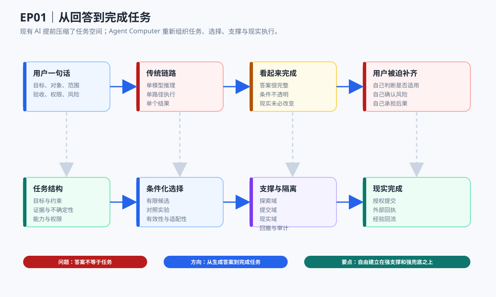

# Agent Computer 01｜AI 越来越会回答，为什么越来越难把事办成

> 本文是 **Agent Computer** 系列的第 1 篇（共 12 篇），整理自「顽皮的程序员」的 Agent Computer 系列直播。
> 这个系列讨论的是方法论和目标架构，依据是 Agent Computer 的方法论白皮书，不是已交付产品的功能清单；哪些是方法论原则、哪些是目标架构、哪些还只是待验证的假设，文中会分开说。

同一个 Agent，面对相似的问题，有时像专家，有时像刚入职的实习生。我们的第一反应通常是怀疑模型：是不是不够大，Prompt 是不是不够长，温度是不是没调对。于是 Prompt 从一页写到十页，比员工手册还长。

但把问题往前推一步会发现，很多任务在进入模型之前，就已经被说成了一句很模糊的话。这一篇不讨论哪个模型更强，只追问一件事：

> **现有 AI 系统赖以工作的计算范式，是否仍然适合真实世界的复杂任务？**

## 会回答和会完成任务，中间差了什么

你让 AI 分析一个业务问题，它很快给出一份报告：有背景、有数据、有结论、有建议。内容不算错，但你不敢直接拿去做决策，因为你不知道结论在什么条件下成立。它用的是哪个时间范围？“增长变慢”是和上个月比还是和去年同期比？预算减半以后，原来的建议还成立吗？

回答只是一个输出。要完成任务，还得知道目标对应哪些条件、有哪些可选方案、每个方案的证据和代价是什么、哪些是确定的哪些只是推断，以及最后由谁选择、谁授权、谁承担后果。

不少 AI 系统的链路接近这样：用户输入 → 单模型推理 → 单次工具调用 → 单个结果 → 用户接受或拒绝。这条链路本身没有错，问题是它很早就把该保留的东西压缩掉了：输入被压成一种任务理解，多个方案被压成一个答案，复杂的评价标准被压成一个分数。系统看起来很简洁，实际上把责任推给了用户，由用户自己判断结果是否适用、自己补上没被记录的条件。

下面按一个任务流经系统的顺序，看这条链路上的七个问题。后面的十一篇，各自展开其中一块。

## 一、需求还没有被理清，执行就已经开始

“帮我看看最近业务怎么样。”这句话很自然，但最近是多久？业务指整个公司还是某条产品线？“怎么样”是看趋势、找异常，还是要行动建议？指标是收入、订单量还是利润？一句话里，目标、对象、范围、口径、交付物都没有确定。

把这句话直接拼进 Prompt 交给模型，很像跳过类型检查和链接就直接运行：错误要到运行期才暴露，而且分不清出在哪一层。是意图理解错了，Skill 路由错了，槽位绑定错了，模型能力不够，工具执行失败，还是验收标准根本没有定义？

所以 Agent 的不稳定不只来自模型的随机性，也来自需求没有先变成结构。Agent 需要一个稳定的语义层，把自然语言整理成结构化任务，再映射到能力、工具和权限。这里说“编译”只是比喻：自然语言到任务结构的转换既不保持语义，也不确定，所以产物必须让用户看得到、能确认。

## 二、单答案：真实世界很少有脱离条件的最优解

同一个目标，在不同的时间、预算、设备、身份和风险偏好下，对应不同的合理方案。方案 A 最快但改动大，方案 B 稳但见效慢，方案 C 最便宜但后续维护重。你不能说 A 最优、B 和 C 不好，只能说在某一组条件下 A 更合适。

一种常见的做法是生成若干结果，挑分数最高的交给用户，其余的直接丢掉。没被选中的方案为什么没被选中、在什么条件下其实有价值，都没有保存下来。计算发生了，却没有留下可以再用的东西，下次遇到相似任务只能重新生成。

> **旧系统的终点是一个答案；下一代系统的终点应该是一次有依据的选择。**

这不是说每次都要给用户十个答案。简单任务可以快速闭环，复杂任务才需要保留选择空间。要避免的只是在没有说明条件的情况下，过早地把空间压成一个答案。

## 三、单一评分：权重来自场景

单答案背后通常还有单一评分。打了分就能排序，排了序选第一名就行。但快和可解释、便宜和低风险、自动化和可补救，这些差异不在同一条轴上。要把它们压成一个综合分，就得先定权重，而权重来自具体场景：创业公司嫌贵的方案，大企业可能觉得稳。

所以没被选中的方案不等于失败，它可能只是当前预算不够、当前设备不支持。更合理的记录方式是：这个候选在什么条件下生成，依据是什么，当时为什么没选，什么条件变了需要重新评估。候选也不是越多越好，它们必须有差异、有证据、有停止条件，否则只是在增加用户的负担。

## 四、Harness 管住了边界，没有解决探索

现在的 Agent 工程大量使用 Harness：规定能调用哪些工具、用什么格式、哪些步骤必须停下、哪些动作要人工批准。这些机制对安全很重要，但它们回答的是“不要越界”，没有回答“如何探索未知”。

自主探索需要两件事同时存在：一是足够宽的资源、权限申请、分支和试错空间；二是足够强的隔离、回撤、审计、现实提交控制和事故兜底。只给自由不给兜底，错误会被放大到现实里；只给约束不给支撑，Agent 只能在预设流程里做自动化。

> **自由不是没有边界，而是在强支撑和强兜底之上获得探索空间。**

## 五、沙箱里跑通，不等于现实里可以执行

本地的代码、文件和工作区可以靠快照、事务和版本机制回撤。现实动作不行：邮件已经发出，款项已经支付，价格已经发布，生产参数已经改了，机械设备已经动了。这些都不能靠“重新生成”来解决。所以进入现实之前，需要独立的验证、授权、提交和回执机制，而且“做完了”这件事要由外部的回执确认，Agent 自己说了不算。

## 六、参数变大，不等于端侧的有效智能变多

长期任务如果要跑在用户自己的设备上，资源就是硬约束。端侧设备同时受内存、功耗、时延、散热、带宽和成本的限制；模型更大，往往意味着更多的权重搬运、更大的 KV Cache、更长的冷启动和更复杂的装载调度。

所以落地时要看的不只是参数和跑分，还要看在有限硬件上能否持续运行、真实任务能否稳定完成、单位功耗和单位成本能交付多少结果。端侧要比的是在有限资源里持续完成有价值的任务，而不是能塞进多大的模型。

## 七、只保存结果，经验留不下来

任务结束后，系统留下的通常只有最终的文件或答案。可结果只是某个任务结构在特定条件下的一次投影。当时的目标和约束、用到的证据和环境、采用的能力和策略、对比过的候选、用户为什么这样选、现实动作最终产生了什么回执，如果都没有保存，下一次就无从复用，也无从追责。

经验留下来之后，还会多出两个归属问题：这些关于你的记忆归谁管、你能不能看见和删除（第 9 篇）；Agent 接上你的设备以后，谁授权它动手、出了事谁负责（第 10 篇）。

## 所以 Agent Computer 要改变什么

Agent Computer 不是“电脑加一个大模型”，也不是把云端模型缩小后搬到本地。它是否因此构成下一代个人计算，是全系列最后要回答的问题；在那之前，先看它要重新组织什么：

- 任务如何被理解；
- 多个候选如何被生成和比较；
- 能力如何被组织和调度；
- 探索如何被隔离和回撤；
- 权限如何被授予和收回；
- 现实动作如何经过提交门；
- 经验如何被结构化地保存；
- 用户如何拥有自己的数据、记忆、设备和智能。

这是一份目标清单，不是功能清单。还有一个问题贯穿所有条目：这样一套还没有被证明的设计，凭什么值得相信。第 11 篇专门回答它。

## 结论

这一篇把“模型还不够大、Prompt 还不够长”这个常见诊断，换成了一个结构性的判断：从需求进入系统，到候选被比较、探索被隔离、动作进入现实、经验被保存，每一步都有该保留的东西被过早压缩了。这个判断的前提是任务确实开放、长期、带现实后果；对一次性的封闭问答，现有链路已经够用。它留下的问题是，如果不压缩，系统到底该保存什么。

> **理解任务，保留选择，提供支撑，经过验证，安全提交，并从结果中持续沉淀经验。**

## 系列目录

1. **AI 越来越会回答，为什么越来越难把事办成**（本文）
2. [为什么结果不等于任务](https://0x00.community/zh-CN/blog/agent-computer-02-results-are-not-tasks/)
3. [为什么 AI 总给你一个“标准答案”](https://0x00.community/zh-CN/blog/agent-computer-03-one-standard-answer/)
4. [你存的文件可能都是“假货”](https://0x00.community/zh-CN/blog/agent-computer-04-files-are-projections/)
5. [Agent 的一天](https://0x00.community/zh-CN/blog/agent-computer-05-a-day-of-an-agent/)
6. [为什么 Agent 需要“多个世界”](https://0x00.community/zh-CN/blog/agent-computer-06-multiple-worlds/)
7. [AgentOS 不只是一个运行环境](https://0x00.community/zh-CN/blog/agent-computer-07-agentos-support/)
8. [端侧 AI 比的是智能密度](https://0x00.community/zh-CN/blog/agent-computer-08-intelligence-density/)
9. [AI 记住你，不等于你拥有自己的记忆](https://0x00.community/zh-CN/blog/agent-computer-09-memory-sovereignty/)
10. [Agent 走出电脑以后，谁对现实负责](https://0x00.community/zh-CN/blog/agent-computer-10-physical-responsibility/)
11. [一个还没被证明的系统，为什么反而更值得信任](https://0x00.community/zh-CN/blog/agent-computer-11-evidence-and-trust/)
12. [Agent Computer 是不是下一代个人计算](https://0x00.community/zh-CN/blog/agent-computer-12-next-personal-computing/)

下一篇：[为什么结果不等于任务](https://0x00.community/zh-CN/blog/agent-computer-02-results-are-not-tasks/)
