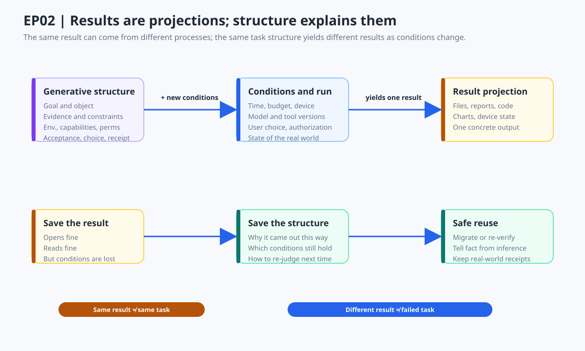

# Agent Computer 02: Why a result is not the task

> This is part 2 of 12 in the **Agent Computer** series, adapted from the Agent Computer live-stream series. Previous: [AI keeps getting better at answers. Why is getting things done getting harder?](https://0x00.community/blog/agent-computer-01-answers-vs-tasks/).
> This post describes a methodology and a target architecture: why mechanisms such as the Spec and the task generative structure cannot be left out. Whether they hold up still has to be shown through concrete implementation, real tasks and environments with real risk.

When a task is done, what remains is usually a file, an answer, a chart, a piece of code, or the current state of some device. These are easy to open and easy to forward. Dig one up three months later, though, and often only the conclusion is left. What problem it was meant to solve, which data it used, what the budget and permissions were, which options were compared and why this one won all have to be recalled from memory or pieced together from chat logs and meeting notes.

The previous post argued that many real tasks, once inside a system, are compressed too early into one answer, one path and one final result. This post asks the next question: if everything we keep is only the result of a task under one set of conditions, what is the task itself?

The central claim here is:

> **A result is one projection of a task generative structure under particular conditions, and a projection is not the thing itself.**

"Projection" sounds abstract, but it addresses a concrete engineering problem. A system cannot store only what came out. It also has to store enough structure to say why that could come out, under which conditions it holds, and how to judge it again later.

## The same result does not mean the same task

Take two business reports that look alike. Both conclude: "reduce spending on this channel."

The first used the last seven days of data from complete sources, and its conclusion was cross-checked by channel, region and product category. The second used data from three months ago, was missing the most recent campaign, and wrote an inference into the text as if it were a fact. The wording of the two can be very close and the conclusion identical, yet they are nowhere near equally reliable.

The reverse also holds. "Draw up a promotion plan for a product" produces different plans when the budget, inventory, regulatory requirements or target users differ. A different plan does not mean the task failed. It means the same task structure produced a new result under new conditions. So the same result does not mean the same task, and a different result does not mean the task failed.

We tend to treat the result as the task because the result is the easiest part to see. A file opens, code runs, a device state can be queried. The goal, constraints, evidence, environment, choices and authorizations that produced them are scattered across chat logs, meeting notes, people's memories and documents nobody versions. The system keeps what is easiest to show and drops what best explains it. Four things follow:

- when conditions change, nobody knows whether the old result still applies;
- when the result is wrong, nobody can tell whether the goal, the data, a tool, the model or the execution environment was at fault;
- when a similar task comes up, the earlier experience cannot be reused, and the system generates another answer that merely looks new;
- when the result is handed downstream, the recipient gets the conclusion without its scope, evidence or risk.

So the thing we save has to move one step upstream. Besides "what was generated", we need "which structure generated it, under which conditions".

## What a task generative structure is

A task generative structure is the structured information a task needs, at minimum, in order to be understood, executed, verified, committed and reused. It is neither a longer prompt nor the model's internal reasoning, and it does not require a permanent archive of every token and draft. It falls into seven groups.

1. **Task semantics**: the goal, the object, what the user wants to change, and what is still uncertain. "Take a look at how the business has been doing lately" first has to be resolved into a trend analysis, an anomaly diagnosis or a set of recommended actions, and into the whole business or one product line.
2. **Facts and evidence**: recording "sales dropped" is not enough. You also need the data source, the time range it covers, whether the data is complete and how confident the system is. Fact, inference and unknown stay separate.
3. **Constraints and selection rules**: hard constraints (stay within budget, never touch a certain class of data), soft preferences (speed or stability first), plus how the result is accepted, how candidates are chosen among, and when exploration stops.
4. **Execution dependencies**: the environment, inputs, tools, models and Skills required, their versions, and whether there is a substitute if a tool fails.
5. **Permissions, risk and real-world commit policy**: what may be read, what may be written, whether anything may be sent outside, whether user approval is needed, and what happens when an action fails. They belong to the task structure and are more than execution details.
6. **Differences in conditions along the way**: if several candidates were explored, which conditions changed between them, what was observed, which path failed and where the failure boundary lies. When a candidate is not adopted, the record has to say whether it was invalid in itself or merely unfit for current conditions, and the two are kept apart (the [next post](https://0x00.community/blog/agent-computer-03-one-standard-answer/) covers this).
7. **Choice, authorization and external receipts**: which option was chosen, by whom, who authorized it, and what the real world returned. This group decides whether the task was really completed.

Together the seven groups answer a single question: why could this result be produced under the conditions of that moment?

A software build offers a useful comparison. If the final file is the build artifact, the task generative structure is closer to the combination of source code, dependency manifest, build environment, test cases, release record and runtime receipts. Keep only the artifact and the file still opens, but you can hardly tell why it looks the way it does, and you cannot safely rebuild it once the environment changes. The software supply chain already has close relatives. Lockfiles pin the dependency inputs, reproducible builds guarantee bit-identical artifacts from the same inputs, and build provenance (SLSA and in-toto, for example) records which inputs, environment and steps produced an artifact. A task generative structure borrows the same idea. The difference is three kinds of content that provenance does not record: the candidates that were not chosen and why, the human choices and authorizations, and the receipts returned by the outside world.

## The Spec is the authoritative version of the task structure, not the truth about the world

The task generative structure needs a representation that can move through the system, be compared and be versioned. That is the Spec. After clarification and compilation, natural language becomes a versioned Spec that declares what the system currently accepts:

- the goal and object;
- references to inputs and context;
- factual claims and an index of evidence;
- hard constraints and soft preferences;
- acceptance, selection and stopping rules;
- budget, permissions and risk;
- the output form and the real-world commit policy;
- the uncertainties that remain open.

One boundary has to hold here. The Spec is the authoritative version of the task's state and constraints, but it is not the objective world. It records the system's current understanding of the task and what it has agreed to act on. Facts about the outside world must be supported by independent evidence (Evidence).

Suppose the Spec says "sales in the East China region fell over the last thirty days." That can be a factual claim the task currently accepts, but being written into the Spec does not make it true. It still has to cite a data source, a time range and a method of calculation. If the metric definition later turns out to have changed, or new evidence appears, the system should produce a new Spec version and a Spec Diff that says what changed. Silently overwriting the old number would leave everyone believing history had always read that way.

> **The Spec is the authoritative record of how we currently understand the task. It is not universal truth.**

This resembles version control in software, but what gets tracked is change in the task structure: whether the goal, the constraints, the factual basis, the acceptance criteria, the permissions or the real-world commit policy moved. Keep only the "latest version" and there is no way to explain why the system chose differently this time.

The Spec does not work alone either. Evidence supports the facts, an environment manifest describes where execution happens, and agreements on capabilities and policy state which capabilities are available and where the permission boundaries are. Together with the Spec these form the Spec Package: the list of inputs fixed before execution, which can be audited and executed against. The candidates, choices, projections, external actions and receipts produced by a run go into the Run Package, the record kept after execution, which points back to the Spec Package version it ran against. That keeps the structure fixed before the run from blurring into the record of the run itself.

## The result is only a projection: what to save

Results must of course be saved. They should not be the only thing saved, and arguably not the main thing. Alongside them the system needs the structure that makes a task explainable, auditable, portable and re-executable: the Spec Package and Run Package, user authorizations and real-world receipts, and experience recorded together with its conditions and failure boundaries.

This is not the same as keeping every chat log, token-level trace and intermediate draft. Doing so raises privacy, cost and governance problems, and storing more does not mean understanding more.

> **Save the minimal structure that is enough to explain the task, not everything.**

With that structure in place, the system can still answer a handful of questions after conditions change: what the task was, what it rested on, what the constraints and environment were, why this option was chosen, which conditions have since changed, and whether the result can be used as is or needs re-verification. How these contents are layered in storage, and how far a promise of "reproducible" can actually go, is the subject of [part 4](https://0x00.community/blog/agent-computer-04-files-are-projections/).

## How Agent Computer looks at tasks

The core objects of a traditional computer are files, programs, processes and devices. They still matter, but Agent Computer needs to raise the task to a more central computing object. A task is no longer a single command or a stretch of chat history. It should hold the goal, constraints, evidence, capabilities, permissions, acceptance criteria, candidates and choices, the real-world commit, and the feedback and experience that follow.

In other words, what gets saved is not only "what it generated for me in the end", but also "why it did so, under which conditions that holds, and how to judge again once conditions change". Only when the task becomes a system object that can be versioned, executed, verified, chosen, committed and accumulated can Agent Computer move from helping you generate content to helping you finish work.

Writing permissions, risk and commit policy into the task structure has one more use. The more clearly a system knows where a task's boundaries are, the more freely it can let an agent try different approaches inside them. [Part 7](https://0x00.community/blog/agent-computer-07-agentos-support/) develops this when it turns to AgentOS.

## Conclusion

This post changes one judgment: files, answers and device states are results of a task, and the task itself is the generative structure behind them, which determines how a result is produced, explained, verified and committed. The Spec is the authoritative version of that structure without being the truth about the objective world, so new evidence leads to a new version through a Spec Diff and never to a silent rewrite of the old record. The judgment rests on one premise: the system is willing to pay for saving structure, and saves only the part that is enough to explain the task.

> **If traditional computing saves files, Agent Computer needs even more to save the task that generated the file.**

The question it leaves open: when a task has more than one reasonable answer, how does the system keep candidates, organize conditions and let a real choice happen?

Next: [Why AI always gives you one "standard answer"](https://0x00.community/blog/agent-computer-03-one-standard-answer/)
