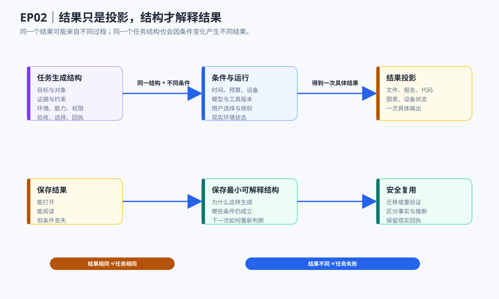

# Agent Computer 02｜为什么结果不等于任务

> 本文是 **Agent Computer** 系列的第 2 篇（共 12 篇），整理自「顽皮的程序员」的 Agent Computer 系列直播。上一篇：[AI 越来越会回答，为什么越来越难把事办成](https://0x00.community/zh-CN/blog/agent-computer-01-answers-vs-tasks/)。
> 本篇讲的是方法论和目标架构：Spec、任务生成结构这些机制为什么不可缺少。它们能否成立，还要经过具体实现、真实任务和真实风险环境的检验。

一项任务做完以后，留下来的通常是一个文件、一份答案、一张图表、一段代码，或者某台设备的当前状态。这些东西很容易打开，也很容易转发。可是三个月后再翻出来，往往只剩一句结论：当时想解决什么问题、用了哪些数据、预算和权限是什么、比较过哪些方案、为什么选了这一个，都要靠人去回忆，或者去翻聊天记录和会议纪要。

上一篇说到，很多真实任务在进入系统之后，被过早压缩成了一个答案、一条路径和一个最终结果。这一篇接着问：如果这些留下来的东西都只是任务在某一组条件下产生的结果，那任务本身是什么？

本篇的核心判断是：

> **结果是任务生成结构在特定条件下的一次投影，投影不是本体。**

“投影”听起来抽象，要解决的却是一个很具体的工程问题：系统不能只保存最后得到了什么，还要保存足以说明它为什么能得到、在什么条件下成立、以后怎样重新判断的那部分结构。

## 同一个结果，不一定代表同一个任务

假设有两份看起来一样的业务报告，结论都是“建议减少某个渠道的投入”。

第一份用的是最近七天的数据，来源完整，结论经过渠道、地区和品类几个维度的交叉验证。第二份用的是三个月前的数据，缺了最近一次活动，还把一个推断当成事实写了进去。两份报告的文字可以非常接近，结论甚至完全相同，可靠性却差得很远。

反过来也成立。同样是“为一个产品制定推广方案”，预算、库存、监管要求或目标用户不同，方案自然不同。方案不同并不说明任务失败了，只说明同一个任务结构在新的条件下产生了新的结果。所以结果相同不等于任务相同，结果不同也不一定代表任务失败。

我们习惯把结果当成任务本身，是因为结果最容易看见。文件可以打开，代码可以运行，设备状态可以查询；产生这些结果的目标、约束、证据、环境、选择和授权，却散落在聊天记录、会议纪要、人的记忆和没有版本管理的文档里。系统保存了最容易展示的东西，没有保存最能解释结果的东西。后果有四个：

- 条件一变，不知道原来的结果还能不能用；
- 结果出错，分不清是目标错了、数据错了、工具错了、模型错了，还是执行环境变了；
- 下次遇到类似任务，无法复用上一次的经验，只能重新生成一个看起来新的答案；
- 结果交给下游时，下游只拿到结论，拿不到结论的适用范围、证据和风险。

所以保存对象要往前推一步：除了“生成了什么”，还要保存“什么结构在什么条件下生成了它”。

## 什么是任务生成结构

任务生成结构（Task Generative Structure）指的是一项任务要能被理解、执行、验证、提交和复用，至少需要哪些结构化信息。它既不是一份更长的 Prompt，也不是模型内部的思维过程，更不要求把每一个 Token、每一段草稿都永久留下来。可以分成七组来看。

1. **任务语义**：目标是什么，对象是什么，用户想改变什么，还有哪些不确定项。“帮我看看最近业务怎么样”要先分清是趋势分析、异常诊断还是行动建议，对象是整体业务还是某条产品线。
2. **事实和证据**：不能只记一句“销售下降了”，还要知道它来自哪个数据源、覆盖什么时间范围、数据是否完整、置信度如何。事实、推断和未知要分开。
3. **约束和选择规则**：硬约束（不能突破预算、不能访问某类数据），软偏好（更看重速度还是稳定），以及怎么验收、候选之间怎么选、什么时候停止探索。
4. **执行依赖**：需要什么环境、输入、工具、模型和 Skill，版本是什么，某个工具失败后有没有替代。
5. **权限、风险和现实提交策略**：能读什么、能写什么、能不能对外发送、是否需要用户批准、动作失败后怎么处理。这些是任务结构的一部分，不是执行细节。
6. **过程中的条件差异**：如果探索过多个候选，它们之间改了什么条件、观察到了什么、哪条路径失败、失败边界在哪里。一个候选没被采用，要分清是它本身无效，还是只是当前条件不适配，两种情况分开记录（[下一篇](https://0x00.community/zh-CN/blog/agent-computer-03-one-standard-answer/)展开）。
7. **选择、授权和外部回执**：最后选了哪个方案，谁选的，谁授权的，现实世界返回了什么。任务是否真的完成，由这一组决定。

七组信息合起来回答一个问题：这个结果为什么能够在当时的条件下产生。

可以拿软件构建做个类比。如果把最终文件看成编译产物，任务生成结构更接近源代码、依赖清单、构建环境、测试用例、发布记录和运行回执的组合。只留编译产物，文件照样能打开，但你很难知道它为什么是这样，也很难在环境变化后安全地重新构建。软件供应链里已经有相近的做法：锁文件固定依赖输入，可重现构建保证相同输入得到逐位相同的产物，构建来源证明（provenance，例如 SLSA 和 in-toto）记录产物由什么输入、在什么环境、经哪些步骤生成。任务生成结构借的是同一个思路，区别在于它还要记下三类来源证明不管的内容：没被选中的候选及其原因，人的选择和授权，以及外部世界返回的回执。

## Spec 是任务结构的权威版本，但不是世界真相

任务生成结构需要一个能在系统里流转、比较和做版本管理的表示，这就是 Spec。自然语言经过澄清和编译之后，形成版本化的 Spec，它声明系统当前接受的内容：

- 目标和对象；
- 输入和上下文引用；
- 事实主张和证据索引；
- 硬约束和软偏好；
- 验收、选择和停止规则；
- 预算、权限和风险；
- 输出方式和现实提交策略；
- 当前仍然存在的不确定项。

这里有一条必须守住的边界：Spec 是任务状态与约束的权威版本，但它不是客观世界本身。它记录的是系统当前对任务的理解和接受范围，外部世界的事实要由独立的证据（Evidence）支持。

比如 Spec 里写着“华东区域最近三十天销售额下降”。这可以是当前任务接受的一项事实主张，但它不会因为写进了 Spec 就变成真理，仍然要引用数据来源、时间范围和计算方式。如果后来发现口径变了，或者出现了新证据，系统应该生成新的 Spec 版本，并用 Spec Diff 说明变了什么。直接把旧数字静默改掉，等于让所有人以为历史一直如此。

> **Spec 是我们当前如何理解任务的权威记录，不是宇宙真理。**

这和软件的版本管理相似，但要记录的是任务结构的变化：目标、约束、事实依据、验收标准、权限和现实提交策略，各自有没有变。只留一个“最新版本”，就没法解释系统这次为什么做了和上次不同的选择。

Spec 也不单独工作。证据支撑事实，环境清单说明执行环境，能力和策略的约定说明可用能力和权限边界。这些内容和 Spec 合在一起叫 Spec Package，是执行前的输入清单，可以审计，也可以据此执行。任务运行之后产生的候选、选择、投影、外部动作和回执，则进入 Run Package，也就是执行后的记录包，并反向引用执行时用的 Spec Package 版本。这样，任务的事前结构和事后运行不会混成一团。

## 结果只是投影：应该保存什么

结果当然要保存，只是它不该是唯一的保存对象，甚至不该是最主要的那一个。除了结果，系统还需要留下足以解释、审计、迁移和重新执行任务的结构：Spec Package 和 Run Package、用户授权和现实回执，以及带条件的经验和失败边界。

这不等于把所有聊天记录、逐 Token 轨迹和中间草稿全部存下来。那样做会带来隐私、成本和治理问题，而且存得多并不等于理解得多。

> **保存足以解释任务的最小结构，而不是保存一切。**

有了这部分结构，条件变化以后系统仍然答得出几个问题：当时的任务是什么，依据是什么，约束和环境是什么，为什么选了这个方案，现在哪些条件变了，这个结果能直接用还是需要重新验证。至于这些内容具体怎么分层保存，以及“可复现”到底能承诺到哪一层，是[第 4 篇](https://0x00.community/zh-CN/blog/agent-computer-04-files-are-projections/)的主题。

## Agent Computer 的任务观

传统电脑的核心对象是文件、程序、进程和设备。这些仍然重要，但 Agent Computer 需要把任务提升为更核心的计算对象。一个任务不再只是一句命令或一段聊天记录，它应该包含目标、约束、证据、能力、权限、验收、候选和选择、现实提交，以及反馈和经验。

也就是说，要保存的不只是“它最后帮我生成了什么”，还有“它为什么这样做、在什么条件下成立、条件变了以后如何重新判断”。任务成了可以被版本化、执行、验证、选择、提交和沉淀的系统对象，Agent Computer 才有可能从帮你生成内容走到帮你完成工作。

把权限、风险和提交策略写进任务结构，还有一个用处：系统越清楚一项任务的边界在哪里，就越能放手让 Agent 在边界之内多试几种做法。这一点[第 7 篇](https://0x00.community/zh-CN/blog/agent-computer-07-agentos-support/)讲 AgentOS 时展开。

## 结论

这一篇改变的判断是：文件、答案和设备状态是任务的结果，不是任务本身；决定结果如何产生、解释、验证和提交的，是它背后的任务生成结构。Spec 是这个结构的权威版本，但不是客观世界的真相，新证据要通过 Spec Diff 形成新版本，而不是静默改写旧记录。这个判断有一个前提：系统愿意为保存结构付出成本，并且只保存足以解释任务的那一部分。

> **如果传统计算保存的是文件，Agent Computer 更需要保存的是生成文件的任务。**

它留下的问题是：当一个任务不只有一个合理答案时，系统如何保留候选、组织条件，并让选择真正发生？

下一篇：[为什么 AI 总给你一个“标准答案”](https://0x00.community/zh-CN/blog/agent-computer-03-one-standard-answer/)
