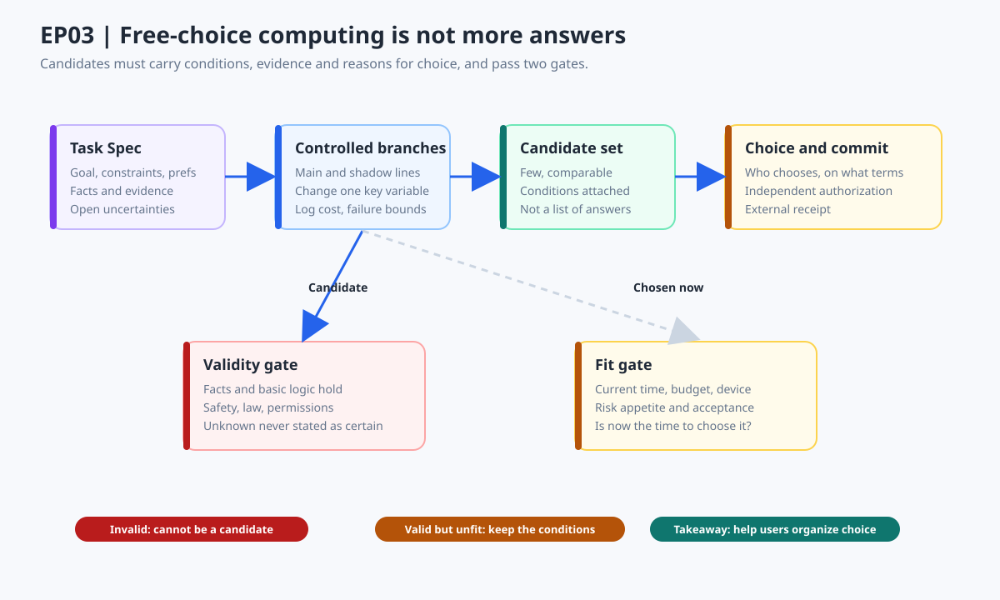

# Agent Computer 03: Why AI always gives you one "standard answer"

> This is part 3 of 12 in the **Agent Computer** series, adapted from the Agent Computer live-stream series. Previous: [Why a result is not the task](https://0x00.community/blog/agent-computer-02-results-are-not-tasks/).
> This post describes a methodology and a target architecture, not shipped functionality.

Most people who use AI know the feeling. The answer is complete and confidently worded, yet something about it is not quite right. Ask again and it rephrases. Change a condition and it produces a different answer. Each time it sounds as if this were the most reasonable plan there is.

We usually put this down to a model that is not smart enough, a context window that is too short or a prompt that was badly written. Those explanations are not wrong, but they miss a deeper layer. Many AI systems compress a task that has several reasonable paths into one answer before the task has been unfolded at all. The choice space is never kept open; the system converges on your behalf.

A "standard answer" here is not necessarily a textbook answer, and it is not necessarily wrong. It means the system has taken a question that depends on time, budget, risk, hardware, preference and evidence and written it up as a single conclusion with the conditions removed. The previous post covered what a task should preserve. This one takes a single layer of that: how the choice space is generated and organized. The central claim is:

> **Free-choice computing keeps conditioned candidates within the bounds of validity so that a real choice can happen. That is different from letting AI produce more answers at will.**

## The single-answer paradigm: the faster the answer, the flatter the problem

Suppose you ask an AI to plan a family trip: next month, with the family, moderate budget, nothing too strenuous, not too tiring for the grandparents, and something for the kids to do. It quickly returns a full itinerary with a city, a neighborhood to stay in, places for each day and how to get around. It looks as though it understands you.

None of the conditions that actually drive the choice have been opened up. Is a "moderate budget" three thousand per person or three thousand for the whole family? Does "nothing too strenuous" mean less walking each day or fewer hotel changes? Does "not too tiring" for the grandparents rule out hiking, or early starts? Without those clarifications, the so-called best itinerary is one path under one set of hidden assumptions. The AI filled in the uncertain parts for you and then stated the filled-in result with confidence.

The single-answer pipeline suits closed tasks such as translating a paragraph. With open-ended tasks it keeps only the winner and none of the conditional differences between candidates, so when the result is poor the only move is to regenerate. Why the first attempt fell short, whether the request was misread, the budget assumption was wrong or the user really cared more about being able to undo, is not recorded anywhere, and the next generation is another draw from the hat.

A single answer is therefore not a neutral display format.

> **It can disguise conditions that are still unresolved as a conclusion that has been reached.**

## The best result is sometimes a few candidates

This does not mean listing ten options for everything from now on. Free-choice computing does not hold that more candidates is better, and it does not push the burden of deciding back onto the user. What it corrects is one judgment: for an open-ended task, the best result is sometimes a few candidates that each hold under different conditions.

Take data backup. Candidate one is cheap and quick to deploy but average on recovery speed. Candidate two costs more and recovers from failure more reliably. Candidate three is fully local, so no data leaves the device, but it demands more maintenance. Ask "which is best" and you get a condition-free reply. Ask "what can you least accept" and things become clear: if data must not leave the premises, candidate two may be out at once; if downtime is the worst fear, candidate one does not fit; if the team cannot maintain it, candidate three will not land no matter how sound the idea.

Inside a system, this means the planning stage cannot emit just one plan. It also has to declare which variables are settled, which still have several reasonable values and which conditions deserve a controlled comparison. This is where multiple worldlines come in, meaning the same task runs along several paths, each in its own isolated working copy ([part 6](https://0x00.community/blog/agent-computer-06-multiple-worlds/) covers them). Under the same Task Spec, change only variables that have been explicitly declared, generate a limited number of control worldlines, and compare their evidence, cost, risk and fit. Branching is controlled and limited in number.

Candidates have two boundaries. First, a candidate is not a freely generated opinion. It must hang off the same Task Spec and obey the same hard constraints and acceptance rules. Second, more candidates does not mean more intelligence. Every branch brings compute cost, context cost, attack surface and merge cost. Whether a branch is worth keeping comes down to three questions:

1. why branch at all;
2. which single key variable does it change;
3. what new evidence or choice value does it produce.

If these cannot be answered, there should be no branch.

## From one result to conditioned candidates: how the system keeps the choice space

When a task enters the system, the first step is to form the task structure, before any answer is generated: goal, evidence, constraints, acceptance criteria, capabilities, permissions and the uncertainties still open (the subject of the [previous post](https://0x00.community/blog/agent-computer-02-results-are-not-tasks/)). That structure then determines whether several worldlines need exploring.

Simple tasks can run on a single path, such as renaming a batch of files. Free-choice computing does not force complexity onto simple tasks. It only requires that even on a single path the system knows why no branch is needed, how the result is accepted and whether the commit can be undone.

When differences in conditions are large enough to change the plan, the system sets up a main line and a limited number of shadow lines (control worldlines beside the main one). Each runs in its own isolated workspace and may use different models, tools or strategies, but those capabilities must be declared first and cannot step outside the task's policy. Besides the final artifact, execution records the key observations: whether inputs were complete, whether evidence conflicted, which step failed, how the cost moved and where the result differs from the baseline.

All results then go to verification. At this point the system has four questions to answer:

- which results are eligible to be discussed as real options;
- which results suit the current time, budget, device and preferences;
- for those not chosen, whether they are invalid or merely unfit for now;
- once one is chosen, who authorizes it, how it is committed and whether anything actually changed outside.

Here is an example. Two code fixes both pass the unit tests. Fix A changes the least but only works with the current dependency versions. Fix B changes more, also deals with a long-standing hazard, and costs more in regression testing. If the task is to restore a production service urgently, A fits better. If the task is long-term maintenance for the next release, B does. There is no permanent champion independent of the situation, only the candidate that is more suitable to choose under the current Spec and conditions. That is what separates a set of conditioned candidates from a list of answers: each candidate carries the conditions under which it holds, its evidence and the reasons it was or was not chosen.

## Two gates: the validity gate and the fit gate cannot be merged into one score

A candidate goes unchosen for one of two reasons, and they are different in nature.

The first is that it cannot be a real candidate at all. That is what the **validity gate** checks. It answers "can this option be taken seriously":

- does it contradict established facts or basic logical consistency;
- does it violate a hard constraint of the Task Spec, or fall short of being minimally executable;
- does it break safety, the law, or permissions that cannot be granted;
- does it state an unknown as certain;
- does it fabricate evidence or conceal a key failure.

A result that fails the validity gate does not become a real candidate just because it "might be useful".

The second is that nothing is fundamentally wrong with the option, but current conditions do not allow it. The **fit gate** answers "under this task and these conditions, is it worth choosing now":

- does it suit the current time, budget, device and resources;
- is the evidence strong enough for the current level of risk;
- does it match the user's preferences this time;
- are the conditions needed for this run actually in place.

An option that needs three days of validation when the task is due tonight, or more compute than the current device has memory for, is unfit for now. That is a long way from permanently invalid. Whether authorization is ready and whether the real-world side effects are acceptable is not judged during candidate evaluation; those checks wait for the commit gate.

> **Validity decides whether it can be a candidate. Fit decides whether it is the right one to choose now.**

Merge the two gates into one total score and the system will file "cannot be used under current conditions" as "wrong option". Take the option above that was passed over because the device was short of memory. After a hardware upgrade the system has no idea it was ever a valid candidate, and in a review the team sees only "option failed", so the improvement effort heads in the wrong direction.

A gate report should therefore record at least: whether the validity check and the fit check each passed or failed, what the blocking reason was, which condition was missing, which evidence supports that judgment, and whether a re-evaluation is worthwhile once conditions change.

The validity gate is also more than "looks reasonable". The methodology specifies an order of verification: structural checks, deterministic verification, policy compliance checks (whether the safety floor or a hard constraint of the Spec is touched, not whether authorization is ready), evidence checks, and where needed a semantic review by an independent source or by a human. Hard constraints go to deterministic verifiers first, such as compilation, tests and static checks, and a model cannot explain away a deterministic failure.

Tasks such as trip planning or a business report have no deterministic verifier. What the validity gate can check mechanically is then limited to structural conditions: whether every factual claim has an evidence reference attached, whether the reference resolves and has not expired, and whether the conclusion rests on a slot marked unknown. Review at the semantic level remains probabilistic and should be labeled honestly as "model-reviewed", not as "passed". A model's score can serve as one signal, but it does not replace facts, permissions, evidence and real-world conditions.

## Uncertainty must be a first-class state

Uncertainty is often handled as a matter of tone: soften the wording, add "possibly", "roughly" or "we suggest", and risk management appears to be done. Managing uncertainty as an engineering matter depends on something else, namely whether the system explicitly knows:

- which slot is unknown;
- where a fact came from and whether the source can be verified;
- its confidence and how long it stays valid;
- which choice this unknown affects;
- whether the next step is to gather evidence, ask a clarifying question, set up a control line or lower permissions.

Consider hiring. A résumé says "responsible for system architecture" without saying whether the candidate led the design or contributed to one module, and without the scale of the system or the outcome. If the AI concludes "strong architecture skills", it has turned a blank into a conclusion. A more careful record notes that this is the candidate's own statement, that the scope of "responsible" is unclear, which evidence would settle it and which decisions it affects. If the unknown is enough to change the hiring decision, the system should not return a decimal probability. It should raise the item to a state that requires clarification or a comparative check.

Only when uncertainty is structured does the system know what to do next. This is also why a single score falls short: "insufficient evidence", "budget does not fit", "violates a safety floor" and "user preference unknown" are not the same failure and should not be handled the same way. Uncertainty is therefore a task state that can trigger the next action, and more than a disclaimer beside the answer.

## More candidates are possible because exploration is kept apart from reality

Keeping candidates has a precondition: trial and error must not land directly in the real world. If an agent can write its exploratory results straight into production, send email, make payments or change a device's state, all that has grown is the set of real-world side effects. The methodology therefore divides the running space into three domains. The exploration domain is for trial and error and for generating candidates. The commit domain handles diffs, regression, acceptance and the user's choice. Only the reality domain writes to the user's real directories and touches external APIs, publishing, payments and device actions. A chosen candidate has to pass the commit gate and is executed by the commit broker (External Effect Broker), the only component allowed to perform external actions and record receipts. Whether an action took effect is established by the receipt the external system returns (the Effect Receipt) and by trusted observation; the agent saying "done" does not count. How each domain works, and how rollback differs from compensation, is covered in [part 6](https://0x00.community/blog/agent-computer-06-multiple-worlds/). What the system needs in order to provide this support is the subject of [part 7](https://0x00.community/blog/agent-computer-07-agentos-support/).

## What this changes for products and organizations

Quite a few AI products still present a chat box, and however many tools run behind it, the user sees a block of answer text. If the system keeps the choice space, the product can instead show a small number of verified candidates and state for each one its applicable conditions, cost, risk level, strength of evidence, required permissions and known limits. The user's confirmation changes too, from "generate again" to "choose this option under this set of conditions". An option that was not chosen should say that it passed the validity gate but does not fit the current budget, or which piece of evidence it lacks.

From this an organization can accumulate conditioned experience: which option works under which conditions, which failures were capability problems and which were only a mismatch with the environment.

## How to tell whether an AI system has free-choice capability

Five questions can be used to check an AI product:

1. Does it acknowledge that the task has conditions, and explain how time, budget, device, risk, permissions and preferences affect the conclusion?
2. When a key variable would change the plan, does it keep a limited, comparable set of candidate differences?
3. Does it record "invalid in itself" separately from "unfit for now"?
4. Is uncertainty pinned to specific slots, and can it trigger evidence gathering, clarification or a reduction in permissions?
5. Are exploration and real-world commit separated? Do sending, paying, publishing and device actions have independent authorization and receipts?

If none of the five has a clear answer, the system may simply have made the single answer look better. What the system stores when a task ends, and which kind of reproduction "reproducible" refers to, are a separate set of questions for the next post.

## Conclusion

This post changes one judgment: an open-ended task should not end at a single answer stated with confidence. When a task really does have several reasonable paths, candidates must come from the same task structure and carry their conditions and evidence, "invalid in itself" and "unfit for now" must be recorded at two separate gates, and uncertainty must become a state that can trigger action. It assumes that candidates are few and every branch has a reason, so simple tasks still run on a single path. It also assumes exploration can be kept apart from reality; otherwise more candidates only means more risk.

> **The next step for AI is to go from "converging for you" to "helping you organize the choice".**

The question it leaves is a more everyday one: once choices are preserved, is the file saved at the end of the task enough to recover all of this?

Next: [The files you saved may all be "fakes"](https://0x00.community/blog/agent-computer-04-files-are-projections/)
