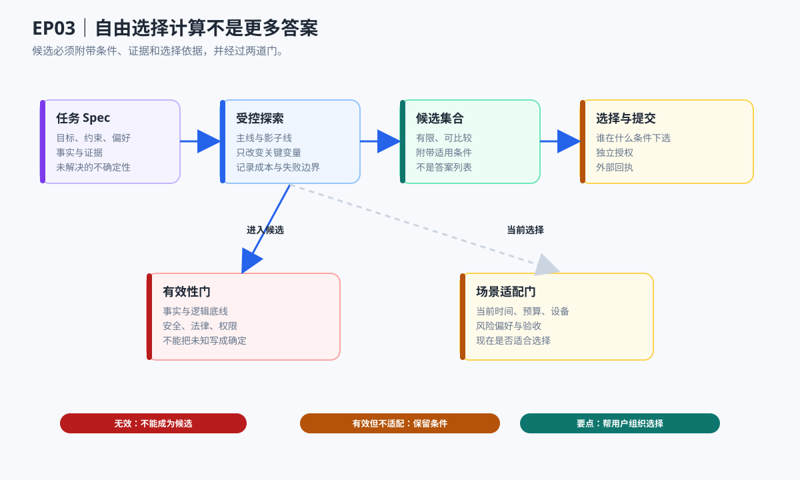

# Agent Computer 03｜为什么 AI 总给你一个“标准答案”

> 本文是 **Agent Computer** 系列的第 3 篇（共 12 篇），整理自「顽皮的程序员」的 Agent Computer 系列直播。上一篇：[为什么结果不等于任务](https://0x00.community/zh-CN/blog/agent-computer-02-results-are-not-tasks/)。
> 本篇描述的是方法论和目标架构，不是已经交付的功能。

用 AI 的人大概都有过这种感觉：它答得很完整，语气也很确定，但你总觉得不完全对。再问一次，它换一种说法；把条件改一下，它又给出另一个答案。每一次它都像在说，这就是最合理的方案。

我们通常把这归结为模型不够聪明、上下文不够长或者 Prompt 没写好。这些解释不算错，但没有碰到更深的一层：很多 AI 系统在任务还没有展开之前，就把一个本来有多条合理路径的任务压成了一个答案。选择空间没有被留下来，系统直接替你收敛了。

这里说的“标准答案”不一定是教科书答案，也不一定是错的。它指的是系统把一个依赖时间、预算、风险、设备、偏好和证据的问题，写成了脱离条件的单一结论。上一篇讲了任务里应该保存什么，这一篇只讲其中的一层：选择空间怎样生成、怎样组织。核心判断是：

> **自由选择计算要做的，是让任务在有效边界内保留条件化候选，让选择真正发生；它不等于让 AI 随便生成更多答案。**

## 单答案范式：答案越快，问题可能被压得越扁

假设你让 AI 安排一次家庭旅行：下个月带家人出去，预算适中，轻松一点，老人不要太累，孩子也有东西玩。它很快给出一份完整行程，去哪座城市、住哪一片、每天去哪里、怎么移动，看上去很懂你。

可是影响选择的条件都没有展开。“预算适中”是每人三千还是一家三口三千？“轻松一点”是每天少走路，还是不频繁换酒店？老人不能太累，是不能爬山，还是不能早起？这些没有澄清，所谓的最佳行程就只是某一组隐含假设下的一条路径。它只是先替你把不确定的地方填上，再把填完的结果说得很确定。

单答案链路适合封闭任务，比如翻译一段文字。面对开放任务，它只留下胜者，不留下候选之间的条件差异，所以结果不好时只能重新生成：第一次为什么不好，是需求理解错了、预算假设错了，还是用户其实更看重可撤销，都没有记录，下一次生成等于重新抽签。

所以单答案并不是一种中性的展示格式。

> **它可能把尚未解决的条件，伪装成已经解决的结论。**

## 最好的结果，有时是几个候选

这不等于以后每件事都要列十个方案。自由选择计算不追求候选越多越好，也不把决策负担推回给用户，它要纠正的是一个判断：对于开放任务，最好的结果有时是保留几个在不同条件下成立的候选。

以数据备份为例。候选一成本低、部署快，但恢复速度一般；候选二贵一些，故障恢复更稳；候选三完全本地化，数据不出设备，但维护要求更高。只问“哪个最好”，得到的是脱离条件的回答。先问“你最不能接受什么”，事情就清楚了：不能接受数据离开本地，候选二可能直接出局；最怕业务中断，候选一就不合适；团队没有维护能力，候选三理念再好也落不了地。

落到系统里，这意味着规划阶段不能只产出一条 Plan，还要声明哪些变量已经确定、哪些变量仍有多个合理取值、哪些条件值得建立对照。这里用到多世界线的做法，也就是让同一个任务在几份互相隔离的工作副本里各走一条路（[第 6 篇](https://0x00.community/zh-CN/blog/agent-computer-06-multiple-worlds/)展开）：在同一个 Task Spec 下，只改变明确声明的变量，生成有限的对照世界线，再比较它们的证据、成本、风险和适配程度。分叉是受控的，数量有限。

候选有两条边界。其一，它不是随便生成的观点，必须挂在同一个 Task Spec 上，受同一组硬约束和验收规则约束。其二，候选不是越多越聪明，每条分支都带来计算成本、上下文成本、攻击面和合并成本。一条分支值不值得保留，看三个问题：

1. 为什么要分叉；
2. 只改变了哪个关键变量；
3. 产生了什么新的证据或选择价值。

答不上来就不该分叉。

## 从单结果到条件化候选：系统怎样保留选择空间

任务进入系统后，第一步是先形成任务结构，暂不生成答案：目标、证据、约束、验收、能力、权限和尚未解决的不确定项（这部分是[上一篇](https://0x00.community/zh-CN/blog/agent-computer-02-results-are-not-tasks/)的内容）。然后由这个结构决定要不要探索多条世界线。

简单任务可以单路径执行，比如把一批文件统一改名。自由选择计算不会把简单任务强行变复杂，它只要求即使退化成单路径，系统也知道为什么不需要分支、怎么验收、提交能不能撤回。

当条件差异足以改变方案时，系统建立一条主线和有限的几条影子线（主线之外的对照世界线）。每条线在自己的隔离工作区里执行，可以用不同的模型、工具或策略，但这些能力要先声明，不能越过任务的策略约定。执行中除了最终产物，还要记录关键观测：输入是否完整，证据是否冲突，哪一步失败，成本怎样变化，与基准的差异在哪里。

接下来所有结果进入验证。系统这时要回答四个问题：

- 哪些结果有资格进入现实讨论；
- 哪些结果适合当前的时间、预算、设备和偏好；
- 没被选中的，是无效还是只是当前不适配；
- 选中之后谁授权、如何提交、外部是否真的产生了变化。

看一个例子。两个代码修复方案都通过了单元测试：方案甲改动最少，但只适用于当前版本的依赖；方案乙改动更大，顺带处理了一个长期隐患，回归成本也更高。任务是紧急恢复线上服务，甲更合适；任务是下一个版本的长期维护，乙更合适。这里没有脱离场景的永久冠军，只有在当前 Spec 和条件下哪个候选更适合被选择。条件化候选集因此和答案列表不同：每个候选都附带它成立的条件、证据和被选或不被选的依据。

## 两道门：有效性门和场景适配门不能混成一个分数

一个候选没有被选择，原因有两种，性质完全不同。

第一种是它本身不能成为现实候选。**有效性门**检查的就是这个，它回答“这个方案能不能被认真讨论”：

- 是否违反已确立的事实，或者逻辑上自相矛盾；
- 是否违反 Task Spec 的硬约束，或者达不到最低可执行性；
- 是否突破安全、法律或不可授权的权限；
- 是否把未知写成确定；
- 是否伪造证据或隐瞒关键失败。

没有通过有效性门的结果，不能因为“可能有用”就进入现实候选。

第二种是方案没有根本错误，但当前条件不允许采用。**场景适配门**回答“在当前任务和当前条件下，它现在值不值得选”：

- 是否适配当前的时间、预算、设备和资源；
- 证据是否足以支撑当前的风险等级；
- 是否符合用户这一次的偏好；
- 本次执行需要的条件是否具备。

比如一个方案需要三天验证，而任务今晚必须交付；或者它需要的计算资源超过了当前设备的内存。这些都属于目前不适配，谈不上永久无效。至于授权是否就绪、现实副作用能否承受，不在候选评估里判断，留到提交门检查。

> **有效性决定它能不能成为候选，适配性决定它现在是不是适合被选择。**

把两道门合成一个总分，系统就会把“当前条件下用不了”记成“方案错误”。拿上面那个因设备内存不够而没被采用的方案来说：设备升级以后，系统不知道它曾经是有效候选；团队复盘时只看到“方案失败”，改进方向也跟着错了。

所以门控报告至少要记录：有效性检查和适配性检查各自通过还是失败，阻断原因是什么，缺少什么条件，哪些证据支持这个判断，条件改变后是否值得重新评估。

有效性门也不是一句“看起来合理”。这套方法给出的验证顺序是：结构校验、确定性验证、策略合规校验（是否触碰安全底线和 Spec 硬约束，不含授权是否就绪）、证据校验，必要时再做异源语义复核或人工复核。硬约束优先交给确定性验证器，比如编译、测试和静态检查，模型不能用解释推翻确定性的失败。

旅行规划、业务报告这类任务没有确定性验证器。这时有效性门能机械检查的只有结构性条件：每条事实主张是否挂着证据引用，引用能否解析、有没有过期，结论有没有建立在被标为未知的槽位上。语义层面的复核仍然是概率性的，应当如实标成“模型复核”，不写成“通过”。模型分数可以作为一个信号，但替代不了事实、权限、证据和现实条件。

## 不确定性必须是一等状态

不确定性常被当成语气问题来处理：把话说得保守一点，加上“可能”“大概”“建议”，好像就完成了风险管理。工程上的不确定性管理要看另一件事：系统是否明确知道，

- 哪一个槽位未知；
- 事实来自哪里，来源能否验证；
- 置信度和有效期如何；
- 这个未知会影响哪一个选择；
- 下一步应该补证据、问澄清问题、建立对照线，还是降低权限。

举个招聘的例子。简历里写着“负责系统架构”，但没说是主导设计还是参与某个模块，也没说系统规模和最终结果。AI 如果直接判断“架构能力强”，就是把空白填成了结论。更严谨的记录是：这是候选人的自述，“负责”的语义范围不清楚，需要补什么证据，哪些决定会受它影响。如果这个未知项足以改变录用决定，系统就不该只给一个概率小数，而应该把它升级为需要澄清或需要对照验证的状态。

把不确定性结构化，系统才知道下一步做什么。这也是单一评分不够用的原因：“证据不足”“预算不适配”“违反安全底线”“用户偏好未知”不是同一种失败，不该用同一种方式处理。不确定因此是一种任务状态，能触发下一步动作，而不只是答案旁边的一句免责声明。

## 候选能多，是因为探索和现实隔开了

保留候选有一个前提：试错不能直接落到现实里。如果 Agent 可以把探索结果直接写进生产环境、发邮件、付款或改变设备状态，多出来的就只是现实副作用。所以这套方法把运行空间分成三个域：探索域用来试错和生成候选，提交域做 Diff、回归、验收和用户选择，现实域才是写入用户真实目录、外部 API、发布、付款和设备动作。候选被选中以后要过提交门，由提交代理（External Effect Broker，唯一有权执行外部动作并记录回执的组件）执行；动作有没有生效，看的是外部系统返回的回执（Effect Receipt）和可信观测，Agent 自己说“已经完成”不算数。三个域各自的机制、回撤和补偿的区别，在[第 6 篇](https://0x00.community/zh-CN/blog/agent-computer-06-multiple-worlds/)展开；系统靠什么提供这些支撑，见[第 7 篇](https://0x00.community/zh-CN/blog/agent-computer-07-agentos-support/)。

## 这会怎样改变产品和组织

不少 AI 产品的界面仍然是一个聊天框，不管背后调用了多少工具，用户最后看到的仍是一段答案。如果系统保留了选择空间，产品展示的可以是少量经过验证的候选，并说明每个候选的适用条件、成本、风险等级、证据强度、所需权限和已知限制。用户的确认也跟着变，从“再生成一次”变成“在这一组条件下选择这个方案”；没被选中的方案要写明它通过了有效性门但当前预算不适配，或者缺少哪项证据。

组织可以由此沉淀条件化经验：什么条件下哪个方案有效，哪些失败是能力问题、哪些只是环境不适配。

## 如何判断一个 AI 系统有没有自由选择能力

可以拿下面五个问题检查一个 AI 产品：

1. 它是否承认任务有条件，并说明时间、预算、设备、风险、权限和偏好如何影响结论？
2. 关键变量会改变方案时，它是否保留有限、可比较的候选差异？
3. 它是否把“本身无效”和“当前不适配”分开记录？
4. 不确定性是否被定位到具体槽位，并能触发补证据、澄清或降权？
5. 探索和现实提交是否分离？发送、付款、发布和设备动作是否有独立的授权与回执？

如果这五个问题都没有清晰的答案，系统可能只是把单答案做得更漂亮。任务结束后系统保存了什么、“可以复现”指哪一种复现，是另一组问题，下一篇讨论。

## 结论

这一篇改变的判断是：开放任务的终点不该是一个被说得很确定的答案。任务确实存在多条合理路径时，候选要来自同一个任务结构并带着条件和证据，“本身无效”和“当前不适配”要分两道门记录，不确定性要成为能触发动作的状态。它的前提是候选有限、分叉有理由，简单任务照样单路径执行；另一个前提是探索和现实隔得开，否则候选越多风险越大。

> **AI 的下一步，是从“替你收敛”变成“帮你组织选择”。**

它留下的问题更日常一些：选择被保留下来以后，任务结束时存下的那个文件，够不够把这一切找回来？

下一篇：[你存的文件可能都是“假货”](https://0x00.community/zh-CN/blog/agent-computer-04-files-are-projections/)
