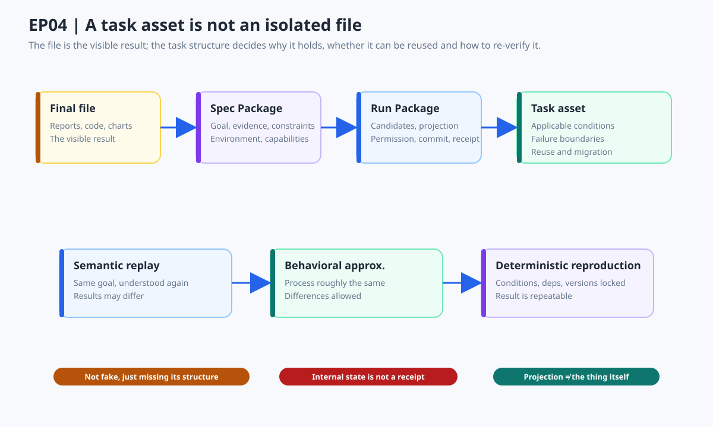

# Agent Computer 04: The files you saved may all be "fakes"

> This is part 4 of 12 in the **Agent Computer** series, adapted from the Agent Computer live-stream series. Previous: [Why AI always gives you one "standard answer"](https://0x00.community/blog/agent-computer-03-one-standard-answer/). The layered storage, levels of reproduction and task asset management described here belong to the methodology and target architecture, and are still to be verified in concrete implementations and real tasks.

Anyone who has inherited a project knows this folder: "plan_final", "plan_final_rev", "plan_final_rev2". Every file opens and every one looks respectable. But three questions go unanswered: which one was actually submitted, which version of the data it was based on, and whether it can still be used now that conditions have changed.

[Part 2](https://0x00.community/blog/agent-computer-02-results-are-not-tasks/) showed that a result is only one projection of a task generative structure, and the [previous post](https://0x00.community/blog/agent-computer-03-one-standard-answer/) covered how candidates are generated and filtered. This post takes the engineering question that follows: if a result cannot stand for the task on its own, what exactly has to be stored, and what can be recovered from it afterwards?

"Fakes" in the title does not mean the content is forged. It names a mistake in how things are saved:

> **A result detached from the task structure that generated it may look like a complete asset while lacking the very parts that determine where it is valid.**

The claim of this post: storage comes in layers and reproduction comes in levels. An asset should be able to say which layer it stored and what it promises can be recovered.

## The file is there, but the task may be gone

Pick up a saved report and try asking it a few questions:

- what goal did it serve;
- where did the input data come from, and what time range does it cover;
- which parts are fact, which are inference, and which are still unknown;
- which model, tools, Skills and runtime environment were used;
- were other candidates compared;
- is it the output of an exploration or a result that passed acceptance and was committed;
- does it need re-verification once conditions change.

Many files cannot answer. They are not necessarily worthless. They carry a conclusion without the structure that determines where the conclusion is valid. A traditional file system treats a file as a fairly independent object with a path, name, size, modification time and content, and if it opens it counts as a complete deliverable. For static content that is enough. When a file comes out of an agent task that involved evidence, an environment, permissions, candidates and real-world actions, the file is only one part of that task.

> **Saving the result is not the same as saving the ability to produce it.**

## What to save: structure first, but not everything

If structure matters this much, should every chat log, intermediate file and token be kept? No. Token-level traces and raw drafts raise privacy, cost and governance problems, and storing more does not explain more. What is saved can be divided into four layers:

1. **Structure layer**: the Spec, evidence, dependencies, capabilities, policies, permissions, acceptance, choice and commit structure. This is the main content to save. It says what the task is and within which boundaries it holds.
2. **Projection layer**: the adopted result, key candidates and external receipts, along with their hashes or controlled copies. A result is not disposable just because it is "only a projection". It remains important material for use and audit, but it cannot represent the task on its own.
3. **Experience layer**: diffs between worldlines, failure boundaries, applicable conditions, costs and re-verification requirements. It does not keep the process verbatim, only what the next judgment will need.
4. **Process layer**: token-level traces, private reasoning and temporary state with no reuse value. Released by default. Whether some diagnostic information is retained is decided by specific governance rules.

In terms of concrete objects, a Spec Package is formed before execution and holds the task generative structure. A Run Package is formed after execution and holds the projections, candidates, gate reports, choices, external actions and real-world feedback, with a reference to the Spec Package version it used. This is the same line of thinking as lockfiles and build provenance in the software supply chain. The difference is three things those do not record: the candidates that were not chosen and why, the human's choice and authorization, and the receipts from the outside world.

The structure layer has one rule that belongs to storage in particular: no silent rewrites. When new evidence changes the understanding of the task, the system keeps the old version, creates a new one and records a Spec Diff saying which goal, constraint, evidence for a factual claim, acceptance criterion or commit policy changed. This is also not the same as "adding a version number to the prompt". Storing the prompt without the evidence, environment, capabilities, permissions and choices is still not enough. When a result turns out badly, you need to be able to tell whether the understanding of the goal changed, or the evidence, the environment, the capabilities or the preference behind the choice. Once everything is squeezed into one "latest file", those causes can no longer be told apart.

How much is enough depends on the purpose. Auditing needs more fields. Semantic replay centers on the goal, constraints, acceptance criteria and key dependencies. Deterministic reproduction additionally requires freezing more of the runtime and external conditions. A low-risk, short-lived, simple task can use a smaller structure. The amount of structure should be in proportion to the task's risk, reuse value and real-world impact.

For a file to count as a reusable asset, you should at least be able to find:

- the task goal and Spec version it corresponds to;
- its input references, evidence sources and time conditions;
- its environment, tool, model and version dependencies;
- the acceptance results and known limitations;
- why some candidates were adopted and others were not;
- the authorization, status and external receipt of any real-world commit;
- the conditions for re-verifying or re-executing it.

## The limits of reproduction: say exactly what you get back

"Reproducible" is often used as a promise that can be stretched to mean anything. In fact it has three levels, and they differ greatly in engineering cost and in how far they can be trusted.

**Semantic replay**: run the task again under the same goal, constraints and acceptance criteria. The result may differ, but it is the same task being solved. Rerunning "propose three backup plans within a budget of one hundred thousand yuan" today may give different results because market prices and tool capabilities have moved, while the goal and acceptance criteria stay the same.

**Approximate behavioral reproduction**: with the same dependencies, key inputs, control over randomness and environment manifest, aim for similar behavior. For example, with the same model version, the same toolchain, the same database snapshot and comparable runtime resources, regenerate a report of similar structure and a similar ranking of candidates.

**Deterministic reproduction**: only when the toolchain, runtime, external dependencies and sources of randomness can all be frozen may you promise the same result, possibly down to the bit. Most open-ended tasks that depend on external web pages, live data or third-party services cannot reach this. Even with a fixed random seed, different hardware, batch sizes or operator implementations can produce floating-point results that are no longer bit-identical.

The more honest default promise is therefore semantic replay plus an auditable explanation, and stronger levels have to declare their dependencies and limits separately. This is a product commitment too. A file is labeled "reproducible"; the user may expect the same conclusion, the same evidence definitions or even the same bytes, when all the system did was regenerate a file with similar content.

> **Reproduction is not a slogan. First say whether what is reproduced is the task, the behavior or the result.**

## Status has to be stored correctly too

If the content is saved and the status is recorded wrongly, the asset is just as unusable. Three disciplines apply.

First, record the two gates separately. Candidates pass through a validity gate and a fit gate (covered in the [previous post](https://0x00.community/blog/agent-computer-03-one-standard-answer/)), and the asset should record for each one whether it passed, the blocking reason, the missing condition and the supporting evidence. "Valid but unfit for now" must not be stored as "failed", or it will never be reconsidered when conditions change, and in a review it will be misread as a flaw in the design.

Second, an unknown must not be recorded as a pass. If a check was skipped, the reason is written down, and unverified is never recorded as verified.

Third, "done" needs grounds. A real-world commit cannot be declared complete by the model itself. The execution process, the external receipt and independent trusted observation are recorded separately. A record that says "sent successfully" and rests only on a sentence the agent wrote, with no external receipt, is merely an internal projection. When the receipt is missing, receipts conflict or the real-world state cannot be observed, the correct status is "unknown". It is not "failed", and it is certainly not "succeeded".

The record should also say what this state can be restored by. At the file level, git commits plus a worktree can roll tracked files back to an earlier version, and a copy-on-write snapshot can roll back untracked files as well. But neither isolates processes, ports, the network, local databases or global caches, and neither reaches an email or a payment that has already gone out. Rolling back managed digital state and compensating for a real-world action are two different things, and [part 6](https://0x00.community/blog/agent-computer-06-multiple-worlds/) is devoted to them.

## From file management to task asset management

A product that manages only files will concentrate on names, folders, search, sharing and versions. Those are still useful, but Agent Computer also has to manage the task asset behind the file:

- which Spec version generated the file;
- which evidence supports it, and until when that evidence is valid;
- which environment and capabilities it depends on;
- which worldline it is a projection of;
- which candidates were not chosen;
- what its scope of applicability and failure conditions are;
- whether it needs re-verification after conditions change.

This does not mean every user must face a giant engineering console. What the user sees can still be a file, and the interface can expand context only when needed, provided the underlying layer has not thrown the structure away. Document systems, collaboration tools, search and audit all gain one more job: besides attachments and final conclusions they store structure references, evidence chains, choices and authorizations, and when recalling they look first for task structures with similar applicable conditions instead of files with similar keywords.

Organizational reviews change too. Today a review mostly circles around a result file: was it right, who wrote it, when was it submitted. With the generative structure available, a wrong result can be traced to five different places: the task semantics were never clarified, the evidence was incomplete or expired, capabilities and environment did not match, the selection rules favored an option unsuited to current conditions, or the real-world commit never obtained a trustworthy receipt. If only the file is kept, all five end up as "the result was poor".

When conditions change, the system should neither reuse the old file blindly nor regenerate from scratch. It can recall the old structure, determine which parts still hold, which need migrating and which must be re-verified, and then form a new projection under the new conditions. That is how one computation settles into a task asset.

## How to spot a file that only looks complete

Given an AI-generated report, piece of code, plan or config file, ask nine questions in order:

1. What goal and acceptance criteria does it correspond to?
2. Where do the inputs and evidence come from, and what are their time range and validity period?
3. Which parts are fact, assumption, inference or unknown? If every sentence has the same confident tone, the risk has most likely been hidden.
4. Which model, tools, Skills, environment and versions were used?
5. Which hard constraints does it satisfy, and which soft preferences did it give up?
6. Are there candidates that passed the validity gate but were not adopted because of current conditions?
7. Was any real-world action actually committed, and is there an external receipt and trusted observation?
8. If current conditions change, which parts can be used as they are and which must be re-verified?
9. What exactly does "reproducible" promise: semantics, behavior or the result?

Only when these questions have structured answers does the file come close to a reusable task asset. If all you can see is a polished file with no goal, evidence, conditions, choices or receipts to be found, it can serve as reading material, but it should not be used directly as the basis for a high-risk decision or a real-world commit.

## Conclusion

This post split "the file was saved" into three questions that can be checked separately: which layer was stored, which level of reproduction is promised, and whether the status is honest. It rests on one premise: the system has to record structure, evidence and receipts while the task runs, because they cannot be reconstructed afterwards. Nothing is wrong with the file itself. What is missing is the structure behind it:

> **The file is not fake. A file detached from its generative structure is an incomplete asset.**

So far task structure, candidates and storage have been treated one at a time, without saying in what order they appear in a real task or who is responsible for each. The next post ties them together with a code-fix example.

Next: [A day in the life of an agent](https://0x00.community/blog/agent-computer-05-a-day-of-an-agent/)
