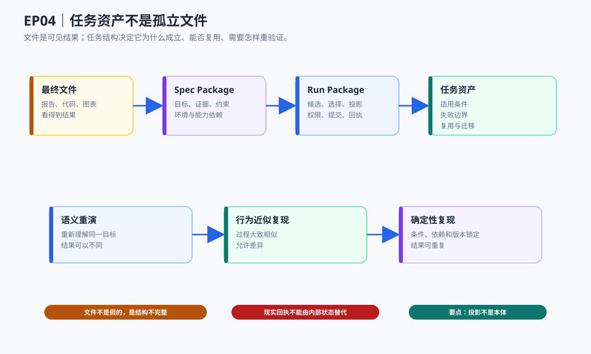

# Agent Computer 04｜你存的文件可能都是“假货”

> 本文是 **Agent Computer** 系列的第 4 篇（共 12 篇），整理自「顽皮的程序员」的 Agent Computer 系列直播。上一篇：[为什么 AI 总给你一个“标准答案”](https://0x00.community/zh-CN/blog/agent-computer-03-one-standard-answer/)。文中的分层保存、复现分级和任务资产管理属于方法论和目标架构，有待在具体实现和真实任务中验证。

接手过别人项目的人大概都见过这样的目录：“方案_最终版”“方案_最终版_改”“方案_最终版_改2”。每个文件都能打开，内容也都像模像样。但你答不出三个问题：哪一份是当时真正提交的，它依据的是哪一版数据，现在条件变了，它还能不能直接用。

[第 2 篇](https://0x00.community/zh-CN/blog/agent-computer-02-results-are-not-tasks/)说明了结果只是任务生成结构的一次投影，[上一篇](https://0x00.community/zh-CN/blog/agent-computer-03-one-standard-answer/)讲了候选怎样生成和筛选。这一篇处理接下来的工程问题：既然结果不能单独代表任务，那到底要存下什么，存下以后又能重新得到什么。

标题里的“假货”不是说文件内容是伪造的。它指的是一种保存上的错误：

> **如果一个结果脱离了生成它的任务结构，它可能看起来像完整资产，实际上缺少决定其有效范围的关键部分。**

本篇的判断是：保存要分层，复现要分级。一份资产应当说得清自己存了哪一层、承诺能重新得到什么。

## 文件在，但任务可能已经丢了

拿到一份保存下来的报告，可以试着问它几个问题：

- 它对应的目标是什么；
- 输入数据来自哪里，时间范围是什么；
- 哪些内容是事实，哪些是推断，哪些仍然未知；
- 当时用了什么模型、工具、Skill 和运行环境；
- 有没有比较过其他候选方案；
- 它是一次探索的结果，还是已经通过验收的提交结果；
- 条件变了以后，它是否需要重新验证。

很多文件回答不了。它们未必没有价值，问题在于只带着结论，没有带着决定结论有效范围的结构。传统文件系统把文件看作相对独立的对象，有路径、名称、大小、修改时间和内容，能打开就算完整的交付物。对静态内容这足够了；当文件出自一个带着证据、环境、权限、候选和现实动作的 Agent 任务时，它只是任务的一部分。

> **保存了结果，不等于保存了产生结果的能力。**

## 应该保存什么：结构优先，但不是保存一切

既然结构重要，是不是要把所有聊天记录、中间文件和每一个 Token 都留下？不是。逐 Token 轨迹和原始草稿会带来隐私、成本和治理问题，存得多也不代表解释得清楚。保存内容可以分成四个层级：

1. **结构层**：Spec、证据、依赖、能力、策略、权限、验收、选择和提交结构。这是主要保存内容，回答任务是什么、在什么边界内成立。
2. **投影层**：采用的结果、关键候选、外部回执，以及它们的哈希或受控副本。结果不会因为“只是投影”就可以丢掉，它仍是使用和审计的重要材料，只是不能单独代表任务。
3. **经验层**：世界线之间的 Diff、失败边界、适用条件、成本和再验证要求。它不原样保留过程，只留下下一次判断用得上的内容。
4. **过程层**：逐 Token 轨迹、私密推理、没有复用价值的临时状态，默认释放。是否保留某些诊断信息，由具体的治理规则决定。

落到具体对象上，执行前形成 Spec Package，保存任务生成结构；执行后形成 Run Package，保存投影、候选、门控报告、选择、外部动作和现实反馈，并引用所用的 Spec Package 版本。这和软件供应链里的锁文件、构建来源证明是同一类思路，区别在于多记了三样它们不记录的东西：没被选中的候选及原因，人的选择与授权，外部世界的回执。

结构层有一条专属于保存的规则：防止静默改写。新证据改变了对任务的理解时，系统保留旧版本，生成新版本，并记录 Spec Diff，写明哪个目标、约束、事实主张的证据、验收标准或提交策略变了。这也不等于“给 Prompt 加版本号”，只存 Prompt 而不存证据、环境、能力、权限和选择，仍然不够。结果不好的时候，需要分得清是目标理解变了、证据变了、环境变了、能力变了，还是选择偏好变了；所有东西都压成一份“最新文件”，这些原因就分不开了。

保存多少算够，取决于目的。为了审计，需要的字段多一些；为了语义重演，重点是目标、约束、验收和关键依赖；为了确定性复现，还要冻结更多运行时和外部条件。低风险、短期的简单任务可以用更小的结构，结构的多少应当与任务风险、复用价值和现实影响相称。

一份可以复用的文件资产，至少应该能找到：

- 对应的任务目标和 Spec 版本；
- 输入引用、证据来源和时间条件；
- 环境、工具、模型和版本依赖；
- 验收结果和已知限制；
- 采用与未采用候选的原因；
- 现实提交的授权、状态和外部回执；
- 重新验证或重新执行的条件。

## 复现边界：重新得到什么，必须说清楚

“可复现”经常被当成一句可以随意扩大解释的承诺。实际上它有三个层级，工程成本和可信程度差别很大。

**语义重演**：在相同的目标、约束和验收标准下重新执行任务。结果可以不同，但解决的是同一项任务。比如今天重新运行“在预算不超过十万元的前提下提出三种备份方案”，市场价格和工具能力变了，结果可能不同，目标和验收标准不变。

**行为近似复现**：在相同的依赖、关键输入、随机性控制和环境清单下，争取得到相近的行为。比如用相同版本的模型、相同的工具链、相同的数据库快照和相近的运行资源，重新生成结构接近的报告和相近的候选排序。

**确定性复现**：只有工具链、运行时、外部依赖和随机源都能冻结时，才可以承诺相同的结果，甚至位级一致。依赖外部网页、实时数据或第三方服务的开放任务，多数做不到；即使固定了随机种子，换一种硬件、批大小或算子实现，浮点结果也可能不再逐位相同。

所以更诚实的默认承诺是语义重演加可审计的解释，更强的层级要单独声明依赖和边界。这也是产品承诺：文件标着“可复现”，用户期待的也许是相同的结论、相同的证据口径甚至相同的字节，而系统做到的只是重新生成了一份内容相近的文件。

> **复现不是一句口号，必须先说清楚复现的是任务、行为，还是结果。**

## 状态也要存对

内容存下来了，状态记错，资产同样不可用。这里有三条纪律。

第一，两道门的结果分开记。候选要过有效性门和场景适配门（[上一篇](https://0x00.community/zh-CN/blog/agent-computer-03-one-standard-answer/)讲过），资产里要分别记下通过与否、阻断原因、缺少的条件和支撑证据。“有效但当前不适配”不能记成“失败”，否则条件变化后它不会被重新考虑，复盘时还会被误读成设计有问题。

第二，未知不能记成通过。跳过了某项检查要写明原因，未验证不能写成已验证。

第三，“已完成”要有依据。现实提交不能由模型自行宣布完成，执行过程、外部回执和独立的可信观测要分开记录。一条“发送成功”的记录，如果只有 Agent 自己写下的一句话而没有外部回执，就只是一次内部投影。回执缺失、回执冲突或者现实状态无法观测时，正确的状态是“未知”，不是“失败”，更不是“成功”。

还要记下这份状态靠什么恢复。文件层面，git 提交加 worktree 能把被跟踪的文件回撤到旧版本，写时复制（Copy-on-Write）快照能连未跟踪的文件一起回撤；但它们隔离不了进程、端口、网络、本地数据库和全局缓存，更管不到已经发出的邮件和付款。受管数字状态的回撤和现实动作的补偿是两回事，[第 6 篇](https://0x00.community/zh-CN/blog/agent-computer-06-multiple-worlds/)专门讲。

## 从文件管理走向任务资产管理

只管理文件的产品，重点自然落在名称、目录、搜索、分享和版本上。这些仍然有用，但 Agent Computer 还要管理文件背后的任务资产：

- 文件由哪个 Spec 版本生成；
- 哪些证据支持它，有效期到什么时候；
- 它依赖什么环境和能力；
- 它是哪条世界线的投影；
- 哪些候选没有被选择；
- 它的适用边界和失效条件是什么；
- 条件改变后是否需要重新验证。

这不意味着每个用户都要面对一张巨大的工程控制台。用户看到的可以仍然是文件，界面只在需要的时候展开上下文，前提是底层没有把这些结构丢掉。文档系统、协作工具、搜索和审计都会因此多出一项工作：保存的除了附件和最终结论，还有结构引用、证据链、选择和授权；召回时优先找适用条件相近的任务结构，而不只是关键词相似的文件。

组织复盘也会不同。现在的复盘多半围着一份结果文件转：结果对不对，谁写的，什么时候提交。有了生成结构，一个错误结果可以定位到五个不同的位置：任务语义没有澄清，证据不完整或已经过期，能力和环境不匹配，选择规则偏向了不适合当前条件的方案，或者现实提交没有拿到可信回执。只保存文件，这五种原因最后都只剩下一句“结果不佳”。

条件变化时，系统既不该盲目复用旧文件，也不必从零重新生成。它可以召回旧结构，判断哪些部分仍然成立、哪些需要迁移、哪些必须重新验证，再在新条件下形成新的投影。一次计算就是这样沉淀成任务资产的。

## 如何识别一个“看似完整”的文件

拿到一份 AI 生成的报告、代码、方案或配置文件，可以按顺序问九个问题：

1. 它对应的目标和验收标准是什么？
2. 输入和证据来自哪里，时间范围和有效期是什么？
3. 哪些内容是事实、假设、推断或未知？如果所有句子都是同样确定的语气，风险多半已经被藏起来了。
4. 使用了什么模型、工具、Skill、环境和版本？
5. 它满足哪些硬约束，牺牲了哪些软偏好？
6. 是否存在通过了有效性门、但因当前条件未被采用的候选？
7. 现实动作是否真的提交了，有没有外部回执和可信观测？
8. 当前条件改变后，哪些部分可以直接用，哪些必须重新验证？
9. 所谓“可复现”，承诺的是语义、行为还是结果？

这些问题都能得到结构化的回答，文件才接近一份可复用的任务资产。只看得到一份漂亮的文件，找不到目标、证据、条件、选择和回执，它可以当阅读材料，但不该直接作为高风险决策或现实提交的依据。

## 结论

这一篇把“文件存下来了”拆成了三个可以分别检查的问题：存了哪一层，承诺哪一级复现，状态是否如实。它依赖的前提是系统在执行时就把结构、证据和回执记了下来，事后补不出来。文件本身没有问题，缺的是它背后的结构：

> **文件不是假的，脱离生成结构的文件才是不完整的资产。**

到这里，任务结构、候选和保存方式都是分开讲的，还没有回答它们在一次真实任务里按什么顺序出现、由谁负责。下一篇用一个代码修复案例把它们串起来。

下一篇：[Agent 的一天](https://0x00.community/zh-CN/blog/agent-computer-05-a-day-of-an-agent/)
