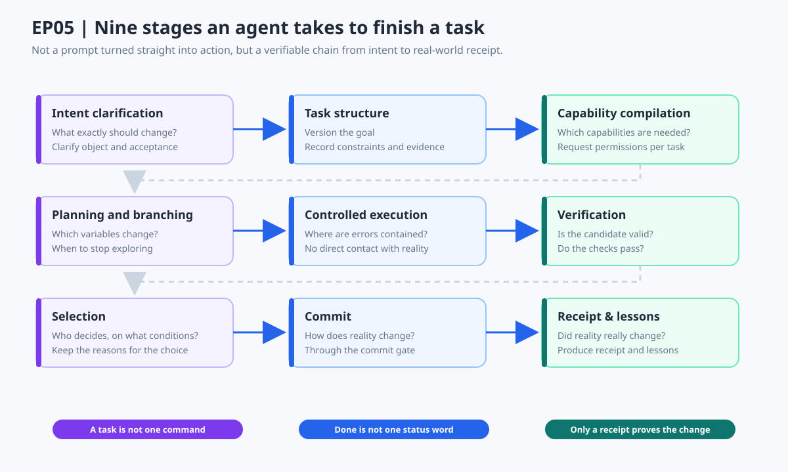

# Agent Computer 05: A day in the life of an agent

> This is part 5 of 12 in the **Agent Computer** series, adapted from the Agent Computer live-stream series. Previous: [The files you saved may all be "fakes"](https://0x00.community/blog/agent-computer-04-files-are-projections/). What follows describes a target architecture and its engineering objects. It does not mean every item has been verified in a real product.

You notice that the payment report in your local repository is often off by one day, so you tell the agent: "Fix the payment report being a day off, test it and commit."

That sounds specific, but a system that has to act on it is still missing a lot. Which report? Is "a day off" a time zone boundary problem, or a disagreement about what the business means by a day? Which directories may be changed, and is network access allowed? Which samples does "test it" have to cover? Does "commit" mean a local branch, a remote branch or a release? Should it ask you before committing?

The last three posts covered task structure, candidates and storage, all of them static objects. This post sets them in motion and shows the order in which they appear in one real task. Its claim is:

> **An agent does not turn a sentence straight into an action. It compiles the intent into a task structure, explores, verifies, selects and commits inside a controlled environment, and confirms completion with a real-world receipt.**

That chain has nine stages. The code fix above will take us through all of them.

## Why "just fix it" is not yet a task

An ordinary chat-style system might break the sentence straight into actions: search the code, edit files, run tests, run a Git commit, report that it is done. The questions above did get answered along the way, but the answers were buried in the model's momentary judgment. You do not know which choices it made for you, and when the result is wrong you cannot attribute the error precisely.

The usual explanation is that the user's prompt was not detailed enough. That is half right. A user cannot write a full interface document for every request. Extracting the parts of natural language that affect outcome and risk, and separating "details that can be defaulted" from "variables that must be clarified", is the agent's job. Natural language is the entry point of a task, and the task still has to be compiled before it becomes something that can be executed, verified and committed.

## The more autonomous the agent, the less it can skip clarification

Intuition says a more autonomous agent should ask fewer questions: hand it one sentence and let it judge, act and commit by itself. But autonomy does not mean guessing every key condition on the user's behalf. If the agent finds UTC, the user's time zone and the merchant settlement time zone all present in the code, it should not confidently pick UTC because that is the most common convention. This open item has high impact and low confidence, so the agent should ask the user, or set up two control worldlines with explicit assumptions, or adopt a safe default. In the other direction, a small difference in how a date is formatted in a log does not change business behavior, and there is no need to pull the user in to confirm it.

> **Asking less is not clarifying less. A good agent asks where the answer would change the decision.**

## Having tools is not the same as doing the job

Once the intent is understood and the tools are there, it seems all that remains is to call them. But a tool only answers "can this kind of operation be performed": read a file, run tests, create a commit. It cannot say whether the current task is allowed to use it, what permission this action needs, what side effects it produced, or whether a failure should lead to a retry, a fallback or a new plan. It also cannot say whether "the tool returned success" means the business goal has been met.

Reading code, modifying code, running tests, creating a local commit and pushing a remote branch may all be used by the same "coding agent", but they are different capabilities and should not share one tool card with unlimited permissions. So the user's intent, the Task Spec, the capability contracts and the capability leases are stored separately. An agent that can call Git does not thereby have the right to push to the remote at this moment.

## The nine stages of the task lifecycle

### Stage 1: Intent clarification

The output of this stage is an initial intent structure and a checkable list of open items, not a more polished prompt. The system keeps a record of the original intent and extracts from it the goal, object, inputs, hard constraints, soft preferences, acceptance criteria, budget, permissions and open items, marking whether each field comes from the user's own words, a model inference or a tool observation.

The case is clarified as follows. The goal is to fix the payment report's error at date boundaries. The hard constraints are no change to amounts or order scope, no access to production write interfaces, and no reading of files outside the repository. The soft preferences are a minimal diff and unchanged interfaces. Acceptance means existing tests pass and new boundary tests cover at least UTC, UTC+8 and one negative offset. The commit policy is to commit to a local fix branch first, with a remote commit requiring the user's explicit choice. One open item remains: whether the report date follows the user's time zone or the merchant settlement day. At this point the agent has not written a line of code.

### Stage 2: Task structure

The initial structure is compiled into a versioned Task Spec. The full generative structure before execution is a Spec Package: besides the goal, constraints, acceptance criteria and open items, it holds an evidence ledger (factual claims, sources, freshness and conflicts), an environment manifest (input snapshots, dependencies, device and runtime), capability versions, policy and capability contracts, and the execution configuration.

They are kept together because the same fix can come out differently on a different branch, with different test dependencies or under different permissions. If only the final patch is stored, nobody can tell whether it depended on some temporary configuration.

### Stage 3: Capability compilation

This step produces a capability configuration by stage, risk and resources. It is not a matter of picking "the strongest model". Clarification and planning may need a stronger long-context model, search and formatting can go to a smaller one, testing relies on deterministic tools, and review is best done by an independent role. Each capability declares its version, preconditions, failure modes and fallback paths through a Capability Contract. If a static analysis tool is unavailable, for instance, the system can fall back to a compile check plus targeted tests, but the degraded check must not be reported as full verification.

The capability list for this case: read the repository and test configuration, search the date and time zone logic, build a minimal patch, run deterministic tests and static checks, produce a diff and impact notes, and create a local commit. Pushing to the remote is a separate real-world action and is not performed automatically by default. The agent can discover a capability gap and file a minimal request, but it does not issue its own lease.

### Stage 4: Planning and branching

The planner produces a plan version. Planning is more than "search, then edit, then test". It also decides which variables are worth comparing, how much budget to spend, when to stop, and where to return to after a failure.

The main line assumes the problem is a UTC-to-local conversion error, locates the call chain and builds a minimal fix. The open item left by stage 1 is not settled by guessing: the system sets up a control worldline that changes only one variable, the interpretation of date semantics, reading it as the merchant settlement day, and writes down the hypothesis under test. This is different from having several models each write a patch and then voting. Repeated attempts with no declared variable or hypothesis only add randomness. Why forks are designed this way, and how multiple worldlines are kept apart from reality, is the subject of the [next post](https://0x00.community/blog/agent-computer-06-multiple-worlds/).

### Stage 5: Controlled execution

Execution happens in an isolated workspace in the exploration domain. The agent can read the designated repository snapshot, modify its own workspace and run authorized tests, but it cannot write directly to the user's production directory. Capabilities are granted through short-lived Capability Leases. Worldlines share read-only inputs and never share writable directories.

Failure handling is also settled at this stage. A compile failure can go back to planning. If tests show that the business definition does not hold, the current line can be frozen and a new one derived from it. When permissions are insufficient, the agent files a new authorization request and does not route around the gateway.

### Stage 6: Verification

Verification has several layers: structural checks first (the artifact is well formed and the diff parses), then deterministic verification (compilation, unit tests, regression, static checks), then policy compliance and evidence checks and, where needed, semantic or human review. Hard constraints go to deterministic verifiers first, and the model cannot overturn a deterministic failure with a paragraph of explanation.

What this stage answers is validity: whether the option holds on facts, logic, the Spec's hard constraints and minimum executability. It does not answer two other questions, namely whether the authorization needed to execute is ready and whether real-world side effects are ready to happen. Those are checked by the commit gate in stage 8. The three must not be merged into one "pass".

> **Passing tests only shows that one set of checks passed. It does not by itself show that the change is ready to be committed to reality.**

### Stage 7: Selection

Both worldlines pass the validity gate, and the boundary tests for all three time zones pass on both. Next comes the fit gate: both can be completed under the current time, budget and device conditions and differ only in the size of the change and the cost of regression, so both stay in the candidate set. The main line is a small change, but the merchant settlement day rule stays implicit. The control line is a somewhat larger change that makes the settlement day rule explicit and passes more historical samples. A hidden scoring function should not announce "the best answer" here. The two candidates, each with its conditions, trade-offs, evidence, limitations, cost, risk and failure boundary, form a set of conditioned candidates. The user, or a principal with authority to choose, makes the decision, and a record of the choice is kept.

Suppose the user picks the main line with the smallest diff because this is an urgent fix. That is a decision made under conditions: the settlement day semantics are recorded as needing re-verification, and what is recorded for the control line is "why it does not fit right now". If the business calendar changes later, it may still be useful.

### Stage 8: Commit

A chosen candidate is still not a finished job. A candidate is a verified projection, not yet a fact about reality. The system turns it into an Effect Proposal that lists the concrete diff, scope of impact, pre-checks, required authorization, compensation plan on failure and receipt requirements. The proposal goes to the commit gate, and once it passes, the commit broker (External Effect Broker) executes it.

Local commit and remote push must be kept apart. A local commit written into the user's repository also belongs to the reality domain, but it can be rolled back with version control. Pushing a remote branch affects other collaborators and automated pipelines and can only be compensated, so it needs its own authorization and receipt. In this example the user confirmed the local commit and then separately approved the push to the remote fix branch. Being able to roll back local files does not mean a remote branch, a release system or a production environment can be rolled back.

### Stage 9: Receipt and lessons fed back

After a real-world commit, two kinds of evidence are needed: the Effect Receipt from the external system, and independent trusted observation where necessary. The remote repository returns a commit ID and branch state, for example, and the system then confirms with a read-only query that the commit really is on the target branch. The agent saying "done" does not count as evidence.

If the push request times out, all we know is that no response arrived. We do not know whether the other side accepted it. The status is `Unknown`. It cannot be reported as failed or as succeeded. The right move is a read-only query of the remote branch first. Resending the same request is allowed only when the connector declares idempotent semantics (a non-forced push of the same commit to the same branch is idempotent: nothing changes if the remote already has it, and the push is rejected if the branch has moved on; a forced push is not, because a resend can overwrite someone else's later commits) or the request carries an idempotency key the other side honors. Actions with no idempotency guarantee, such as a payment or an email, must not be retried blindly.

What settles after the task is a Run Package: the Spec, evidence, environment and capabilities that were used, the key candidates and the record of the choice, the external actions and receipts, the differences between worldlines, and the failure boundaries, applicable conditions and re-verification requirements. The lesson left by this case should not be "the date problem is fixed". It should be: when a payment report's date boundary is involved, confirm both the time zone conversion and the merchant settlement day semantics; passing every boundary test is not enough to show the business definition is right; a remote commit is authorized separately from the local patch. This is conditioned experience, kept for the next judgment.

## Simple tasks take a fast path

Nine stages do not mean every small job runs the full heavy process. The sensible approach is to tier by risk. A task with no external side effects that can be rolled back locally takes a fast path: the Spec holds only the goal and acceptance criteria, there is one model and one worldline, and the commit is a local snapshot. Only when external side effects are involved does it escalate to the full flow. What can be saved is the overhead of the stages. What cannot be skipped is three rules: results are verified, choices leave a record, and real-world actions pass the commit gate and obtain a receipt. Whether this flow is worth its extra cost over "just do it" is itself something to measure against a baseline, a question [part 11](https://0x00.community/blog/agent-computer-11-evidence-and-trust/) returns to.

Walking through the nine stages also shows that versions of tasks and plans, isolation of worldlines, issuing and revoking leases, and real-world actions with their receipts are more than a loop inside a chat window can carry reliably. The system layer that carries them is a supportive AgentOS, which is left to [part 7](https://0x00.community/blog/agent-computer-07-agentos-support/).

## How to tell whether an agent really got it done

Six questions help:

1. Did it keep the original intent and the key open items?
2. Is there a versioned Task Spec, with evidence and an environment manifest?
3. Are capabilities, permissions and real-world actions kept apart?
4. Did candidates go through both the validity check and the fit check?
5. Did the user choose among candidate projections, or did the system quietly commit on the user's behalf?
6. Is there an external receipt and trusted observation, or only the word "done" on the screen?

If an agent can only show a result and cannot say what the goal, conditions, permissions, verification, choice, commit and receipt were, what it offers is generation, not yet the full ability to complete a task.

## Conclusion

This post rewrote "getting something done" from a single generation into a chain:

> Intent clarification → task structure → capability compilation → planning and branching → controlled execution → verification → selection → commit → receipt and lessons fed back.

The order is useful because it gives each easily confused question its own place: validity is answered in verification, fit under current conditions before a candidate enters the set, authorization and side effects at the commit gate, and whether reality changed by the receipt. It depends on a system layer that stores state for this chain, isolates exploration and guards the commit, and that layer is still target architecture. Exploration, verification and commit in these nine stages in fact happen in three different places. Why they must be kept apart, and why there can be many branches but only one reality, is what the next post answers.

Next: [Why an agent needs "multiple worlds"](https://0x00.community/blog/agent-computer-06-multiple-worlds/)
