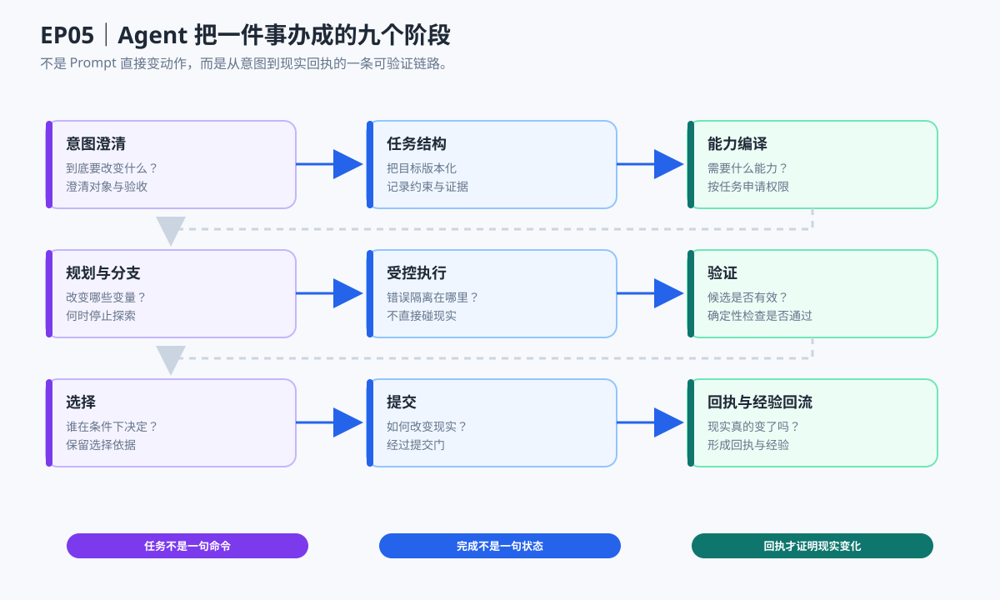

# Agent Computer 05｜Agent 的一天

> 本文是 **Agent Computer** 系列的第 5 篇（共 12 篇），整理自「顽皮的程序员」的 Agent Computer 系列直播。上一篇：[你存的文件可能都是“假货”](https://0x00.community/zh-CN/blog/agent-computer-04-files-are-projections/)。这里描述的是目标架构和工程对象，不代表每一项都已经在真实产品里完成验证。

你在本地代码仓库里发现支付报表的日期经常错一天，于是对 Agent 说：“帮我修一下支付报表日期错一天的问题，测完提交。”

这句话听起来已经很具体，但真要交给一个系统去做，它还缺很多东西。是哪张报表？错一天是时区边界问题，还是业务对“一天”的定义不同？允许改哪些目录，能不能联网？“测完”要覆盖哪些样本？“提交”是提交到本地分支、远程分支，还是直接发布？提交前要不要你确认？

前三篇分别讲了任务结构、候选和保存方式，都是静态的对象。这一篇让它们动起来，看它们在一次真实任务里按什么顺序出现。判断是：

> **Agent 不是把一句话直接变成一个动作，而是把意图编译成任务结构，在受控的环境里探索、验证、选择、提交，并用现实回执确认完成。**

这条链路可以分成九个阶段。下面用这个代码修复案例从头走一遍。

## 一句“帮我修好”，为什么还不算任务

普通的聊天式系统可能直接把这句话拆成几个动作：搜索代码，修改文件，运行测试，执行 Git commit，然后告诉你完成。上面那些问题它并不是没有回答，只是答案被藏进了模型的临时判断里。你不知道它替你做了哪些选择，结果出错时也没法准确归因。

常见的解释是用户的 Prompt 写得不够详细。这只对了一半。用户不可能为每件事写一份完整的接口文档，把自然语言里会影响结果和风险的部分提取出来，区分“可以默认的细节”和“必须澄清的变量”，本来就是 Agent 的职责。自然语言是任务的入口，任务还要经过一次编译，才能成为可执行、可验证、可提交的对象。

## Agent 越自主，越不能跳过澄清

直觉上，Agent 越自主就该越少问问题，最好一句话交给它，自己判断、自己做、自己提交。但自主不等于替用户猜完所有关键条件。如果 Agent 发现代码里同时存在 UTC、用户时区和商户结算时区，它不应该因为最常见的写法是 UTC 就自信地选一个。这个不确定项影响大、置信度低，要么向用户澄清，要么建立两条带明确假设的对照世界线，要么采用安全的默认值。反过来，如果只是日志里日期显示格式的细小差异，不影响业务行为，就没有必要把用户拉进来确认。

> **少问不等于少澄清；好的 Agent 是把问题问在会改变决策的地方。**

## 有工具，不等于会做事

意图理解完了，工具也有了，剩下的似乎只是调用工具。但工具只回答“能不能执行某种操作”：读文件、跑测试、生成提交。它回答不了当前任务是否允许使用它、这次动作需要什么权限、它产生了什么副作用、失败后应该重试、降级还是重新规划，也回答不了“工具返回成功”是否等于业务目标已经完成。

读取代码、修改代码、运行测试、创建本地提交和推送远程分支，可能被同一个“代码 Agent”使用，但它们不是同一种能力，不应该共用一张无限权限的工具卡。所以用户意图、Task Spec、能力契约和能力租约要分开保存。一个 Agent 会调用 Git，不代表它此刻有权推送远程。

## 任务生命周期的九个阶段

### 阶段一：意图澄清

这一阶段的输出是初始的意图结构和一份可以检查的不确定项列表，而不是一段更漂亮的 Prompt。系统保留一份原始意图记录，从中提取目标、对象、输入、硬约束、软偏好、验收标准、预算、权限和不确定项，并标明每个字段来自用户原话、模型推断还是工具观测。

案例被澄清成这样：目标是修复支付报表跨日期边界的错误；硬约束是不改变金额和订单范围、不访问生产写接口、不读取仓库之外的文件；软偏好是最小 Diff、保持现有接口；验收是现有测试通过，新增边界测试至少覆盖 UTC、东八区和一个负时区；提交策略是先提交到本地修复分支，远程提交需要用户明确选择。还剩一个不确定项：报表日期采用用户时区还是商户结算日。到这里 Agent 还没有写一行代码。

### 阶段二：形成任务结构

初始结构被编译成版本化的 Task Spec。执行前的完整生成结构是一个 Spec Package：除了目标、约束、验收和不确定项，还有证据账本（事实主张、来源、时效和冲突）、环境清单（输入快照、依赖、设备和运行时）、能力版本、策略与能力契约，以及执行配置。

把它们放在一起，是因为同一个修复在不同分支、不同测试依赖、不同权限下可能得到不同结果。只保存最终补丁，就不知道它是否依赖了某个临时配置。

### 阶段三：能力编译

这一步按阶段、风险和资源生成能力配置，并不是挑一个“最强模型”：澄清和规划可能需要较强的长上下文模型，搜索和格式化可以交给更小的模型，测试依赖确定性工具，审查最好由独立角色完成。每项能力通过能力契约（Capability Contract）声明版本、前置条件、失败和降级路径。例如静态分析工具不可用时，可以改为编译检查加定向测试，但不能把降级验证说成完整验证。

本案例的能力清单是：读取仓库和测试配置，搜索日期与时区逻辑，构造最小补丁，运行确定性测试与静态检查，生成 Diff 和影响说明，创建本地提交。远程推送是单独的现实动作，默认不自动执行。Agent 可以发现能力缺口、提出最小申请，但租约不由它自己签发。

### 阶段四：规划与分支

Planner 生成一个计划版本。规划除了“先搜索、再修改、再测试”，还要决定哪些变量值得对照、预算多少、什么时候停、失败后回到哪里。

主线假设问题是 UTC 与本地时区的转换错误，先定位调用链，再构造最小修复。阶段一留下的那个不确定项不靠猜：系统建立一条对照世界线，只改变“日期语义解释”这一个变量，按商户结算日来解释，并写明待检验的假设。这和让几个模型各写一份代码再投票不是一回事，没有变量和假设的多次重试只增加随机性。分叉为什么要这样设计、多条世界线如何与现实隔开，是[下一篇](https://0x00.community/zh-CN/blog/agent-computer-06-multiple-worlds/)的主题。

### 阶段五：受控执行

执行发生在探索域的隔离工作区里。Agent 可以读取规定的仓库快照，修改自己的工作区，运行被授权的测试，但不能直接写用户的生产目录。能力通过短期的能力租约（Capability Lease）授予；世界线之间只共享只读输入，不共享可写目录。

失败处理也在这一阶段定型：编译失败可以回到规划；测试发现业务口径不成立，可以冻结当前线并派生新线；权限不足时应该提出新的授权请求，而不是绕过网关。

### 阶段六：验证

验证分几层：先做结构校验（产物格式正确、Diff 可解析），再做确定性验证（编译、单元测试、回归、静态检查），然后是策略合规、证据校验和必要时的语义复核或人工复核。硬约束优先交给确定性验证器，模型不能用一段解释推翻确定性的失败。

这一阶段回答的是有效性：方案在事实、逻辑、Spec 硬约束和最低可执行性上是否成立。它不回答另外两件事，即执行所需的授权是否就绪、现实副作用是否就绪，那是提交门在阶段八检查的内容。三者不能合并成一个“通过”。

> **测试通过只说明某组检查通过，不自动说明已经可以提交现实。**

### 阶段七：选择

两条世界线都通过了有效性门，三个时区的边界测试也都通过。接着过场景适配门：两者都能在当前的时间、预算和设备条件下完成，区别只在改动范围和回归成本，所以都留在候选集里。主线改动很小，但商户结算日规则仍然是隐式的；对照线改动略大，把结算日规则显式化，并通过了更多历史样本。这时不应该由一个隐藏的评分函数宣布“最佳答案”。两个候选连同各自的条件、权衡、证据、限制、成本、风险和失效边界组成条件化候选集，由用户或具备选择权限的主体做出决定，并留下选择记录。

假设用户因为这是一次紧急修复而选了 Diff 最小的主线。这是一次带条件的决策事实：结算日语义被记为需要再验证，没被选中的对照线记下的是“当前为什么不适配”，日后业务日历变了，它仍然可能有用。

### 阶段八：提交

候选被选中，事情仍然没有完成。候选是经过验证的投影，还不是现实事实。系统把它转成一份现实动作提案（Effect Proposal），列出具体 Diff、影响范围、前置检查、所需授权、失败后的补偿方案和回执要求，交给提交门检查，通过后由提交代理（External Effect Broker）执行。

本地提交和远程推送必须分开。写进用户仓库的本地提交也属于现实域，但它可以用版本回撤；推送远程分支会影响其他协作者和自动化流程，只能补偿，需要单独授权和回执。本案例里，用户在本地提交确认后，单独批准了推送到远程修复分支。本地文件能回撤，不等于远程分支、发布系统或生产环境能回滚。

### 阶段九：回执与经验回流

现实提交之后需要两类证据：外部系统给出的回执（Effect Receipt），以及必要的独立可信观测。比如远程仓库返回提交编号和分支状态，系统再用只读查询确认该提交确实出现在目标分支上。Agent 自己说“已完成”不算证据。

如果推送请求超时，我们只知道没有收到回应，不知道对方有没有接受。这时状态是 `Unknown`，既不能说成失败，也不能说成成功。正确的做法是先只读查询远程分支。只有连接器声明了幂等语义（非强制地把同一个 commit 推到同一个分支是幂等的：对端已有则不变，分支已前进则被拒绝；强制推送不在此列，重发可能覆盖别人随后的提交），或者请求带着对端认可的幂等键时，才允许用同一个请求重发；付款、发信这类没有幂等保证的动作不能盲目重试。

任务结束后沉淀的是 Run Package：用到的 Spec、证据、环境和能力，关键候选和选择记录，外部动作与回执，世界线之间的差异，以及失败边界、适用条件和再验证要求。本案例留下的经验不该是“日期问题已修复”，而是：涉及支付报表日期边界时，要同时确认时区转换和商户结算日语义；边界测试全部通过不足以证明业务口径正确；远程提交要和本地补丁分开授权。这是带条件的经验，供下一次判断使用。

## 简单任务走快路径

九个阶段不意味着每件小事都要走完一套重流程。合理的做法是按风险分级：没有外部副作用、可以在本地回撤的任务走快路径，Spec 只含目标和验收，单模型、单世界线，提交就是一次本地快照；一旦涉及外部副作用，才升级到完整流程。能省的是阶段的开销，不能省的是三条规则：结果要验证，选择要留痕，现实动作要过提交门并拿到回执。这套流程相对“直接做”多付出的成本是否值得，本身也需要拿基线来比，[第 11 篇](https://0x00.community/zh-CN/blog/agent-computer-11-evidence-and-trust/)会回到这个问题。

走完九个阶段还会发现，任务和计划的版本、世界线的隔离、租约的签发和回收、现实动作与回执，都不是聊天窗口里的一个循环能稳定承担的。承载它们的系统层是支撑型 AgentOS，留到[第 7 篇](https://0x00.community/zh-CN/blog/agent-computer-07-agentos-support/)。

## 怎样判断一个 Agent 真的“办成了事”

可以用六个问题检查：

1. 它是否保留了原始意图和关键的不确定项？
2. 是否有版本化的 Task Spec、证据和环境清单？
3. 能力、权限和现实动作是否分开？
4. 候选是否经过了有效性和场景适配两道检查？
5. 用户选择的是候选投影，还是系统悄悄替用户提交了？
6. 是否有外部回执和可信观测，而不只是界面上显示“完成”？

如果一个 Agent 只能展示结果，却说不清目标、条件、权限、验证、选择、提交和回执，它提供的是生成能力，还不是完整的任务完成能力。

## 结论

这一篇把“办成一件事”从一次生成改写成了一条链路：

> 意图澄清 → 任务结构 → 能力编译 → 规划与分支 → 受控执行 → 验证 → 选择 → 提交 → 回执与经验回流。

这个顺序的用处是让容易混在一起的问题各有位置：有效性在验证阶段回答，当前条件下是否适配在进入候选集之前回答，授权和副作用在提交门回答，现实是否改变由回执回答。它成立的前提是有一个系统层替这条链路保存状态、隔离探索、把住提交，这一点目前仍是目标架构。九个阶段里的探索、验证和提交其实发生在三个不同的地方，为什么要把它们分开、为什么分支可以有很多而现实只能有一个，是下一篇要回答的问题。

下一篇：[为什么 Agent 需要“多个世界”](https://0x00.community/zh-CN/blog/agent-computer-06-multiple-worlds/)
