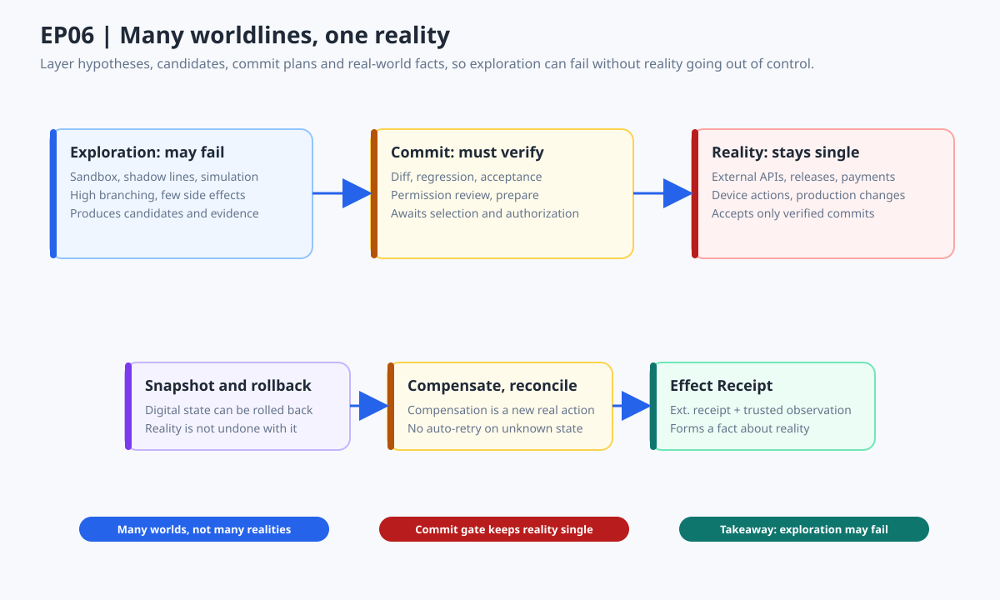

# Agent Computer 06: Why an agent needs "multiple worlds"

> This is part 6 of 12 in the **Agent Computer** series, adapted from the Agent Computer live-stream series. Previous: [A day in the life of an agent](https://0x00.community/blog/agent-computer-05-a-day-of-an-agent/). What follows is target architecture and candidate system mechanisms, to be verified with real tasks, real connectors and real risk environments. They are not general-purpose capabilities that exist today.

An agent has changed the code in a local sandbox. All tests pass, static checks pass, the diff is clean, and a run in a simulated deployment environment looks normal. Can it now tell you "it's fixed"?

If "fixed" only means the local candidate passed the current tests, yes. If it means the remote branch accepted the change, CI passed, production was deployed and users are no longer affected, no. The local environment and reality are not the same state space.

The previous post walked a task through nine stages from intent to receipt. The exploration, verification and commit in those stages in fact happen in three different places. A real task has at least three kinds of state at once: exploratory state where trial and error is free, commit state waiting for verification and authorization, and real state that has already taken effect for users and external systems. Mix the three and a single attempt by the model can become a real-world consequence. Cut them off from each other completely and the results of exploration cannot be delivered. This post's claim is:

> **An agent needs multiple worlds to keep hypotheses, candidates and real-world facts apart: exploration may fail, a commit must be verified, and there is still only one reality.**

The three domains are:

- **Exploration domain**: generating candidates, simulation and local trial and error, with no irreversible real-world side effects by default;
- **Commit domain**: comparing diffs, regression verification, permission review, candidate selection and pre-commit preparation (prepare);
- **Reality domain**: writes to the user's real directories, external APIs, releases, payments and device actions. It accepts only results that have been verified, chosen and authorized. Of these, local writes can be rolled back by version, and the rest can only be compensated.

Two things sit between the commit domain and the reality domain and will come up repeatedly. The commit gate is a checkpoint. The commit broker (External Effect Broker) is the only component entitled to execute real-world actions through connectors and to write their receipts.

## Why local success can still fail in reality

When a code fix "succeeds locally", the precise meaning is that under one code snapshot, one set of dependencies, one operating system and certain test data, it passed the current checks. That is valuable evidence with clear limits. It does not show that the remote repository is still at the same version, that the target branch accepts the commit, that CI has the same dependencies as the local machine, or that the change has reached users.

Other tasks are the same: a device command that executes correctly in a simulator does not show that the real device is online, that the firmware is compatible, or that the motor actually moved to the target position.

> **Local success is evidence for a candidate, not proof of success in reality.**

Quite a few products end their progress bar on "Done" without saying whether "done" means the model finished generating, a local tool returned, an external API returned, or the real-world state has been confirmed. Behind that, the objects inside the system are not layered.

## The more worlds there are, the more there must be only one reality

Allowing multiple worldlines sounds as if the system accepts multiple realities. It is the opposite. During exploration a file can have several candidate versions, and a code problem can be tested as a time zone error, a data definition error and a cache error in parallel. These possibilities can coexist because none of them has entered reality.

After commit it is different. Which commit is on the target branch, whether the payment succeeded, whether the email went out, whether the device moved: each must have one authoritative state, and worldlines cannot each announce their own from their own logs. An engineering team can review three design drafts at once, but a production database cannot believe three conflicting balances at once.

So a multi-world architecture carries a constraint: the worldline engine may produce candidates, but it is never the authoritative writer of real-world action state. The scope of that constraint needs stating precisely. Authority over external reality sits with the external systems, other people write to the remote repository too, and the system cannot control that. What it can control is that the record of "which actions I initiated and which receipts I got back" has exactly one writer, the commit broker, and that caches, memory, model judgments and worldline logs never stand in for it. The common mistakes are exactly these: treating a cached "authorized" as the current authorization, or treating a worldline's saved "push succeeded" as the state of the remote repository.

## Multiple worldlines are not a few more tries

Multiple worldlines do not mean three models answering the same question and taking a majority vote, or raising the temperature and generating a few more times. Worldlines are built around the same Task Spec and deliberately vary conditions, methods, resources or combinations of roles so that the outcomes can be compared. Every legitimate fork declares at least two things: which variable changed, and which hypothesis is under test.

Take the code fix from the previous post. The main line reads the report date as "the user's time zone", and the control line reads it as "the merchant settlement day". The variable that changed is date semantics, and the hypothesis is which reading satisfies historical bills, cross-time-zone boundary tests and existing interface constraints together. A fork without those two declarations is just repeated computation.

Worldlines come in several common forms: multi-candidate worldlines running several plans in parallel; a main line that aims to deliver quickly alongside a shadow line that keeps looking for counterexamples; multi-objective worldlines optimizing for speed, quality, cost or robustness; control worldlines that change one variable at a time; and cross-device worldlines executed on a trusted device pool by capability matching. The last form depends on device attestation, permission decay and a cross-device trust model, and remains target architecture to be verified.

More branches is not better. Branching needs a fork limit, a budget and stopping conditions: the budget is used up, two consecutive stages produce no new evidence, the candidates have become semantically the same, a strong conclusion has been reached, or the user chooses to close the exploration. The value of worldlines comes from information gain that can be attributed, not from their number.

Each worldline also has its own workspace and capability lease. Shared inputs are read-only, and one line's writable directory is never mounted into another, or the experiments contaminate each other. The unit of isolation is also more than a directory: a git worktree separates the working directory and the index (worktrees of one repository still share refs, config and hooks), and a copy-on-write snapshot separates a whole directory tree; neither separates processes, ports, the network or local databases. Once a line is chosen it should be frozen. If key parts of the environment or evidence change later, a new line is derived from it and the frozen record is not patched in place.

## Candidates and controlled experiments: giving the choice evidence

What a worldline produces when it runs is a projection, and a projection is not yet a candidate. It first has to pass the validity gate and the fit gate ([part 3](https://0x00.community/blog/agent-computer-03-one-standard-answer/)) before entering the set of conditioned candidates, and it carries its applicable conditions, goals and trade-offs, evidence and confidence, known limitations, resource cost and risk, failure boundary and re-verification requirements. Those fields decide whether it can be recalled correctly later. Whether authorization is ready is not judged at these two gates. A candidate that passed both and was chosen, but currently lacks permission to push to the remote, waits in front of the commit gate for authorization and should not be recorded as "a failed option".

A controlled experiment changes one variable at a time where it can. If the model, the prompt and the data were all swapped together, nobody can tell what made the difference. Even with one variable changed, the difference between single generations is mixed with sampling noise. Attribution therefore relies either on deterministic acceptance (the same tests give definite results for the two patches) or on repeated sampling under each condition to see whether the difference is stable.

> **A fork with no declared variable is just repetition. A candidate with no failure boundary cannot be reused.**

What the user sees should not be three final files either, but something like this:

- Candidate A: minimal diff, suited to the current urgent fix; the risk is that the business calendar rule stays implicit.
- Candidate B: introduces settlement-day semantics explicitly; a larger change that is clearer to maintain in the long run and needs wider regression.
- Candidate C: currently invalid because it breaks compatibility with historical queries; the failure evidence is kept, but it does not become a real candidate.

## Rollback, compensation and reconciliation: reversibility comes in layers

A common line is "put the agent in a sandbox and roll back if it goes wrong". Sandboxes matter, but that sentence covers only some of the cases. Copy-on-write workspaces, snapshots and version rollback are good at managed digital state: file edits, configuration changes, temporary databases, versioned objects. They have no reach over external change. Once an email is sent, restoring a local directory does not bring it back. Once a payment succeeds, a Git reset does not change the balance. Once a device has moved, deleting the log does not return it to its position.

At least three concepts therefore need to be kept apart:

- **Rollback**: restoring managed digital state to an earlier version, such as undoing a file edit or discarding a whole worldline;
- **Compensation**: initiating a new action in reality to correct an earlier effect, such as a refund, a published correction or a revoked permission;
- **Reconciliation**: when it is not known whether an action happened, querying state and gathering evidence without creating a new execution attempt.

The target architecture divides reversibility into four levels: rollback of a single operation, rollback of a planning stage (back to the previous plan version), rollback of a whole worldline (discard a candidate workspace and keep a structured failure record), and cancellation, undo or compensation of a batch of real-world commits. The first three are rollbacks of managed digital state. The fourth is not, and it cannot be promised in general: each real-world connector must declare for itself whether it supports cancel, undo or compensate and under which conditions. No declaration means no support.

Compensation is not an atomic rollback. If a release had a harmful effect, the subsequent "roll back the release" is a new real-world action. It needs fresh authorization, produces its own receipt, and may itself succeed, partly succeed or end in an unknown state. A sequence of actions across several connectors has no global atomicity either, the same situation as a saga in distributed systems: each step commits separately, and a failure runs the compensation declared in advance. The history of the original action is kept, and the interface should not display "compensated" as "never happened". When the three concepts are blurred, products end up offering abilities that do not exist, such as an all-purpose "Undo" button next to an irreversible action.

## Receipts: who proves that reality changed

The agent cannot prove it. "Executed successfully" generated by a model is not evidence. A local tool returning 0 does not necessarily mean business success. An external API returning 200 may only mean the request was accepted while the final state is still pending.

Real-world actions therefore start from an Effect Proposal. It is a structure containing the action type, target object, scope of impact, authorization reference, preconditions, reversibility, compensation strategy and receipt requirements. Once the proposal passes the commit gate, the commit broker executes it through a connector and produces an Effect Receipt for each item.

"For each item" matters because a commit plan may contain several actions, such as pushing a remote branch, opening a merge request and triggering a deployment. If the first two succeed and the third fails, the system can say neither "the task failed" nor "everything succeeded". A single action has at least three canonical states: `Committed` (enough evidence that the action happened), `Failed` (enough evidence that the action did not produce its intended effect) and `Unknown` (neither success nor failure can be shown). A batch of several actions adds `Partially Committed`.

`Unknown` is the one most often mishandled. A network timeout tells us only that no answer arrived. It does not tell us that the other side did not execute. Treating a timeout as failure and retrying blindly can cause duplicate payments, duplicate messages and duplicate releases. In an unknown state only two moves are available: reconcile, or, where the other side supports it, resend the same request with the same idempotency key and let the other side deduplicate. If the action really has to be executed again in a different way, a new proposal is created and goes through review and authorization again. An interface that claims to be idempotent may still produce duplicate side effects at the business level, and that too is for the connector to declare.

> **An agent's own account is not evidence of reality. Only an external receipt plus trusted observation can establish a fact about the state of reality.**

## What the commit gate checks

The commit gate sits between exploration and reality and checks at least the following:

- whether the candidate is still within its validity period, and whether the environment or evidence has changed;
- whether the diff and scope of impact are explicit;
- whether permissions and capability leases are ready;
- whether preconditions hold and resources were locked successfully;
- whether the action is reversible, cancellable or compensable;
- whether a receipt and reconciliation strategy exists.

An expired candidate goes through the fit gate again. A failed prepare cannot proceed to commit. Insufficient permission cannot be explained away by the model as "low risk".

Products and organizations each get one requirement from this. For products, "preview", "apply", "committed", "unknown" and "compensated" are different states. The interface may show only the key ones by default, but the system must not merge their meanings for the sake of simplicity. For organizations, the explorer, the verifier, the chooser and the real-world executor should not share one kind of power, and a structure that "executes, verifies and declares success all by itself" is to be avoided. In the exploration domain, a worldline that was not chosen still contributes information. What must be stopped is a failure in exploration leaking into reality, or a state with no evidence being written down as success.

## Seven questions to ask

To judge whether an agent that calls itself "multi-world" has real structure or is only staging parallelism, ask:

1. Does each fork declare a variable and a hypothesis?
2. Does each worldline have its own workspace and lease?
3. Do candidates carry conditions, evidence and failure boundaries?
4. Are rollback, compensation and reconciliation distinguished?
5. Are the diff, scope of impact and authorization checked before commit?
6. Does each external action produce its own receipt?
7. When a state cannot be shown, does the system honestly enter `Unknown`?

## Conclusion

This post separated "it ran in the sandbox" from "it got done in reality", with a commit domain in between. Multiple worldlines widen the space that can be explored safely, the commit gate and the commit broker guard the system's single record of reality, and many worlds do not mean many realities. The division rests on two premises: every connector honestly declares what it can cancel, undo or compensate, and there is a system layer that issues leases, isolates workspaces and guards the commit. That layer is the subject of the next post: what a supportive AgentOS has to provide, and how it differs from a Harness.

Next: [AgentOS is more than a runtime](https://0x00.community/blog/agent-computer-07-agentos-support/)
