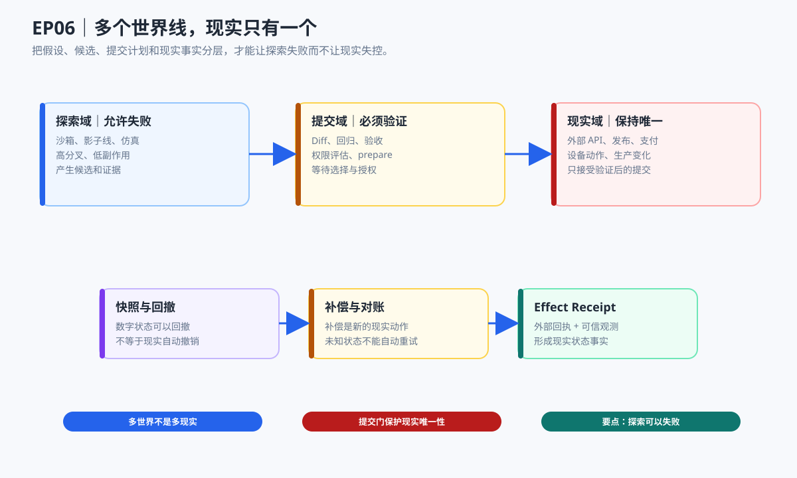

# Agent Computer 06｜为什么 Agent 需要“多个世界”

> 本文是 **Agent Computer** 系列的第 6 篇（共 12 篇），整理自「顽皮的程序员」的 Agent Computer 系列直播。上一篇：[Agent 的一天](https://0x00.community/zh-CN/blog/agent-computer-05-a-day-of-an-agent/)。这里讲的是目标架构和候选的系统机制，需要真实任务、真实连接器和真实风险环境来验证，不是已经具备的通用能力。

Agent 在本地沙箱里改完了代码，测试全部通过，静态检查也通过，Diff 很干净，甚至在模拟部署环境里跑了一遍，结果正常。这时它能不能告诉你“已经修好了”？

如果“修好了”只表示本地候选通过了当前的测试，可以。如果它表示远程分支已经接受、CI 已经通过、生产环境已经部署、用户不再受影响，就不可以。本地环境和现实不是同一个状态空间。

上一篇把任务从意图到回执的九个阶段走了一遍，其中的探索、验证和提交，其实发生在三个不同的地方。真实任务至少同时存在三类状态：可以自由试错的探索状态，等待验证和授权的提交状态，已经对用户和外部系统生效的现实状态。三者混在一起，模型的一次尝试就可能直接变成现实后果；三者完全隔断，探索的结果又交付不出去。这一篇的判断是：

> **Agent 需要多个世界，是为了把假设、候选和现实事实分开：探索可以失败，提交必须验证，现实保持唯一。**

对应的三个域是：

- **探索域**：生成候选、仿真、局部试错，默认不产生不可逆的现实副作用；
- **提交域**：比较 Diff、回归验证、权限评估、候选选择和提交前准备（prepare）；
- **现实域**：写入用户真实目录、外部 API、发布、支付和设备动作，只接收经过验证、选择和授权的结果。其中本地写入可以用版本回撤，其余只能补偿。

提交域和现实域之间有两样东西，后文会反复用到。提交门是检查点；提交代理（External Effect Broker）是唯一有权通过连接器执行现实动作并写下回执的组件。

## 本地成功，为什么现实里仍然可能失败

一个代码修复“在本地成功”，准确的含义是：在某个代码快照、某组依赖、某个操作系统和某些测试数据下，它通过了当前的检查。这是有价值的证据，但边界很明确。它不能证明远程仓库还停在同一个版本，不能证明目标分支允许提交，不能证明 CI 的依赖和本地一致，也不能证明改动已经触达用户。

别的任务也一样：模拟器里一条设备命令执行正确，不代表真实设备在线、固件兼容，也不代表电机真的转到了目标位置。

> **本地成功是候选证据，不是现实成功证明。**

不少产品的进度条最后显示“已完成”，但这个“完成”指的是模型生成完成、本地工具返回、外部 API 返回，还是现实状态已经被确认，往往没有区分。背后是系统里的对象没有分层。

## 世界越多，现实越应该只有一个

允许多条世界线，听起来像是系统承认了多个现实。实际上正相反。在探索阶段，一个文件可以有多个候选版本，一个代码问题可以分别按时区错误、数据口径错误和缓存错误去验证。这些可能性可以并存，因为它们还没有进入现实。

提交之后就不同了。目标分支上到底是哪一个提交，支付是否成功，邮件是否发出，设备是否动作，必须有一个权威的状态，不能让每条世界线根据自己的日志各自宣布。工程团队可以同时评审三份设计稿，但生产数据库不能同时相信三个互相冲突的余额。

所以多世界架构里有一条约束：世界线引擎可以生成候选，却不能成为现实动作状态的权威写者。这条约束的范围要说准确。外部现实的权威在外部系统那里，远程仓库别人也在写，系统管不了；能管的是“我发起了什么动作、拿到了什么回执”这份记录只有提交代理一个写者，缓存、记忆、模型判断和世界线日志都不得充当它。常见的错误正是把缓存里的“已授权”当成当前授权，或者把某条世界线保存的“推送成功”当成远程仓库的状态。

## 多世界线不是多试几次

多世界线不是让三个模型回答同一个问题再按多数票决定，也不是把温度调高多生成几次。世界线围绕同一个 Task Spec，有目的地改变条件、方法、资源或角色组合，形成可以比较的结构。每一次合法的分叉至少要声明两件事：改变了哪个变量，待检验的假设是什么。

沿用上一篇的代码修复案例：主线按“用户时区”解释报表日期，对照线按“商户结算日”解释。改变的变量是日期语义，待检验的假设是哪一种解释能同时满足历史账单、跨时区边界测试和现有接口约束。没有这两项声明的分叉只是重复计算。

常见的世界线形态有几种：多个方案并行的多候选世界线；主线追求快速交付、影子线持续找反例的主线与影子线；分别优化速度、质量、成本或稳健性的多目标世界线；一次只改一个变量的对照世界线；以及在可信设备池中按能力匹配执行的跨设备世界线。最后一种依赖设备证明、权限衰减和跨端信任模型，仍属于有待验证的目标架构。

分支不是越多越好。它需要分叉上限、预算和停止条件，例如预算耗尽、连续两个阶段没有新证据、候选在语义上已经同质、得到了强结论，或者用户主动收束。世界线的价值来自可以归因的信息增量，和数量无关。

每条世界线还要有独立的工作区和能力租约。共享的输入只读，一条线的可写目录不能挂给另一条，否则对照实验会互相污染。隔离的单位也不只是一个目录：git worktree 能隔开工作目录和索引（同一仓库的 worktree 仍共享 refs、配置和钩子），写时复制（Copy-on-Write）快照能隔开整棵目录；两者都隔不开进程、端口、网络和本地数据库。一条线被选中以后应该冻结；关键环境或证据后来发生变化时，派生一条新线，而不是在冻结的记录上原地修补。

## 候选与对照实验：让选择有证据

世界线运行以后产生的是投影，投影还不是候选。它要先通过有效性门和场景适配门（[第 3 篇](https://0x00.community/zh-CN/blog/agent-computer-03-one-standard-answer/)），才进入条件化候选集，并带上适用条件、目标与权衡、证据与置信度、已知限制、资源成本与风险、失效边界和再验证要求。这些字段决定了它以后能不能被正确地召回。授权是否就绪不在这两道门里判断：一个候选通过了两道门、也被选中，但当前没有远程推送权限，它停在提交门前等待授权，不该被记成“失败方案”。

对照实验尽量一次只改一个变量。如果同时换了模型、改了 Prompt、换了数据，就不知道是什么起了作用。即便只改一个变量，单次生成的差异里也混着采样噪声，所以归因要么依赖确定性验收（同一组测试对两份补丁给出确定的结果），要么对每个条件重复采样，看差异是否稳定。

> **没有变量声明的分叉，只是重复；没有失败边界的候选，无法复用。**

用户看到的也不应该只是三个最终文件，而是类似这样的呈现：

- 候选 A：最小 Diff，适合当前的紧急修复，风险是业务日历规则仍然是隐式的；
- 候选 B：显式引入结算日语义，改动更大，长期维护更清楚，需要更广的回归；
- 候选 C：当前无效，因为破坏了历史查询的兼容性，保留失败证据，但不进入现实候选。

## 回撤、补偿与对账：可逆性要分层

常见的说法是“把 Agent 放进沙箱，错了就回滚”。沙箱很重要，但这句话只覆盖了一部分情况。写时复制工作区、快照和版本回撤擅长处理受管的数字状态：文件修改、配置变更、临时数据库、版本对象。它们管不到外部变化。邮件发出以后，恢复本地目录收不回来；付款成功以后，Git reset 改不了余额；设备动过以后，删日志也不能让它回到原位。

因此至少要区分三个概念：

- **回撤**：把受管的数字状态恢复到之前的版本，比如撤销一次文件修改，或者丢弃整条世界线；
- **补偿**：在现实里发起一个新的动作去纠正先前的影响，比如退款、发布更正、撤回权限；
- **对账**：在不知道某个动作是否发生时，查询状态、收集证据，过程中不创建新的执行尝试。

目标架构把可逆性分成四级：单次操作回撤，Planning 阶段回撤（回到上一个计划版本），整条世界线回撤（丢弃一个候选工作区，保留结构化的失败记录），以及现实提交批次的取消、撤销或补偿。前三级是受管数字状态的回撤，第四级不是，也不能笼统承诺：每个现实连接器必须自己声明是否支持取消、撤销或补偿，以及支持的条件；没有声明，就视为不支持。

补偿不是原子回滚。一次发布产生了错误影响，后续的“回滚发布”是一个新的现实动作，需要重新授权，会产生自己的回执，也可能成功、部分成功或进入未知。跨多个连接器的动作序列也没有全局原子性，这和分布式系统里的 saga 是同一种处境：每一步单独提交，失败时走事先声明的补偿。原动作的历史要保留，界面不应该把“已补偿”显示成“从未发生”。三者混用，产品就会提供实际上并不存在的能力，比如在不可逆动作旁边放一个看起来万能的“撤销”按钮。

## 回执：谁来证明现实发生了

Agent 自己证明不了。模型生成的“执行成功”不是证据；本地工具返回 0 不一定代表业务成功；外部 API 返回 200，也可能只表示请求被接受，最终状态还没有完成。

所以现实动作从一份提案（Effect Proposal）开始。它是一个结构，包含动作类型、目标对象、影响范围、授权引用、前置条件、可逆性、补偿策略和回执要求。提案通过提交门后由提交代理经连接器执行，逐项生成回执（Effect Receipt）。

强调“逐项”，是因为一个提交计划可能包含多个动作，比如推送远程分支、创建合并请求、触发部署。前两项成功、第三项失败时，系统既不能说“任务失败”，也不能说“全部成功”。单个动作的规范状态至少有三种：`Committed`（有足够证据证明动作已发生）、`Failed`（有足够证据证明动作没有产生目标效果）和 `Unknown`（既不能证明成功，也不能证明失败）；对一个包含多个动作的批次，还有 `Partially Committed`。

其中最容易被处理错的是 `Unknown`。网络超时只告诉我们没有收到回答，没有告诉我们对方没有执行。把超时当成失败并盲目重试，可能造成重复付款、重复发送、重复发布。未知状态下能做的只有两件事：对账，或者在对端支持的前提下用同一个幂等键重发同一个请求，由对端去重。确实需要换一种方式重新执行时，要新建提案，重新走审查和授权。某个接口声称幂等，也不代表业务上不会产生重复的副作用，这同样要由连接器声明。

> **Agent 的自述不是现实证据，外部回执加可信观测才可能形成关于现实状态的事实。**

## 提交门检查什么

提交门位于探索和现实之间，至少检查：

- 候选是否仍在有效期内，环境和证据有没有变化；
- Diff 和影响范围是否明确；
- 权限和能力租约是否就绪；
- 前置条件和资源锁定是否成功；
- 动作是否可逆、可取消或可补偿；
- 回执与对账策略是否存在。

过期的候选要重新经过适配门，准备失败不能进入提交，权限不足也不能靠模型解释成“风险不高”。

这对产品和组织各有一条要求。产品上，“预览”“应用”“已提交”“未知”“已补偿”是不同的状态，界面可以默认只显示关键状态，但系统内部不能为了简洁而合并语义。组织上，探索者、验证者、选择者和现实执行者不应该共享同一种权力，“自己执行、自己验证、自己宣布成功”的结构要避免。在探索域里，没被选中的世界线同样贡献了信息；要阻止的是探索中的失败泄漏到现实，或者没有证据的状态被写成成功。

## 七个检查问题

评估一个自称“多世界”的 Agent 是真有结构还是只在表演并行，可以问：

1. 分叉是否声明了变量和假设？
2. 每条世界线是否有独立的工作区和租约？
3. 候选是否带着条件、证据和失效边界？
4. 是否区分回撤、补偿和对账？
5. 提交前是否检查 Diff、影响范围和授权？
6. 外部动作是否逐项生成回执？
7. 状态无法证明时，系统是否诚实地进入 `Unknown`？

## 结论

这一篇把“沙箱里跑通了”和“现实里办成了”分成了两件事，中间隔着一个提交域。多世界线扩大的是可以安全探索的空间，提交门和提交代理守住的是系统对现实的那一份唯一记录，多世界并不等于多现实。这套划分依赖两个前提：每个连接器如实声明自己能取消、撤销或补偿什么，以及有一个系统层来签发租约、隔离工作区、把住提交。后者正是下一篇的主题：支撑型 AgentOS 要提供什么，它和 Harness 又有什么不同。

下一篇：[AgentOS 不只是一个运行环境](https://0x00.community/zh-CN/blog/agent-computer-07-agentos-support/)
