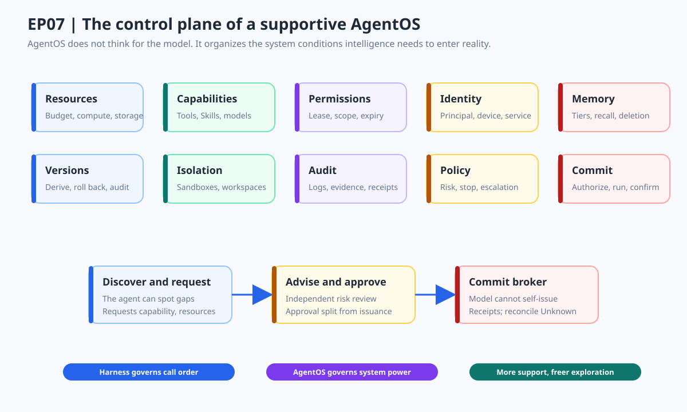

# Agent Computer 07: AgentOS is more than a runtime

> This is part 7 of 12 in the **Agent Computer** series, adapted from the Agent Computer live-stream series. Previous: [Why an agent needs "multiple worlds"](https://0x00.community/blog/agent-computer-06-multiple-worlds/).
> This post describes a methodology, a target architecture and engineering boundaries, not the feature list of a delivered system. For kernel-level isolation, cross-device trust, receipts from real-world connectors and general compensation, any concrete engineering effort has to mark separately what is implemented, what is a candidate and what is still to be verified.

Picture an agent that has to work for several hours straight: reading project material, calling a local model, opening a few worldlines, using a set of tools, editing files, waiting on external systems and finally committing a real-world action. Over that time the system has to answer a string of questions. Who is this agent? Which files can it read, and when do those permissions expire? May it share a workspace with another worldline? How much memory and battery has it used? Did the memory it read cross the task boundary? Who approves the real-world action, and who writes the external receipt?

Many people take AgentOS to mean "an operating system that can run agents": load models, connect tools, start processes, allocate compute. Those abilities are necessary, and they answer none of the questions above.

The last two posts covered the task lifecycle and the split into exploration, commit and reality domains. This post is about the system layer that carries them:

> **A supportive AgentOS is not just somewhere for an agent to run. It organizes resources, capabilities, permissions, identity, memory, versions, isolation, audit, policy and real-world commit into system support that can be verified.**

## Running an agent is not the same as trusting it with long-running work

A typical agent system has a model, a planner, a set of tools and a loop: the model decides the next step, calls a tool, reads the result and decides again. That is enough for a good number of closed tasks. Once a task grows long, spans applications, reads private data or triggers external actions, the structural gaps show.

Three worldlines all need to read the same project material, but each may modify only its own workspace. If the system offers one ordinary directory and one shared process space, the branches contaminate each other. An agent was allowed to read one directory and finds midway that it needs network access. Can it open the network for itself? The system says "done" but the audit log was never written. Is the result acceptable? If audit is a required condition for high-risk actions, it is not.

These questions have nothing to do with the prompt, and model capability alone does not settle them. Tool allowlists and in-chat confirmations cannot say who owns a process, when a permission expires, whether resources are over budget, whether an external action can be undone or compensated, or who answers for the final state.

[Part 1](https://0x00.community/blog/agent-computer-01-answers-vs-tasks/) argued that freedom has to rest on support and a backstop. Here is the concrete version. Without isolation, one mistake contaminates all state. Without snapshots, a failed exploration cannot be walked back. Without short-lived leases, temporary permissions become permanent. Without a commit gate, candidates turn directly into reality. Organizations give new hires working access on the same reasoning: nobody expects a newcomer never to make a mistake, so project scope, approvals, code review and version control keep mistakes within a tolerable range. The more of this a system provides, the more it can afford to let the agent try things in the exploration domain.

## What the Harness, existing mechanisms and AgentOS each cover

A Harness is the orchestration layer around an agent. It defines tool call formats, parameter validation, the loop, context injection, some stopping conditions and local safety rules. All of that remains necessary. But a Harness usually lives inside the agent framework and is not the authoritative control plane of the whole system: it does not decide the global allocation of CPU, NPU, memory and bandwidth, and it should not be the sole writer of authoritative receipts for real-world actions.

> **A Harness constrains how an agent uses capabilities. AgentOS decides whether a capability exists, who may use it, for how long, and how it enters reality.**

It should be said plainly that today's agent tools do not rely on the Harness alone. OS-level sandboxes, containers and lightweight VMs, OAuth scopes, policy engines and audit logs are already in use, and they work. A supportive AgentOS does not propose to replace them. It adds a few things on top that the existing combination does not directly provide:

| Concern | What existing mechanisms already do | What this architecture adds |
| --- | --- | --- |
| Isolation | Sandboxes and containers isolate files and network per process or app | The worldline as the unit of isolation: each candidate of one task has its own workspace, shared inputs are read-only |
| Permissions | OAuth grants are made per app; access tokens are short-lived, but with refresh tokens the grant often lasts a long time and is not withdrawn when a task ends | Short-lived leases issued per task, void when the task ends or the generation changes |
| External actions | Idempotency keys, callbacks and reconciliation are mature in fields such as payments, yet most agent toolchains still treat a successful tool return as done | The same practices unified into a commit gate and per-item receipts, with a timeout that becomes Unknown and gets reconciled |
| Audit | Logs are mostly inspected afterwards; system-level auditing has fail-closed options, but they are rarely wired into whether an agent action is allowed | High-risk actions are refused while audit is unavailable |

The difference is clearest in a case like this: two candidates are running at once, one needs temporary network access and the other is about to push a remote branch. Existing mechanisms can put the whole agent in one sandbox. They do not easily express "this line may use the network for ten minutes, and that line's push needs separate approval and a receipt".

## Definition and boundaries of a supportive AgentOS

A supportive AgentOS is the system's control, isolation and commit plane. It is responsible for who may use which resources within which boundaries, and for how state is isolated, versioned and admitted into reality. What it is not responsible for needs stating just as clearly:

- it is not tied to a particular planner, model, agent framework or chip-specific private API;
- it does not plan tasks or generate candidates for the Agent Runtime, and it does not decide the best answer to a business question;
- it does not interpret operators and hardware topology for the NPU Runtime;
- it does not let the developer toolchain become a backdoor at run time.

The target architecture divides the work this way. The Agent Runtime owns the task data plane, meaning how a task is planned, forked, executed, verified and brought to a close. AgentOS owns the control, isolation and commit plane. The NPU Runtime owns the execution plane for models and hardware. The developer toolchain supplies engineering evidence for development, debugging, reproduction and fault location. Only stable object contracts let a third party swap the planner, the model or a runtime adapter without changing the meaning of permissions and commits.

## Ten kinds of core support

Each item below is a design requirement on the system.

**Resources.** Manage CPU, NPU, memory, bandwidth, storage, network, energy and budget, with quotas, preemption, reclamation and accounting. A shadow worldline cannot drain the main task's budget without limit. The scheduler arranges resources, but that does not give it the power to decide whether an action is legitimate.

**Capabilities.** Models, Skills, tools, Adapters (lightweight adaptation weights attached to a base model) and device capabilities are all expressed as versioned contracts: what is provided, which preconditions apply, how it can fail, which fallbacks exist. A tool that exists is not automatically available to the current task.

**Permissions.** A short-lived Capability Lease is issued per task, with a scope, an expiry and a bound principal. It is not transferable, and lower layers may only narrow it. None of this is a new invention: it is capability-based security combined with short-lived tokens. Compared with the common pattern of a bearer token plus scopes, it makes three demands. Leases are issued per task, not per app (OAuth's Rich Authorization Requests can express a single transaction, but are rarely used). A lease is bound to the holder's key, so passing it on is useless (OAuth has DPoP and mTLS-bound tokens for this; here binding is mandatory). And a lease carries a monotonically increasing generation number, the fencing token of distributed locking, which the enforcement point checks on every call, so a request from an old generation is refused even inside its validity period. The first two make existing standards mandatory; the third is something OAuth itself does not provide. Classic capability models allow delegation, and it is deliberately switched off here.

**Identity.** Users, agents, worldlines, services, devices and real-world connectors are distinct identities. Requesting, reviewing, approving, issuing and executing must not merge into one. A worldline needs its own scope too, or the system cannot tell which candidate a file edit belongs to.

**Memory.** Supply the smallest necessary slice according to the Task Spec, role and capability contract, and record why it was accessed. A copy of a policy held in memory does not stand in for the authoritative authorization fact. Who owns memory and how it is governed is the subject of [part 9](https://0x00.community/blog/agent-computer-09-memory-sovereignty/).

**Versions.** Versioning covers more than files: the Task Spec, plan revisions, environment, capabilities, policy, workspaces and receipts. New evidence produces a new version and a structural diff and does not silently overwrite the old record.

**Isolation.** Isolation covers processes, files, network, devices and worldline workspaces, with shared inputs read-only by default. It also means failing closed: when the gateway is down, tool calls are refused, not allowed to connect directly; when safety review is unavailable, high-risk actions are not waved through. Atomicity across files and processes depends on the actual file system, transaction layer and runtime.

**Audit.** Record who did what and when, on which Spec, lease and evidence, and with what result. Audit is a chain of evidence at run time, not a report written afterwards.

**Policy.** Governance has four layers: the legal, system-integrity and safety floor that cannot be overridden; the device owner's policy; the per-task capability lease; and individual inference and historical preference. The first three are sets of permissions. The effective permission is their intersection, and each upper layer bounds the one below. The fourth layer, preference, grants nothing; it only affects ordering and defaults inside that intersection. Why a preference cannot relax the conditions on an irreversible action is covered in part 9.

**Commit.** A real-world commit first passes the commit gate and is then executed by an independent commit broker (External Effect Broker). The broker manages dry-run, prepare, checking the authorization it was handed, commit, a per-item Effect Receipt, reconciliation of unknown states and compensation. It only checks authorization; it neither approves nor issues. Prepare here is not a participant's durable promise as in two-phase commit. It is a local pre-check before committing, plus a resource reservation where the connector explicitly supports one, such as a payment pre-authorization or a content draft. External state can still change between a passed pre-check and the commit, so the commit carries preconditions. A sequence of actions across several connectors is handled as a saga: each step commits separately, a failure follows the declared compensation, and there is no global atomicity. Exactly-once delivery was never achievable; what can be done is at-least-once delivery with idempotent deduplication. The meaning of the commit states is covered in the [previous post](https://0x00.community/blog/agent-computer-06-multiple-worlds/).

## How support turns freedom into an authorized space

The "support first" sequence, in full:

1. make the task and the choice space explicit;
2. provide context, models, tools, resources and simulation;
3. grant revocable permissions in the exploration domain;
4. verify validity, safety, resources and real-world impact in the commit domain;
5. have policy or the user approve, and then have the single lease issuer issue the lease;
6. let the reality domain execute only actions authorized item by item;
7. collect feedback and feed it into evolution as proposals that can be rolled back.

The most important point in this sequence is that a restriction should, wherever possible, yield an alternative a machine can act on, not just the reply "permission denied". An agent without production write access can still be allowed to edit and test in a sandbox, produce a diff and an impact report, create a pending commit plan, request a minimal temporary lease, or hand the commit entry point to the user for confirmation. A final refusal comes only when every alternative that respects the hard constraints has run out.

Step six has one more detail. An action's parameters, target, scope of impact, authorization reference and version digest are bound together, so that what gets executed cannot differ from what was approved.

## Separation of four powers: autonomy without self-escalation

First, why a model cannot authorize itself. Anything a model reads, whether a web page, a file, a tool result or a memory, may carry instructions. That is prompt injection. As long as the model's output can be steered by what it reads, the model and its context cannot be counted as part of the trusted base. What should be trusted are the lease issuer, the commit broker and the enforcement points, and they accept only structured requests and do not interpret natural language.

On that premise, "can the model authorize things autonomously?" turns out to mix four different powers:

1. **The power to discover.** The agent may notice which capability it lacks, such as permission to read a test data set. This is where autonomy starts and should be as open as possible.
2. **The power to request.** The agent may file a minimal, structured permission request stating why it is needed, how wide the impact is, whether it is reversible and which alternatives exist.
3. **The power to advise on safety.** An independent safety role or policy control point assesses the risk and recommends allowing, refusing or substituting.
4. **The power to approve and issue.** Approval comes from the user or from policy, and issuance is done only by the single lease issuer. Approval is not issuance, and advice is not approval.

> **An agent may discover and request capabilities. It may not issue power to itself.**

The engineering counterpart is a single-writer matrix. Permission requests, safety reviews, approval decisions, lease issuance, real-world action state and receipts are each written by exactly one service identity, with no signing on another's behalf. Separate service identities only mean something if they sit in separate protection domains: separate processes under mandatory access control, with the issuing key held in a hardware keystore or a trusted execution environment, so that no single compromised service can both request and issue. Otherwise splitting into several services is a separation in name only.

## What this changes for products

Users need one control surface showing which tasks and worldlines exist, which models and Skills are in use, how many resources are consumed, which memories were read, what real-world effect the next step will have, and how to stop. Stopping here means a global stop: block new admissions, new tool calls and new real-world actions while keeping the reconciliation service alive, because actions already sent still need their final state confirmed. The emergency stop on a physical device is a different matter, covered in [part 10](https://0x00.community/blog/agent-computer-10-physical-responsibility/).

## Eight questions to ask

To assess a system that calls itself an AgentOS, ask:

1. Does it separate the Agent Runtime, AgentOS and the NPU Runtime?
2. Are permissions issued per task, short-lived, non-transferable and revocable?
3. Are worldlines isolated at the system level, not only by a convention in the prompt?
4. Is memory access minimal and auditable?
5. Are historical versions safe from silent overwriting?
6. When it restricts, does it offer an executable alternative?
7. Do real-world actions pass through an independent commit broker with per-item receipts?
8. When the system is unsure whether it is safe, does it fail closed?

If model output is wired directly to external connectors, or the system keeps letting actions through while the gateway, audit or identity service is down, it is closer to a collection of tools than to a control plane for reality.

## Conclusion

A supportive AgentOS does not think for the model, plan for the planner or run models for the hardware runtime. What it provides is a set of system rules: who may run, how state is isolated and rolled back, and how actions are authorized, committed and audited. The Harness remains the layer of execution protocol and tool constraints, and existing sandboxes and authorization mechanisms remain useful. What this architecture adds is leases, isolation and commit organized around the task and the worldline. Whether it holds up has to be tested with real tasks, real devices and real risk.

The first of the ten kinds of support is resources. When a task runs mainly on the user's own device, memory, bandwidth, power and heat are hard limits, and resources stop being a scheduling question and become the precondition for the whole thing working at all. The next post starts there.

Next: [On-device AI competes on intelligence density](https://0x00.community/blog/agent-computer-08-intelligence-density/)
