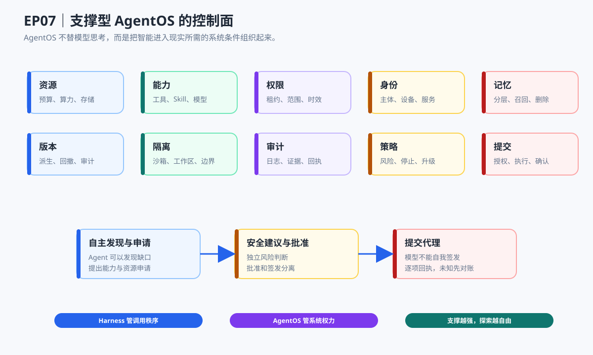

# Agent Computer 07｜AgentOS 不只是一个运行环境

> 本文是 **Agent Computer** 系列的第 7 篇（共 12 篇），整理自「顽皮的程序员」的 Agent Computer 系列直播。上一篇：[为什么 Agent 需要“多个世界”](https://0x00.community/zh-CN/blog/agent-computer-06-multiple-worlds/)。
> 本文描述的是方法论、目标架构和工程边界，不是某个已交付系统的功能清单；内核级隔离、跨设备信任、现实连接器回执和通用补偿，都要在具体工程里分别标明已实现、候选还是待验证。

设想一个 Agent 要连续工作几个小时：读取项目资料，调用本地模型，建立几条世界线，访问一组工具，修改文件，等待外部系统返回，最后提交一个现实动作。这段时间里，系统要回答一串问题：这个 Agent 是谁？它能读哪些文件，这些权限什么时候过期？它和另一条世界线能不能共用工作区？它用了多少内存和电量？它读到的记忆有没有越过任务边界？现实动作由谁批准，外部回执由谁写入？

很多人把 AgentOS 理解成“能运行 Agent 的操作系统”：装模型、接工具、开进程、分配算力。这些能力是必要的，但上面那些问题它们一个也回答不了。

前两篇讲了任务的生命周期，以及探索域、提交域和现实域的划分。这一篇讨论承载它们的系统层：

> **支撑型 AgentOS 不只是给 Agent 一个能跑的环境，它要把资源、能力、权限、身份、记忆、版本、隔离、审计、策略和现实提交组织成可验证的系统支撑。**

## 能运行，不等于能长期托付

典型的 Agent 系统有一个模型、一个 Planner、一组工具和一个循环：模型决定下一步，调用工具，读取结果，再决定下一步。这足以完成不少封闭任务。任务一旦变长、跨多个应用、读取私有数据或触发外部动作，结构上的缺口就会露出来。

三条世界线都要读同一份项目资料，但只能各自修改自己的工作区；如果系统只提供一个普通目录和一个共享的进程空间，分支之间就会互相污染。Agent 先被允许读取一个目录，运行到一半又需要联网，它能不能自己给自己打开网络？系统说“已完成”，审计日志却没有写进去，这个结果能不能接受？如果审计是高风险动作的必要条件，答案是否定的。

这些问题和 Prompt 无关，也不只取决于模型能力。仅靠工具白名单和对话确认，回答不了进程属于谁、权限何时到期、资源是否超预算、外部动作能否撤销或补偿、谁对最终状态负责。

[第 1 篇](https://0x00.community/zh-CN/blog/agent-computer-01-answers-vs-tasks/)提出过，自由要建立在支撑和兜底之上。这里把它说具体：没有隔离，一次错误会污染所有状态；没有快照，探索失败后回不去；没有短期租约，临时权限会变成长期权限；没有提交门，候选直接变成现实。组织给新人工作权限也是这个思路：没有人指望新人永不犯错，靠的是项目范围、审批、代码评审和版本控制，把错误限制在可以承受的范围内。系统越能提供这些，就越敢让 Agent 在探索域里多试。

## Harness、现有机制和 AgentOS 各管什么

Harness 是围绕 Agent 的执行编排层，规定工具的调用格式、参数校验、循环方式、上下文注入、部分停止条件和局部安全规则。这些仍然必要。但 Harness 通常处在 Agent 框架内部，不是整个系统的权威控制面：它决定不了 CPU、NPU、内存和带宽的全局分配，也不应该独自写入现实动作的权威回执。

> **Harness 约束 Agent 如何使用能力；AgentOS 决定能力是否存在、由谁使用、持续多久，以及怎样进入现实。**

需要承认的是，今天的 Agent 工具并不只靠 Harness。操作系统级沙箱、容器和轻量虚拟机、OAuth 授权范围、策略引擎和审计日志都已经在用，而且有效。支撑型 AgentOS 的主张不是替换它们，而是在它们之上补几件现有组合不直接提供的事：

| 问题 | 现有机制已经做到的 | 这套架构主张多出来的 |
| --- | --- | --- |
| 隔离 | 沙箱、容器按进程或应用隔离文件和网络 | 以世界线为隔离主体：同一任务的几个候选各有工作区，共享输入只读 |
| 权限 | OAuth 授权按应用授予；访问令牌虽短，但配合刷新令牌，授权往往长期有效，且不随任务结束收回 | 按任务签发的短期租约，任务结束或代际变化即失效 |
| 对外动作 | 幂等键、回调和对账在支付等领域已经成熟，但多数 Agent 工具链仍把工具返回成功当作完成 | 把这些做法统一成提交门和逐项回执，超时进入未知并对账 |
| 审计 | 日志多为事后可查；系统级审计有失败关闭选项，但很少接到 Agent 的动作放行上 | 审计不可用时，高风险动作不放行 |

差别最明显的场景是这样的：两个候选方案同时在跑，其中一个需要临时联网，另一个准备推送远程分支。现有机制能把整个 Agent 关在一个沙箱里，却不容易表达“这条线可以联网十分钟，那条线的推送要单独批准并留下回执”。

## 支撑型 AgentOS 的定义与边界

支撑型 AgentOS 是系统的控制、隔离与提交面。它负责的是：谁可以在什么边界内使用什么资源，状态如何隔离、版本化并进入现实。它不负责的事同样要说清楚：

- 不绑定某个 Planner、模型、Agent 框架或芯片的私有 API；
- 不替 Agent Runtime 规划任务、生成候选，也不决定某个业务问题的最佳答案；
- 不替 NPU Runtime 理解算子和硬件拓扑；
- 不把开发工具链变成运行时的后门。

目标架构里的切分是：Agent Runtime 管任务数据面，也就是任务如何被规划、分叉、执行、验证和结束；AgentOS 管控制、隔离和提交面；NPU Runtime 管模型与硬件的执行面；开发工具链提供开发、调试、复现和故障定位的工程证据。对象契约稳定，第三方才可能替换 Planner、模型或 Runtime 适配层，而不改变权限和提交的语义。

## 十类核心支撑

下面每一项都是对系统的设计要求。

**资源。** 管理 CPU、NPU、内存、带宽、存储、网络、能耗和预算，支持配额、抢占、回收与分账。一条影子世界线不能无限消耗主任务的预算。调度器负责安排资源，但不因此获得决定某个动作是否合法的权力。

**能力。** 模型、Skill、工具、Adapter（挂在基础模型上的轻量适配权重）和设备能力都表达为版本化的契约：提供什么，需要什么前置条件，可能怎样失败，支持什么降级。工具存在，不等于当前任务可用。

**权限。** 按任务签发短期的 Capability Lease，有范围、有效期和绑定对象，不可转借，下层只能收窄。这并不是新发明，它是能力安全（capability-based security）加短时效令牌的组合。相对常见的“bearer 令牌加 scope”用法，这里有三条要求：按任务而不是按应用签发（OAuth 的 Rich Authorization Requests 可以表达到单次事务，但不常用）；令牌绑定持有者的密钥，使转交无效（OAuth 里对应 DPoP 和 mTLS 绑定令牌，这里要求必须启用）；带单调递增的代际号，也就是分布式锁里的 fencing token，执行点每次调用都校验，旧代际的请求即使还在有效期内也被拒绝。前两条是把已有标准设为强制，第三条是 OAuth 本身不提供的。经典的能力模型允许委托，这里有意把它关掉了。

**身份。** 区分用户、Agent、世界线、服务、设备和现实连接器。请求、审查、批准、签发和执行不能混成同一个身份。世界线也要有自己的作用域，否则系统不知道某次文件修改属于哪个候选。

**记忆。** 按 Task Spec、角色和能力契约提供最小必要的切片，记录访问原因。记忆里保存的策略副本不能替代权威的授权事实。记忆归谁所有、如何治理，见[第 9 篇](https://0x00.community/zh-CN/blog/agent-computer-09-memory-sovereignty/)。

**版本。** 管理的不只是文件，还有 Task Spec、计划修订、环境、能力、策略、工作区和回执。新证据出现时生成新版本和结构 Diff，不静默覆盖旧记录。

**隔离。** 覆盖进程、文件、网络、设备和世界线工作区；共享输入默认只读。隔离还意味着失败关闭：网关不可用时拒绝工具调用，而不是允许工具直连；安全审查不可用时，高风险动作不能自动放行。跨文件、跨进程的原子语义依赖文件系统、事务层和 Runtime 的具体实现。

**审计。** 记录谁在什么时候，基于哪个 Spec、租约和证据，执行了什么，产生了什么结果。审计是运行时的证据链，不是事后补的一份报告。

**策略。** 治理分四层：不可覆盖的法律、系统完整性与安全底线；设备所有者策略；单任务的能力租约；个体化推断和历史偏好。前三层都是许可集合，实际许可是三者的交集，上层是下层的上界；第四层偏好不产生许可，只在这个交集之内影响排序和默认值。偏好为什么不能放宽不可逆动作的条件，见第 9 篇。

**提交。** 现实提交先过提交门，再由独立的提交代理（External Effect Broker）执行。提交代理管理 dry-run、prepare、授权引用的校验、commit、逐项的 Effect Receipt、未知态对账和补偿；它只校验授权，不批准也不签发。这里的 prepare 不是两阶段提交里参与者的持久化承诺，而是提交前的本地预检，加上连接器明确支持时的资源预留，例如支付的预授权、内容的草稿。预检通过到真正提交之间，外部状态仍可能变化，所以提交时要带前置条件。跨多个连接器的动作序列按 saga 处理：每一步单独提交，失败时走已声明的补偿，不存在全局原子性。恰好一次的投递本来就做不到，能做的是至少一次投递加幂等去重。各状态的含义见[上一篇](https://0x00.community/zh-CN/blog/agent-computer-06-multiple-worlds/)。

## 支撑如何把自由变成授权空间

“支撑优先”的顺序可以完整走一遍：

1. 明确任务与选择空间；
2. 提供上下文、模型、工具、资源和模拟；
3. 在探索域授予可撤销的权限；
4. 在提交域验证有效性、安全、资源和现实影响；
5. 由策略或用户做出批准，再由唯一的租约签发方签发租约；
6. 现实域只执行逐项授权的动作；
7. 采集反馈，以可回撤提案的形式进入演进。

这个顺序里最关键的一点是：限制项要尽量产生机器可执行的替代方案，而不是只回复一句“权限不足”。Agent 没有生产写权限时，系统可以让它在沙箱里修改和测试，生成 Diff 和影响报告，创建待提交计划，申请最小范围的临时租约，或者把提交入口交给用户确认。只有当所有不突破硬约束的替代方案都走不通时，才是最终的拒绝。

第六步还有一个细节：动作的参数、目标、影响范围、授权引用和版本摘要要绑定在一起，防止批准的是 A、实际执行的是 B。

## 四权分离：让自主不变成自我扩权

先说为什么模型不能给自己授权。模型读到的任何内容，包括网页、文件、工具返回和记忆，都可能携带指令，这就是提示注入。只要模型的输出可能被它读到的东西操纵，模型和它的上下文就不能算在可信部分之内。可信的应当是租约签发方、提交代理和执行点，它们只接受结构化请求，不解释自然语言。

在这个前提下，“模型能不能自主授权”其实混着四种不同的权力：

1. **自主发现权**：Agent 可以发现自己缺少什么能力，比如没有权限读取某个测试数据集。这是自主性的起点，应当尽量开放。
2. **自主申请权**：Agent 可以提出最小化、结构化的权限申请，说明为什么需要、影响范围多大、是否可逆、有什么替代方案。
3. **安全建议权**：独立的安全角色或策略控制点评估风险，给出允许、拒绝或替代建议。
4. **批准与签发权**：批准来自用户或策略，签发只由唯一的租约签发方完成。批准不等于签发，建议也不等于批准。

> **Agent 可以发现和申请能力，但不能给自己签发权力。**

工程上对应的是单写者矩阵：权限申请、安全审查、批准决定、租约签发、现实动作状态和回执，每一类权威对象只有唯一的服务身份可以写入，不能代签。服务身份的分离要落在不同的保护域上才有意义：独立进程加强制访问控制，签发密钥放在硬件密钥库或可信执行环境里，使任何单个被攻破的服务都无法既申请又签发。否则分成几个服务也只是名义上的分离。

## 对产品的影响

用户需要一个统一的控制面，看得到当前有哪些任务和世界线、用了哪些模型和 Skill、占用了多少资源、读取了哪些记忆、下一步会产生什么现实影响，以及怎样停下来。停下来指的是全局停止：阻断新的准入、新的工具调用和新的现实动作，同时保留对账服务，因为已经发出的动作还需要确认最终状态。物理设备上的急停是另一回事，见[第 10 篇](https://0x00.community/zh-CN/blog/agent-computer-10-physical-responsibility/)。

## 八个检查问题

评估一个自称 AgentOS 的系统，可以问：

1. 是否把 Agent Runtime、AgentOS 和 NPU Runtime 分开？
2. 权限是否按任务签发、短期有效、不可转借，并且可以撤销？
3. 世界线是否在系统层隔离，而不是只靠 Prompt 约定？
4. 记忆访问是否最小化且可审计？
5. 历史版本是否不会被静默覆盖？
6. 限制时是否提供可执行的替代方案？
7. 现实动作是否经过独立的提交代理和逐项回执？
8. 当系统不确定自己是否安全时，是否失败关闭？

如果模型的输出直接连到外部连接器，或者网关、审计、身份服务不可用时仍然继续放行，这个系统更接近一组工具的集合，还称不上现实的控制面。

## 结论

支撑型 AgentOS 不替模型思考，不替 Planner 做计划，也不替硬件 Runtime 执行模型。它提供的是一套系统制度：谁能运行，状态怎样隔离和回撤，动作怎样授权、提交和审计。Harness 仍然是执行协议和工具约束的那一层，现有的沙箱和授权机制也仍然有用；这套架构主张多出来的，是以任务和世界线为单位的租约、隔离和提交。它成立与否，要靠真实任务、真实设备和真实风险环境来检验。

十类支撑的第一类是资源。当任务主要在用户自己的设备上运行时，内存、带宽、功耗和散热都是硬约束，资源就从一个调度问题变成了整件事能不能成立的前提。下一篇从这里讲起。

下一篇：[端侧 AI 比的是智能密度](https://0x00.community/zh-CN/blog/agent-computer-08-intelligence-density/)
