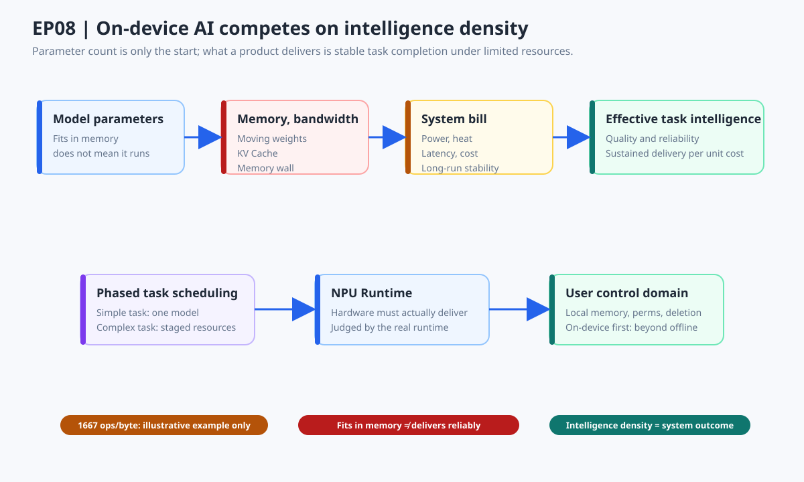

# Agent Computer 08: On-device AI competes on intelligence density

> This is part 8 of 12 in the **Agent Computer** series, adapted from the Agent Computer live-stream series. Previous: [AgentOS is more than a runtime](https://0x00.community/blog/agent-computer-07-agentos-support/).
> This post is about an evaluation method and a target architecture. It gives no measured performance for any device, and it marks every place that needs verification on real hardware.

Discussion of on-device AI is often squeezed into one number: how large a model this device can run. Product material says "supports very large models" and that sounds like the whole answer.

Users, though, do not care whether the model file fits. They care how long it takes to start responding after they speak, whether it slows down after half an hour of continuous work, whether the device heats up and throttles, whether the model gets unloaded when another task runs, and whether the system reduces interruptions or keeps them confirming and waiting. Parameter count answers none of these.

The previous post ended by noting that the first of the ten kinds of support is resources. This post looks at that on hardware:

> **On-device AI competes on how much effective task intelligence each unit of system cost reliably delivers under limited resources, and not on how many parameters the model has.**

## Why long-running tasks belong on the device

One question has gone unanswered so far: if on-device resources are this tight, why put the task here at all.

The value of on-device is often summed up as "it works without a network", and offline use is only part of it. Long-running tasks need a long-term private understanding of one person, local memory that can be governed, low-latency access to local tools and devices, a low marginal cost of inference, and user control over models, data, permissions and deletion. The cloud can take on unfamiliar tasks, heavy reasoning, arbitration or extra compute, but it is a poor fit as the only home of a user's long-term private knowledge.

On-device should not be romanticized either. A device being local does not make it trusted, and actions on local devices still pass through the commit gate. [Part 10](https://0x00.community/blog/agent-computer-10-physical-responsibility/) covers that.

## More parameters does not always deliver more intelligence

Parameter count is a property of the model. Intelligence density is a property of the system. Operationally it can be read as "qualifying tasks divided by resources": a task qualifies when it meets the quality, safety and latency thresholds together, and the resource can be memory, sustained power, hardware cost or user attention. It resembles goodput and performance per watt in serving systems. Because there is more than one resource, it is not a scalar. To say option A is higher than option B, you have to state which thresholds are held fixed and which resource is being compared.

Picture two on-device designs. Option A uses one larger model that stays resident from start to finish. It reasons better on open questions, but every simple tool call pays the same high resource cost, and it holds memory while idle. Option B uses a mid-sized planning model, a specialist execution model, a small tool-calling model and an independent verification model, activated and put to sleep by task phase. Any single model in option B may have fewer parameters than option A, but if B finishes more qualifying tasks within the same power and waiting budget, its intelligence density in that comparison is higher.

The reverse holds too. Several small models are not automatically better. If they keep passing long contexts to each other, reloading models and copying the KV Cache, and still need a large model to merge the results, the cost of organization can exceed the gain from dividing the work.

## The bottleneck is not only compute

The most common metric in on-device discussion is TOPS (trillions of operations per second). It describes a piece of hardware's peak arithmetic capacity under a particular counting convention, and it cannot describe what a long-running agent feels like. At least these other constraints act at the same time:

- memory capacity and memory bandwidth: capacity decides whether models, caches and workspaces fit, bandwidth decides how fast that data can be read and written;
- KV Cache footprint and context length: the cache takes space and also causes continuous data reads during decoding;
- model loading and switching cost: switching often between large and small models can consume the entire scheduling gain;
- compilation, scheduling and recovery in the NPU Runtime;
- power, heat and tail latency: a short peak is not sustained performance, and what users feel is the slowest wait in a long task;
- context copying and result merging across agents;
- the attention cost of asking the user to keep confirming.

The last item is easy to overlook. If the system asks for confirmation at every step, the model may be efficient computationally while the task's actual autonomy is low. The user's waiting, window switching and repeated input all belong in the system cost. A model can therefore "fit" in terms of capacity and still fail to finish real tasks reliably because of first-token latency, sustained power, degradation on long contexts or switching cost.

## The memory wall: reading one number with the Roofline model

The Roofline model tells you whether a workload is limited by compute or by memory bandwidth. Divide the machine's peak compute by its memory bandwidth and you get a ridge point in ops/byte, which is a property of the machine. The workload's own arithmetic intensity, the number of operations it performs per byte read from memory, is a property of the workload. Above the ridge point the workload is compute-bound. Below it, the workload is bandwidth-bound.

The white paper gives a set of parameters for a worked example, equivalent to 3200 TOPS of peak compute and 1.92 TB/s of memory bandwidth:

> 3.2 × 10¹⁵ ops/s ÷ 1.92 × 10¹² bytes/s ≈ **1667 ops/byte**

These parameters are not measured values of any device, and 1667 ops/byte is only an illustrative back-of-the-envelope figure. It is not a performance commitment and cannot by itself tell you a product's throughput. Its use is to give the following comparison a reference point.

In single-stream autoregressive decoding of a dense model, each weight takes part in one multiply-add per generated token. If a multiply-add is counted as two operations, 8-bit integer weights have an arithmetic intensity of about 2 ops/byte and 4-bit weights about 4 ops/byte, two to three orders of magnitude (about 400 to 800 times) below the ridge point above. Under these parameters, then, single-stream decoding can use only a small fraction of peak compute, and its speed is bounded at roughly memory bandwidth divided by the weight bytes that must be read per token. This is an upper bound that follows from the model's structure. KV reads, scheduling and heat push the real figure lower, and it needs to be confirmed by measurement.

Several engineering directions follow:

- Move fewer weight bytes per token. Low-bit quantization makes each weight occupy fewer bytes, so the same bandwidth feeds more operations. The main cost is accuracy, plus unpacking overhead on hardware that does not support that bit width natively.
- Raise arithmetic intensity. If several worldlines on the same model can be decoded as a batch, the weights are read once and serve several sequences, and arithmetic intensity grows roughly linearly with batch size. The cost is a separate KV Cache per sequence. Whether running lines in parallel pays off therefore depends on whether they share weights or merely copy context.
- Spend capacity on holding several models, Adapters (lightweight adaptation weights attached to a base model), contexts and task workspaces at once, not only on one larger model.

## Keep the model ceiling and the model sweet spot apart

The sentence "the device supports models of such-and-such size" can mix at least three different meanings.

The first is a capacity ceiling: with low-bit quantization, low concurrency and a limited context, the model file fits on the device. That is an engineering estimate, not a throughput test. The second is a performance ceiling: what the system actually reaches for a specific model, precision, context, concurrency and runtime, which takes benchmarking on the real machine. The third is the model sweet spot: the range of models whose quality, latency, power and temperature are acceptable and predictable in steady state and that suit long-running use.

One "supports up to" cannot cover all three, because quantization precision, KV Cache needs and model structure all change the conclusion. The same parameter count can occupy very different amounts of memory at different precisions. In a mixture-of-experts model, total parameters set the capacity footprint and active parameters set the weights read and computed per token, but the expert weights that are not activated do not vanish from memory.

Any number about capacity or throughput should therefore say whether it is measured, derived, estimated or simulated, and conclusions should reach only as far as evidence from real hardware does.

## The KV Cache: why long tasks get slower

One of the biggest risks in a long task is context that only grows. A longer context means a larger KV Cache, more data per decoding step and rising latency. When memory is nearly full the context gets truncated and important information is lost.

A larger context window does not solve this. Context governance and cache management have to work together. Context governance handles trimming, deduplication, hierarchical organization and prefix stability: the stable system layer and task definition go first, and changing retrieval results and temporary content go last, so that prefixes can be reused. Cache management handles retention, reuse and release. One caveat matters here: a KV Cache can only be reused by prefix. Change anything in the middle of the context and all KV after that point is invalid and must be recomputed. It cannot be evicted entry by entry like an ordinary cache, so trimming and deduplication should be concentrated at phase boundaries, with the recomputation cost counted in scheduling.

The goal is that decoding latency after an hour of running is not noticeably worse than after five minutes. Whether that goal is met can only be established by long tests on real hardware. Power works the same way: a design that is twice as fast but throttles quickly from heat is not necessarily better than a slightly slower one that runs steadily for hours.

## Model tiering and phased task scheduling

Different phases of a complex task need different capabilities:

- intent understanding and planning: a stronger model, in a short burst;
- specialist execution: a mid-sized model plus a domain Adapter;
- tool calls and formatting: a smaller model, with the emphasis on determinism;
- counter-evidence and safety review: an independent model or role, to avoid sharing bias with the execution model;
- verification and synthesis: a mid-sized to stronger model;
- idle waiting: nothing loaded, or asleep.

So an on-device system does not have to run one largest model from start to finish. It can schedule by phase. The scheduler makes three kinds of decisions: when to preload the next phase's model, which models stay resident and which are unloaded after use, and how to balance energy against completion.

This differs from token-level mixture-of-experts routing. There the switching delay is close to zero and the expert weights usually all stay in memory. Phased task scheduling happens at phase boundaries, where a switch may cost seconds, so it can only be coarse and infrequent. It lets models the current phase does not need be absent from memory altogether, at the price of facing loading and context handoff costs squarely.

It therefore comes with explicit fallback conditions. When the task is simple enough, fall back to a single model. When switching costs too much, prefer keeping models resident. When phased scheduling does not produce a stable Pareto improvement in quality, power and latency (at least one gets better and none gets worse), return to the single-model baseline.

> **Organization is not the goal. A stable system-level gain is.**

## The NPU Runtime: hardware capability has to be delivered through the runtime

The NPU Runtime covers a model's whole life cycle: compilation, precompiled graphs, loading, scheduling, execution, monitoring, fault handling and recovery. Whether many architectural ideas are usable depends on it.

"More chiplets means linearly faster", "Adapters can be hot-swapped at any time", "any model can be re-partitioned dynamically", "several models share base weights": none of these can stand on an architecture description. They need evidence from real chips, compilers and runtimes.

Where evidence is short, the sensible course is to give a fallback path and say so plainly. If physical partitioning is not supported, the system should fall back to logical quotas, queues and whole-instance scheduling. If a cache cannot be migrated losslessly across devices, fault recovery can drop the cache and recompute. If hard preemption is unavailable, a soft cancel at a safe point will do. At the same time, mark which capabilities are verified, which are engineering estimates, which are candidate mechanisms and which are still to be verified on real hardware.

## Ask first what it finishes reliably

When assessing an on-device AI product, ask these seven questions before asking how large a model it can run:

1. Under explicit quality and safety thresholds, which tasks does it finish reliably?
2. Are the model ceiling and the model sweet spot stated separately?
3. Over long runs, do KV, tail latency and temperature degrade?
4. Does phased task scheduling really lower total cost, with preloading, unloading, context handoff and merging counted in?
5. Are memory and bandwidth more likely to be the bottleneck than peak TOPS?
6. Which NPU Runtime capabilities are measured, and which are only target architecture?
7. Can the user control models, memory, permissions, devices and deletion?

The third deserves one more remark. Short benchmarks hide long-term problems easily. Look at how first-token time, decoding speed, memory use and thermal state change after the task has run for an hour, and for several hours.

## Conclusion

This methodology holds that on-device AI should be compared on system-level intelligence density and not on raw parameter count. Hardware sets the limits on memory, bandwidth, power, latency, heat and cost. Model tiering and phased scheduling decide how those resources are organized. The NPU Runtime decides whether architectural ideas can be delivered. Every conclusion about throughput, the sweet spot, long-context behavior and multi-chiplet scaling has to be stated at its evidence tier, and phased scheduling is worth keeping only where it produces a reproducible improvement.

> **On-device first is about putting long-term intelligence back in a domain the user controls, whether or not the network is up.**

With long-term intelligence back in the user's control domain, the next question is what the system remembers about you inside that domain, and who those memories belong to.

Next: [An AI that remembers you is not the same as owning your memory](https://0x00.community/blog/agent-computer-09-memory-sovereignty/)
