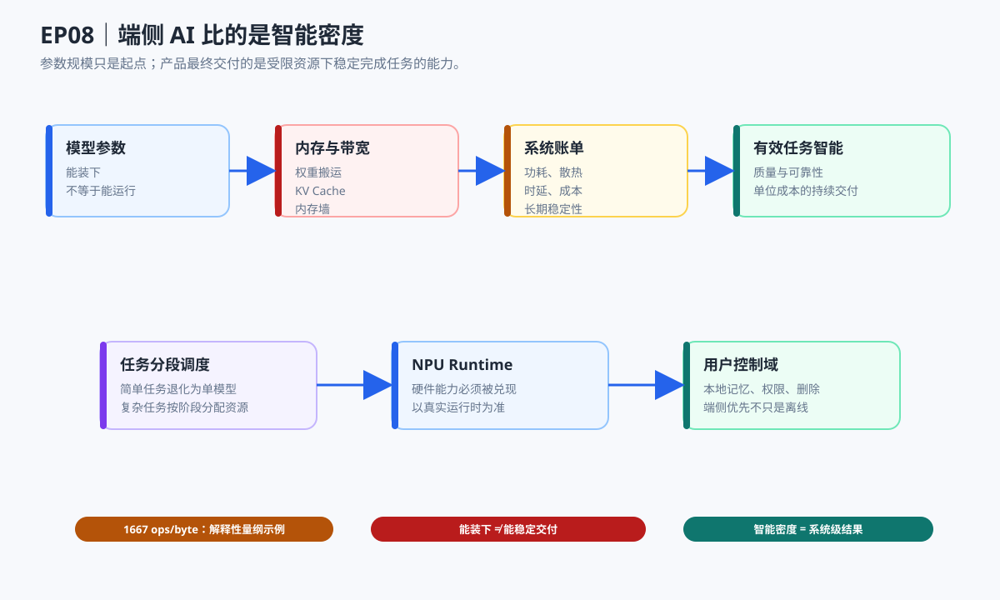

# Agent Computer 08｜端侧 AI 比的是智能密度

> 本文是 **Agent Computer** 系列的第 8 篇（共 12 篇），整理自「顽皮的程序员」的 Agent Computer 系列直播。上一篇：[AgentOS 不只是一个运行环境](https://0x00.community/zh-CN/blog/agent-computer-07-agentos-support/)。
> 本文讨论的是评估方法和目标架构，不给出任何设备的实测性能；凡是需要真实硬件验证的地方都会标出来。

端侧 AI 的讨论经常被压缩成一个数字：这台设备能跑多大的模型。产品材料写上“支持超大模型”，听起来就像回答了全部问题。

但用户关心的并不是模型文件能不能放进去。他关心的是：说一句话以后多久开始回应，连续工作半小时后会不会越来越慢，设备会不会发热降频，另一个任务运行时模型是不是要被卸载，系统是在减少打扰还是让人不停地确认和等待。这些问题没有一个能用参数规模回答。

上一篇结尾说，十类支撑的第一类是资源。这一篇把它放到硬件上看：

> **端侧 AI 比的是在受限资源下，单位系统成本能稳定交付多少有效任务智能，而不是模型参数有多大。**

## 为什么长期任务要放在端侧

先回答一个前面一直没正面回答的问题：既然端侧资源这么紧，为什么还要把任务放在这里。

端侧的价值常被概括为“没网也能用”，离线只是其中一部分。长期任务需要的是对一个人的长期私有理解、可治理的本地记忆、对本地工具和设备的低时延访问、较低的边际推理成本，以及用户对模型、数据、权限和删除的控制。云端可以承担陌生任务、强推理、裁判或算力补充，但不适合成为用户长期私有认知的唯一去处。

端侧也不该被浪漫化：设备在本地不等于可信，本地设备的动作同样要经过提交门，这一点见[第 10 篇](https://0x00.community/zh-CN/blog/agent-computer-10-physical-responsibility/)。

## 参数更大，不一定交付更多智能

参数规模是模型的属性，智能密度是系统的属性。操作上，智能密度可以理解为“达标任务数除以资源”：达标指任务同时满足质量、安全和时延门槛，资源可以是内存、持续功耗、硬件成本或用户注意力。它类似服务系统里的有效吞吐和每瓦性能。因为资源不止一种，它不是一个标量；说方案 A 高于方案 B，必须指明固定的是哪一组门槛、比较的是哪一种资源。

设想两个端侧方案。方案 A 用一个更大的模型，从任务开始到结束一直常驻。它在开放问题上推理更强，但每一次简单的工具调用也要付出同样高的资源成本，空闲时还占着内存。方案 B 用一个中等规模的规划模型、一个专业执行模型、一个小的工具调用模型和一个独立的验证模型，按任务阶段激活和休眠。方案 B 里任何单个模型的参数都可能小于方案 A，但如果它在同样的功耗和等待预算下完成了更多达标任务，它在这个比较里的智能密度就更高。

反过来也成立。多个小模型并不天然更好：如果它们之间频繁传递长上下文、重复加载模型、复制 KV Cache，最后还要一个大模型来合并结果，组织成本可能超过分工带来的收益。

## 瓶颈不只在算力

端侧讨论里最常见的指标是 TOPS（每秒万亿次运算）。它描述某个硬件在特定口径下的峰值运算能力，却不能单独说明一个长期运行的 Agent 体验如何。同时起作用的约束至少还有这些：

- 内存容量和内存带宽：容量决定能否容纳模型、缓存和工作区，带宽决定这些数据能多快被读写；
- KV Cache 占用与上下文长度：缓存不只占空间，解码时还带来持续的数据读取；
- 模型装载和切换成本：频繁在大小模型之间切换，可能把调度收益全部吃掉；
- NPU Runtime 的编译、调度和恢复；
- 功耗、散热和尾时延：短时间的峰值不等于长期稳定的性能，用户感受到的是长任务里最慢的那一段等待；
- 多 Agent 的上下文复制与结果合并；
- 用户持续确认带来的注意力成本。

最后一项容易被忽略。如果系统每一步都要求用户确认，模型在计算上可能很高效，任务的实际自主度却很低。用户的等待、窗口切换和重复输入，都应该算进系统成本。所以一个模型可以在容量上“装得下”，却因为首 Token 延迟、持续功耗、长上下文退化或切换成本，无法稳定完成真实任务。

## 内存墙：用 Roofline 看一个数字

判断一个负载受算力还是受内存带宽限制，可以用 Roofline 模型。机器的峰值算力除以内存带宽，得到一个拐点，单位是 ops/byte，它是机器的属性。负载自己的算术强度，即每从内存读一个字节做多少次运算，是负载的属性。算术强度高于拐点，负载受算力限制；低于拐点，受带宽限制。

白皮书给定了一组参数做算术示例，相当于 3200 TOPS 的峰值算力和 1.92 TB/s 的内存带宽：

> 3.2 × 10¹⁵ ops/s ÷ 1.92 × 10¹² bytes/s ≈ **1667 ops/byte**

这组参数不是任何设备的实测值，1667 ops/byte 也只是一个解释性的量纲示例，不是性能承诺，不能单独推出某个产品的吞吐。它的用处是让下面的比较有一个参照。

单路自回归解码时，稠密模型的每个权重每生成一个 Token 只参与一次乘加。若按一次乘加计 2 次运算，8 位整数权重的算术强度约为 2 ops/byte，4 位权重约为 4 ops/byte，比上面的拐点低两到三个数量级（约 400 到 800 倍）。也就是说，在这组参数下，单路解码只能用到峰值算力的很小一部分，速度的上界大致是“内存带宽除以每个 Token 必须读取的权重字节数”。这是由模型结构推出的上界，实际还会被 KV 读取、调度和散热进一步压低，需要实测确认。

由此可以看出几个工程方向：

- 减少每个 Token 要搬运的权重字节。低比特量化让每个权重占用更少字节，同样的带宽能喂给更多次运算；主要代价是精度损失，在不原生支持该位宽的硬件上还要付出解包开销。
- 提高算术强度。同一个模型上的多条世界线如果能合批解码，权重只读一次、服务多条序列，算术强度随批大小近似线性提高，代价是每条序列各自的 KV Cache。所以多线并行是否划算，取决于共享的是权重，还是在复制上下文。
- 把容量用在同时容纳多个模型、Adapter（挂在基础模型上的轻量适配权重）、上下文和任务工作区上，而不只是装一个更大的单模型。

## 模型上限和模型甜区要分开

“设备支持某某规模的模型”这句话，至少可能混着三种不同的意思。

第一种是容量上限：在低比特量化、低并发和受限上下文下，模型文件从容量上可以放入设备。这是工程估算，不是吞吐测试。第二种是性能上限：在特定模型、精度、上下文、并发和运行时下，系统实际达到的性能，这需要实机基准测试。第三种是模型甜区：在稳态下，质量、时延、功耗和温度都可接受、可预期，适合长期运行的模型范围。

三者不能用一句“支持多大”混在一起，因为量化精度、KV Cache 需求和模型结构都会改变结论。同样的参数规模，不同量化精度占用的内存可以相差很多；混合专家结构的总参数决定容量占用，活跃参数决定每个 Token 要读取和计算的权重，但没被激活的专家权重并不会自动从内存里消失。

所以涉及容量和吞吐的数字，都应该标明是实测、推导、估算还是模拟结果；真实硬件的证据覆盖到哪里，结论就说到哪里。

## KV Cache：长任务为什么越跑越慢

长任务最大的风险之一是上下文单调增长。上下文越长，KV Cache 越大，每一步解码要处理的数据越多，时延逐渐上升；内存快满时被迫截断，重要信息又丢了。

把上下文窗口做得更大解决不了这个问题，需要上下文治理和缓存管理配合。上下文治理负责裁剪、去重、层级组织和前缀稳定：稳定的系统层和任务定义放在前面，变化的检索结果和临时内容放在后面，便于前缀复用。缓存管理负责保留、复用和释放。需要注意，KV 只能按前缀复用：改动上下文中间的任何一处，其后的 KV 全部作废、要重新计算。所以它不能像普通缓存那样按条目淘汰，裁剪和去重应当集中发生在阶段边界，并把重算成本计入调度。

目标是让任务运行一小时后的解码时延，和运行五分钟时相比没有显著退化。这个目标是否达成，只能靠真实硬件上的长时间测试来验证。功耗也是同样的道理：一个方案如果快一倍，却因为温度很快降频，未必比稍慢但能稳定运行几小时的方案更好。

## 模型分层与任务分段调度

复杂任务的不同阶段需要不同的能力：

- 意图理解与规划：较强的模型，短时爆发；
- 专业执行：中等模型加领域 Adapter；
- 工具调用与格式化：较小的模型，强调确定性；
- 反证与安全审查：独立的模型或角色，避免和执行模型同源偏差；
- 验证与综合：中等至较强的模型；
- 空闲等待：不加载或休眠。

所以端侧系统不一定要让一个最大的模型从头跑到尾，可以按阶段调度。调度器要做三类决定：什么时候预加载下一阶段的模型，哪些模型常驻、哪些用完卸载，以及怎样在能耗和完成度之间取得平衡。

这和 Token 级的混合专家路由不同。后者切换延迟接近零，专家权重通常都常驻在内存里；任务分段调度发生在阶段边界，切换成本可能以秒计，只能是粗粒度、低频率的。它允许当前阶段用不到的模型完全不在内存中，代价是必须正视装载和上下文交接的成本。

因此它带着明确的回退条件：任务足够简单时，回退为单模型；切换成本过高时，倾向常驻；分段调度在质量、功耗和时延上没有形成稳定的帕累托改善（至少一项变好，且没有一项变差）时，回到单模型基线。

> **组织化不是目的，稳定的系统级收益才是目的。**

## NPU Runtime：硬件能力要经过运行时兑现

NPU Runtime 负责模型的整个生命周期：编译、预编译图、装载、调度、执行、监控、故障处理和恢复。很多架构设想能不能用，取决于它。

“芯粒越多越线性快”“Adapter 可以随时热切换”“任意模型都能动态重切分”“多个模型共享基础权重”，这些说法都不能只靠架构描述成立，需要真实芯片、编译器和运行时的证据。

证据不足时，合理的做法是给出回退路径，并且把话说清楚。如果物理切分不被支持，系统应回退为逻辑配额、队列和整实例调度；如果缓存无法跨设备无损迁移，故障恢复可以丢弃缓存后重新计算；如果硬抢占不可用，可以在安全点做软取消。同时要标明哪些是已验证的能力，哪些是工程估算，哪些是候选机制，哪些仍待真实硬件验证。

## 先问“稳定完成什么”

评估一个端侧 AI 产品时，与其问最大能跑多大的模型，不如问这七个问题：

1. 在明确的质量和安全门槛下，它能稳定完成哪些任务？
2. 模型上限和模型甜区是否分开说明？
3. 长时间运行时，KV、尾时延和温度是否退化？
4. 任务分段调度是否真的降低了总成本，预加载、卸载、上下文交接和合并的成本算进去了吗？
5. 内存和带宽是否比峰值 TOPS 更可能成为瓶颈？
6. NPU Runtime 的能力哪些已实测，哪些只是目标架构？
7. 用户是否能控制模型、记忆、权限、设备和删除？

第三个问题值得多说一句：短的基准测试很容易掩盖长期问题，要看任务运行一小时、几小时以后，首 Token、解码速度、内存占用和热状态如何变化。

## 结论

这套方法论主张，端侧 AI 的比较单位应当从裸参数转向系统级的智能密度：硬件划定内存、带宽、功耗、时延、散热和成本的边界，模型分层与分段调度决定这些资源怎样被组织，NPU Runtime 决定架构设想能否兑现。其中每一个涉及吞吐、甜区、长上下文表现和多芯粒扩展的结论，都要按证据等级来表述；分段调度只有形成可复现的改善时才值得保留。

> **端侧优先的核心不是断网，而是把长期智能放回用户可控制的域。**

长期智能回到了用户的控制域，接下来的问题是：系统在这个域里记住了关于你的什么，这些记忆又归谁。

下一篇：[AI 记住你，不等于你拥有自己的记忆](https://0x00.community/zh-CN/blog/agent-computer-09-memory-sovereignty/)
