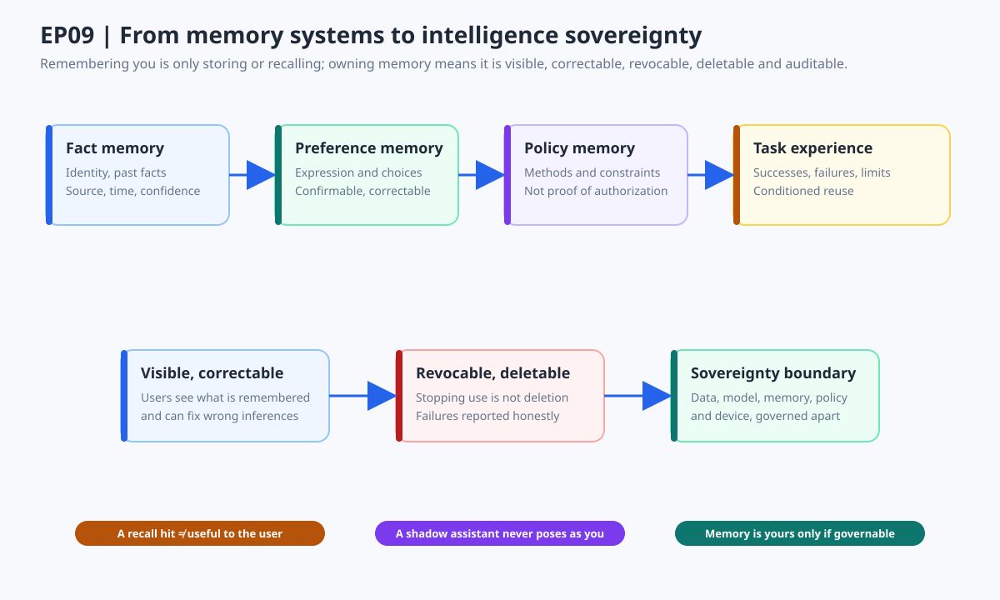

# Agent Computer 09: An AI that remembers you is not the same as owning your memory

> This is part 9 of 12 in the **Agent Computer** series, adapted from the Agent Computer live-stream series. Previous: [On-device AI competes on intelligence density](https://0x00.community/blog/agent-computer-08-intelligence-density/).
> This post is about principles and a target architecture. A separate section near the end says which parts have not been verified.

More and more AI products tell you they can remember your preferences, the things you have done and the way you like things phrased. "It remembers what I like" sounds like a feature question, and in daily use it is convenient.

There is an uncomfortable question underneath. Why would the system remembering you mean that you own that memory? What it keeps may be a chat transcript, a factual claim, a preference, a copy of a policy, an experience from a task, or its own inference about you. Once these are mixed together, the user can hardly tell what the system actually remembers, on what basis, who may read it, whether it can be corrected, whether the system can be made to stop using it, and which layer a so-called "delete" really reaches. If none of that is possible, the memory looks more like a user profile kept inside a platform.

The previous post ended by saying that on-device first means putting long-term intelligence back in a domain the user controls. This post is about the most sensitive part of that domain:

> **An AI remembering you only shows that the system stored or recalled some information. Memory can belong to you only when it is visible, correctable, revocable and deletable, when it is clear which record is authoritative, and when access is auditable.**

## Memory is more than chat history

Many products treat memory as saving past conversations and retrieving the relevant parts next time. That is a memory capability, but chat history only answers "what was said before". It does not answer "what should the system now govern as a long-term object".

A user says in one chat, "use a conservative tone for this report". That may be a one-off requirement for the current task, and the system cannot turn that single sentence into a permanent "this user always prefers a conservative tone". A user says, "our project launches next week". That is a project fact, but it has a source and a shelf life, and once the launch date moves it cannot stay on as a fact that never expires. A subtler case is the system concluding by itself that "this user values speed over cost". There may be some basis for it, or it may be a coincidence across a few tasks. Unless it is marked as an inference and the user can correct it, it quietly turns from a model's guess into a user profile.

A memory system therefore has to separate at least three things: what the raw information is, what the system extracted from it, and which extractions qualify for long-term memory. If everything is called "memory", there is no way to tell what may be recalled proactively, what may be used only within the current task, and what has to be confirmed against the authoritative policy source.

More memory does not mean deeper understanding; memory first needs a type, a source and a boundary. So Agent Computer cannot be designed around a single memory switch. It needs memory objects, each with a source, a lifecycle, a read scope, a version and a governance state.

## Four kinds of memory: facts, preferences, policy, task experience

Memory is split into four kinds because their factual standing and their governance differ.

**Facts** are verifiable statements about the user, a project or the environment: who leads the project, which version a document is, what state a device is in. A fact must carry a source, a validity period and a confidence level. Writing it into a memory store does not make it true. It remains a claim with a period of applicability, waiting for evidence. Dynamic content such as prices, regulations and device state runs a high risk of going stale when frozen into long-term memory without time or source, and is better left in a data layer that can be updated, cited and deleted.

**Preferences** are a user's stable choices about expression, pace, cost or risk, such as wanting the conclusion first or preferring local processing. Preferences can be viewed and edited and they save repeated explanation, but they cannot override an explicit requirement of the current task and they cannot stand in for current authorization. That a user has often picked one supplier does not let the system place an order with it this time.

> **Past preferences can lower uncertainty about intent. They cannot lower the inherent risk of an irreversible action.**

**Policy** covers the permission, risk, resource and real-world commit rules set by the owner, together with the system's safety floor. One engineering prohibition applies here: a projection of policy held in memory must never be the source of truth for authorization. A policy copy in memory may be stale or tampered with. If a cached "camera access allowed" could replace the authoritative lease and the policy decision, then poisoning the cache would amount to privilege escalation. Memory may tell the agent which permissions this kind of task used in the past, but whether something is allowed now has to be decided again against the authoritative policy and lease objects. The memory layer supplies context and the authorization component decides. The two duties stay separate.

**Task experience** is a record that under a certain set of conditions a certain structure was used and a certain result followed. It is not the sentence "this worked last time". It keeps the conditions, the candidates, the reasons for the choice, the evidence and the real-world feedback, along with the conditions of applicability and the counterexamples. One success shows only that a plan held under one set of conditions. It does not generalize to all conditions automatically.

One promotion rule runs across all four kinds. An inference produced by the agent goes, by default, only into a candidate area of task-level memory. Promotion to long-term user memory requires rule-based evidence or the user's confirmation. The rule exists to stop the system from slowly settling its own guesses into facts about the user.

## A governed pipeline

Memory is a governed pipeline. In the target architecture the component that carries it is called the Memory Broker:

> **recall → use → write → update → review → feedback**

Every recall should be able to answer what the purpose is, which fields may be read, which fields were actually read, whether the information has expired and whether there is evidence. "Provide only the minimum necessary information" degrades easily into "give it everything relevant" when no engineering record backs it. So minimum necessity has to be auditable at the very least. Each access records at least a summary of the purpose, the set of permitted fields, the set of fields actually selected, the time window, the number of entries, and whether a broader query was refused. The system must not hand the agent all of a user's memory because it is "relevant", and it should not scan the whole store by default.

Validity needs managing too. Once a memory enters the current task, a cache cannot extend its validity. Among the source's validity period, the expiry of the capability lease and the validity of the task, the earliest one applies.

The pipeline also needs the right optimization target. Retrieval hit rate is a good-looking metric, but returning related content is not the same as being useful. Hits can be split into tiers: a retrieval hit (a candidate was returned), an admission hit (the candidate passed checks on permission, source and freshness), a consumption hit (it actually entered the context and was used), an effective hit (compared with a baseline without this memory, it produced a reproducible net gain), and a negative hit (it caused an error, a detour, an outdated citation or needless cost).

An example of a negative hit: a user has liked concise answers in the past, and in the current task the system recalls that preference and compresses a plan that needed full audit evidence into two sentences. The preference was hit, and the result got worse. Or the system recalls an old device state and saves one live query, when the device has just been replaced.

The target worth optimizing is the effective hit: a memory system is good when it gives future tasks a reproducible net gain at the same safety bar. An effective hit is a counterfactual quantity, so it cannot be observed one by one at run time. It can only be estimated in aggregate with controlled experiments: replaying a fixed set of tasks offline, or randomly masking some memories online as a control.

## Forgetting, revoking and deleting are not the same thing

This is the part product copy blurs most often. A user who says "forget this" may want one of three things: do not bring it up again; do not use it from now on; clean up the underlying copies as well. These correspond to forgetting, revocation and deletion, and none can substitute for another.

**Forgetting** stops proactive recall and ranking. It is recoverable, and the underlying copies may still exist. The system may say "this memory will no longer be used proactively". It may not say "this memory has been deleted".

**Revocation** immediately blocks new reads and uses and invalidates memory slices already handed out. After revocation, later tasks cannot consume the content, but the original may still exist under the retention policy, and backups and external copies have not disappeared as a result. Revocation settles "this may not be used any more". It does not settle "this never existed".

**Deletion** is the stronger operation. It is not removing a name from a list. It first commits a tombstone record that cannot be overwritten, then propagates the cleanup everywhere: primary copies, memory slices, caches, context snapshots, exported files, replicated copies and backups. The tombstone comes first because, if cleanup ran first and a backup were restored later, a deleted object could reappear. With a tombstone in place, any restore or re-import must replay it before deciding whether the object is visible.

Derived artifacts are in scope too. Summaries, embeddings and index entries generated from the memory are deleted with it. If the memory took part in training an individualized Adapter (lightweight adaptation weights attached to a base model), there is currently no way to erase a single memory from the weights precisely. The options are to fall back to a version that does not contain it or to retrain, and until then the status should be reported as "partially complete". For backups that cannot be rewritten, the usual practice is to encrypt each object separately and destroy the key on deletion.

Propagation of a deletion may complete only in part, or may need retries. During that time the system must block new consumption. It cannot show "deleting" while still feeding the memory into tasks. If a legal retention duty, an external system or the state of a backup prevents physical erasure, the system must return a true status such as "blocked" or "partially complete" and keep the object unconsumable.

Beyond these three operations, a fourth situation needs its own expression: unknown. When the system cannot confirm whether a copy has been cleaned up, it should report unknown, presenting it neither as deleted nor as a failed deletion. Unknown is a state that has to be shown as it is.

> **A system may be unable to delete completely. It may not claim to have deleted when it has not.**

The same reasoning applies to content that has already left the local system. A sent email, a published post, a record written into a third party's database does not vanish from reality because of a local deletion. All that can be done is to request deletion, recall or anonymization under the external system's rules, and to keep the necessary note about the status.

## The shadow assistant, and the objects beyond memory

Memory eventually takes a product form. A shadow assistant comes to understand a user's choices, habits and way of expressing things through long-term use, and reduces repeated explanation within the scope of its authorization. It is not a copy of the user and does not decide for the user. A system that understands a user should do more than repeat past choices. It should also know when a past choice cannot simply be reapplied: adopting a plan automatically every time because the user has always liked it is closer to path dependence. A shadow assistant therefore has to keep both continuity and the ability to explore and raise counter-evidence on unfamiliar tasks, while important real-world actions continue to follow current authorization. The test of personalization is whether users can see how the system understands them, and can correct, pause, revoke and clear that understanding.

Beyond memory, four more objects need to be governable by the user: data, models, policy and devices. They are governed differently, and between them there are further questions of copying, derivation, caching, backup and transfer across devices, so they cannot be folded into the sentence "the data all belongs to the user". Sovereignty is a set of rights that can be exercised: to view, correct, pause, revoke, unbind, delete, audit and restore. This post has argued only the case for memory. Devices are the subject of the next one.

## What is principle and what is still unproven

"Memory should be visible, correctable, revocable and deletable" is a methodological principle. Field-level slicing of memory access, proof of the minimal slice, tombstone propagation and the shadow assistant belong to the target architecture and its engineering mechanisms. How much of this a particular product achieves depends on its implementation, demonstrations and acceptance evidence. Cross-device trust and deletion propagation at scale cannot be treated as verified because the design is written in detail. The white paper itself discloses that the system currently has no evidence from a real target environment.

## Six questions to ask

Faced with any "AI remembers you" feature, ask these six questions:

1. Is it storing a fact, a preference, a policy or a task experience?
2. Where are the source, the time and the confidence level?
3. Who can read it, and does reading follow the minimal slice?
4. Can I view, correct, pause, revoke and delete it?
5. Does deletion cover caches, snapshots, exports and backups, and derived artifacts such as summaries and embeddings?
6. When the system cannot clean up completely, does it return a true status such as blocked, partially complete or unknown, in place of a neat "deleted"?

If these six questions go unanswered, the system may hold memory about you while you do not yet hold the right to govern it.

## Conclusion

Taken apart, "the AI remembers you" is a set of independent requirements. Memory is an object with a type and a lifecycle, and facts, preferences, policy and task experience are governed separately. Recall has limits of purpose, fields and validity, and the agent's own inferences cannot be promoted directly into facts about the user. Forgetting, revoking and deleting mean different things, and when the outcome is unknown the system reports unknown. For now these requirements are principles and a target architecture. Whether they hold on real devices and at real scale is still to be verified.

> **Only when memory is visible, correctable, revocable and deletable, with a clear authoritative record and auditable access, can it be more than a profile the platform keeps for you, and possibly an intelligence asset you own.**

Of the objects that need governing, the device remains. Once an agent is connected to cameras, screens, input devices, actuators and industrial systems, the question changes from "who owns the memory" to "who answers for reality".

Next: [When an agent leaves the computer, who answers for reality?](https://0x00.community/blog/agent-computer-10-physical-responsibility/)
