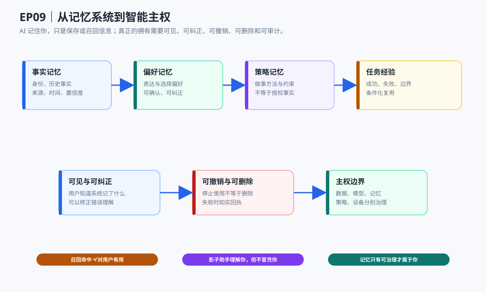

# Agent Computer 09｜AI 记住你，不等于你拥有自己的记忆

> 本文是 **Agent Computer** 系列的第 9 篇（共 12 篇），整理自「顽皮的程序员」的 Agent Computer 系列直播。上一篇：[端侧 AI 比的是智能密度](https://0x00.community/zh-CN/blog/agent-computer-08-intelligence-density/)。
> 本文讲的是原则和目标架构；哪些部分还没有被验证，文末有单独的一节交代。

越来越多的 AI 产品会告诉你：它能记住你的偏好，记住你做过的事，记住你喜欢的表达方式。“它记得我喜欢什么”听起来是个功能问题，用起来也确实方便。

但这里有一个不太舒服的问题：系统记住了你，为什么就等于你拥有这份记忆？它记下的可能是一段聊天记录、一个事实判断、一条偏好、一份策略的副本、一次任务经验，也可能是它自己对你的推断。这些东西混在一起以后，用户很难知道系统究竟记住了什么、依据是什么、谁可以读取、能不能纠正、能不能让它停止使用，以及所谓的“删除”到底删到了哪一层。如果这些都做不到，这份记忆更像平台内部的一份用户画像。

上一篇的结尾说，端侧优先是把长期智能放回用户可控制的域。这一篇讨论这个域里最敏感的一部分：

> **AI 记住你，只说明系统保存或召回了某些信息；只有当记忆可见、可纠正、可撤销、可删除，并且权威边界清楚、访问可审计时，记忆才可能属于你。**

## 记忆不只是聊天历史

很多产品把记忆理解为：保存过去的对话，下次把相关内容检索出来。这是一种记忆能力，但聊天历史只回答“过去说过什么”，不回答“系统现在应该把什么当作长期对象来治理”。

用户在一次聊天里说“这次报告先用保守语气”，可能只是当前任务的临时要求，系统不能凭这一句就永久记成“用户总是喜欢保守语气”。用户说“我们项目下周要上线”，这是一个项目事实，但它有来源和时效，上线时间改了以后，不能继续被当作永不过期的事实。更隐蔽的一种情况是系统自己总结出“这个用户在成本和速度之间更看重速度”。它也许有些依据，也许只是几次任务里的偶然选择。如果不标明这是推断、不允许用户纠正，它就会悄悄从模型的推测变成用户画像。

所以记忆系统至少要分清三件事：原始信息是什么，系统从中抽取了什么，哪些抽取结果有资格进入长期记忆。如果所有内容都叫“记忆”，就无法区分哪些可以主动召回、哪些只能在当前任务里使用、哪些必须回到权威的策略源去确认。

记忆多不等于理解深，它先要有类型、来源和边界。所以 Agent Computer 不能只设计一个记忆开关，它需要的是记忆对象，以及每个对象的来源、生命周期、读取范围、版本和治理状态。

## 四类记忆：事实、偏好、策略、任务经验

把记忆分成四类，是因为它们的事实地位和治理方式不同。

**事实**是关于用户、项目或环境的可验证陈述，比如项目负责人是谁、某份资料是哪个版本、某台设备现在是什么状态。事实必须带来源、时效和置信度。写进记忆库并不让它自动成为真相，它只是一个有适用时间、等待证据支持的主张。价格、法规、设备状态这类动态内容如果被固化成没有时间和来源的长期记忆，过期的风险很高，更适合留在可更新、可引用、可删除的数据层里。

**偏好**是用户对表达、节奏、成本或风险的稳定选择，比如喜欢先看结论、偏好本地处理。偏好可以查看和编辑，能帮系统减少重复沟通，但它不能覆盖当前任务的明确要求，也不能替代当前的授权。用户过去常选某个供应商，不代表这次系统可以自动向它下单。

> **历史偏好可以降低意图不确定性，但不能降低不可逆动作的固有风险。**

**策略**是所有者设定的权限、风险、资源和现实提交规则，以及系统的安全底线。这里有一条工程禁令：记忆中的策略投影不能成为授权的事实源。记忆里的策略副本可能陈旧，也可能被污染；如果缓存里的一句“允许访问摄像头”可以代替权威的租约和策略裁决，污染缓存就等于提权。记忆可以告诉 Agent 这类任务过去用过哪些权限，但现在是否允许，必须回到权威的策略和租约对象重新裁决。记忆层提供上下文，授权组件做决定，两者职责分开。

**任务经验**是某组条件下采取了某种结构并得到某种结果的记录。它不是一句“上次这样做成功了”，而要保留当时的条件、候选、选择的理由、证据和现实反馈，并带上适用条件和反例。一次成功只能说明某个方案在某组条件下成立过，不能自动推广到所有条件。

还有一条晋级规则贯穿这四类：Agent 自己产生的推测，默认只能进入任务级记忆的候选区。要晋级为长期用户记忆，需要规则证据或用户确认。这条规则防的就是系统把自己的猜测慢慢沉淀成关于用户的事实。

## 一条受治理的链路

记忆是一条受治理的链路，在目标架构里承担这条链路的组件叫 Memory Broker：

> **召回 → 使用 → 写入 → 更新 → 复核 → 反馈**

每次召回都应该能回答：用途是什么，允许读取哪些字段，实际读取了哪些字段，信息是否过期，有没有证据。“只提供最小必要信息”如果没有工程记录，很容易退化成“相关的都给它”。所以最小必要信息至少要是可审计的：每次访问至少记录用途摘要、允许的字段集、实际选中的字段集、时间窗、条目数量，以及是否拒绝过更宽的查询。系统不得因为“相关”就把用户的全部记忆交给 Agent，也不应该默认做全库扫描。

时效同样要管。一条记忆进入当前任务后的有效期不能被缓存延长，来源有效期、能力租约到期时间和任务有效期，取其中最早的那个。

链路的优化目标也要选对。检索命中率是个好看的指标，但返回了相关内容不等于有用。可以把命中分成几层：检索命中（返回了一个候选）、准入命中（候选通过了权限、来源、新鲜度检查）、消费命中（它真的进入上下文并被使用）、有效命中（相对没有这条记忆的基线，它带来了可复现的净收益），以及负面命中（它导致了错误、偏航、过时引用或不必要的成本）。

举个负面命中的例子：用户过去喜欢简洁的回答，系统在这次任务里召回了这条偏好，把一份需要完整审计证据的方案压成了两句话。偏好确实命中了，结果却变差了。再比如系统召回了一个旧的设备状态，省掉了一次实时查询，而设备刚刚换过。

应该优化的是有效命中：记忆做得好不好，要看它是否让未来的任务在同样的安全门槛下得到可复现的净收益。有效命中是反事实量，运行时无法逐条得到，只能靠对照实验按总体估计：离线固定一组任务回放，或线上随机屏蔽部分记忆做对照。

## 遗忘、撤销、删除不是一回事

这是最容易被产品文案混淆的部分。用户说“把这件事忘掉”，可能有三种不同的诉求：以后不要主动提起；现在起不许再用；底层的副本也要清理干净。它们分别对应遗忘、撤销和删除，不能互相代替。

**遗忘**是停止主动召回与排名。它可以恢复，底层副本可能仍然存在。系统可以说“今后不再主动使用这条记忆”，不能说“这条记忆已经删除”。

**撤销**是立即阻断新的读取与使用，并让已经发出去的记忆切片失效。撤销之后，后续任务不能再消费这条内容，但原文可能仍按保留策略存在，备份和外部副本也没有因此消失。撤销解决的是“现在不许再用”，不是“从未存在过”。

**删除**是更强的操作。它不是从列表里移走一个名字，而是先提交一条不可覆盖的墓碑记录，再向各处传播清理：主副本、记忆切片、缓存、上下文快照、导出文件、复制出去的副本和备份。先写墓碑的原因是，如果先清理、后来又从备份恢复，已经删除的对象可能重新出现；有了墓碑，任何恢复或回灌都要先重放它，再决定对象是否可见。

派生物也在清理范围内：由这条记忆生成的摘要、嵌入和索引条目要一并删除。如果它参与过个体化 Adapter（挂在基础模型上的轻量适配权重）的训练，目前没有办法从权重里精确抹掉单条记忆，只能回退到不含它的版本或重新训练，在此之前状态应报告为“部分完成”。对无法改写的备份，通行的做法是每个对象单独加密，删除时销毁密钥。

删除的传播可能只完成了一部分，也可能需要重试。这期间系统必须阻断新的消费，不能一边显示“删除中”，一边继续把这条记忆送进任务。如果法规保留义务、外部系统或备份状态阻止了物理清除，系统必须返回“受阻”“部分完成”这样的真实状态，并让对象保持不可消费。

除了这三种操作，还有第四种情况需要单独表达：未知。当系统无法确认某个副本是否已经清理时，它应当报告未知，既不能说成已删除，也不能说成删除失败。未知是一种必须如实呈现的状态。

> **系统可以做不到彻底删除，但不可以谎称已经删除。**

同样的道理也适用于已经离开本地的内容。发出去的邮件、发布了的内容、写进第三方数据库的记录，不会因为本地删除而从现实中消失，只能按外部系统的规则去申请删除、撤回或匿名化，并保留必要的状态说明。

## 影子助手与记忆之外的对象

记忆最终要落到产品形态上。影子助手通过长期使用来理解用户的选择偏好、习惯和表达方式，在授权范围内减少重复表达。它不是用户的复制品，不替用户做主。理解用户的系统不应该只会重复用户过去的选择，还要知道过去的选择什么时候不能直接套用：如果用户一直喜欢某种方案，系统就每次自动采用，那更像路径依赖。所以影子助手要同时维持连续性和对陌生任务的探索与反证，重要的现实动作继续遵循当前的授权。个性化的标准是用户能看见系统如何理解自己，并且能纠正、暂停、撤销和清空这种理解。

记忆之外，还有四个对象需要用户能够治理：数据、模型、策略和设备。它们的治理方式各不相同，彼此之间还有复制、派生、缓存、备份和跨设备传递的问题，所以不能混成一句“数据都归用户”。主权是一组可以执行的权利：查看、纠正、暂停、撤销、解绑、删除、审计和恢复。本篇只论证了记忆这一项；设备见下一篇。

## 哪些是原则，哪些还没有被证明

“记忆应当可见、可纠正、可撤销、可删除”是方法论原则。按字段切片的记忆访问、最小切片证明、墓碑传播、影子助手，属于目标架构和工程机制。某个具体产品做到了其中多少，要看它的实现、演示和验收证据。跨设备信任和大规模的删除传播，不能因为设计写得详细就被当作已经验证；白皮书自己也披露，这套体系目前在真实目标环境上的证据为空。

## 六个检查问题

面对任何“AI 记住你”的功能，可以问这六个问题：

1. 它保存的是事实、偏好、策略还是任务经验？
2. 来源、时间和置信度在哪里？
3. 谁能读取，读取是否遵循最小切片？
4. 我能否查看、纠正、暂停、撤销和删除？
5. 删除是否覆盖缓存、快照、导出、备份，以及摘要、嵌入这类派生物？
6. 系统无法彻底清理时，是否明确返回受阻、部分完成或未知这样的真实状态，而不是显示一个漂亮的“已删除”？

这六个问题答不上来，说明系统可能拥有关于你的记忆，而你还没有拥有对这套记忆的治理权。

## 结论

“AI 记住了你”拆开来是一组彼此独立的要求。记忆是有类型和生命周期的对象，事实、偏好、策略和任务经验要分开治理；召回要有用途、字段和时效的边界，Agent 自己的推测不能直接晋级为用户事实；遗忘、撤销、删除语义不同，结果未知时就报告未知。这些要求目前是原则和目标架构，能否在真实设备和真实规模上成立，仍待验证。

> **记忆只有在可见、可纠正、可撤销、可删除，并且权威边界清楚、访问可审计时，才不只是平台替你保管的画像，而可能成为用户拥有的智能资产。**

需要治理的对象里还剩设备。当 Agent 连上摄像头、屏幕、输入设备、执行器和工业系统以后，问题会从“谁拥有记忆”变成“谁对现实负责”。

下一篇：[Agent 走出电脑以后，谁对现实负责](https://0x00.community/zh-CN/blog/agent-computer-10-physical-responsibility/)
