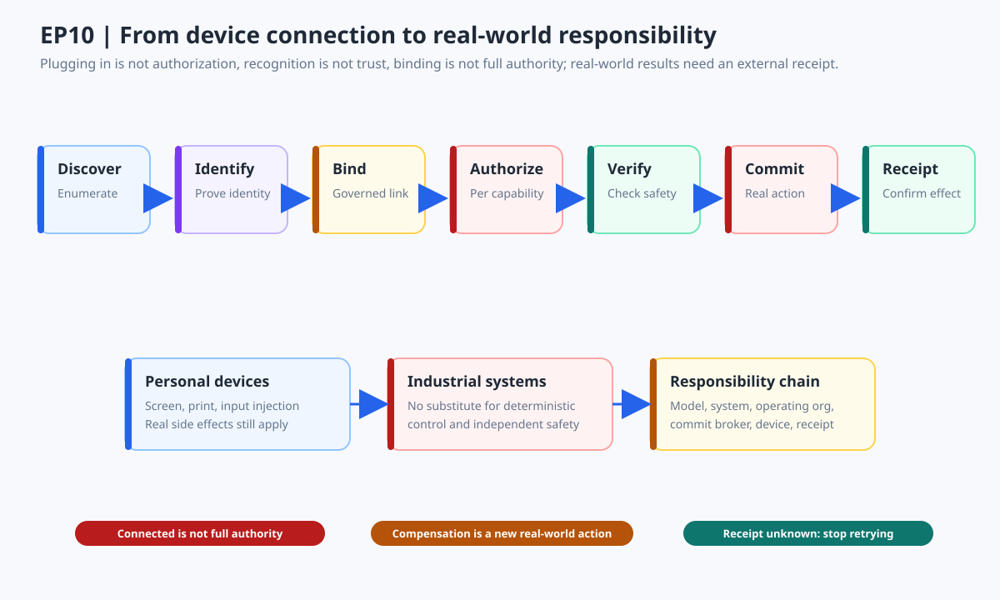

# Agent Computer 10: When an agent leaves the computer, who answers for reality?

> This is part 10 of 12 in the **Agent Computer** series, adapted from the Agent Computer live-stream series. Previous: [An AI that remembers you is not the same as owning your memory](https://0x00.community/blog/agent-computer-09-memory-sovereignty/). This post describes principles and a target architecture, not capabilities that exist today.

An agent drafts an email locally and the interface says "sent successfully". What does that success refer to? Perhaps the local program only placed the message in an outgoing queue. Perhaps the network request went out. Perhaps the external mail service returned an acceptance. Or perhaps the send timed out and the system does not know whether the other side received anything.

Take a device action next. In a sandbox, the agent simulates setting a production temperature to some value, and the simulation passes. That does not show the real equipment has been changed safely. Files can be rolled back. An email, a payment, a printout, injected input, a device movement or a changed production parameter cannot be undone by restoring local state.

The previous post split intelligence sovereignty into five objects, the last of which was the device. Once an agent is connected to cameras, screens, storage, serial devices, human interface devices and actuators, the question is no longer only whether the model can call a tool. The central claim of this post:

> **Once an agent leaves the computer, responsibility cannot be carried by the model saying "I did it". It has to be built from device identification, binding, authorization, verification, commit, receipt and organizational responsibility together.**

## Connected does not mean it may act for you

Traditional systems tend to treat "device connected" as "device available". A connection only shows that a physical channel exists. It does not show what the user authorized, and it does not show that the device's identity can be trusted.

Looked at more closely, a device is a set of capabilities with different risks. A camera may do read-only sensing. A screen involves at least enumeration, configuration, frame submission, brightness and power control. A storage device has read-only mounting, writable mounting, ejection and encryption operations. A human interface device can read input and can also inject it. An actuator can simulate, stand by and execute. Displaying a frame produces a change the user can see, a storage write may overwrite data, and an actuator action changes the state of real equipment directly.

Input injection deserves the most attention. It lets the agent send keystrokes, mouse or touch actions to other applications as the user, and can in effect bypass the permission design those applications already have. A model's first stop in the real world is more likely the peripherals around a user than a factory. Showing something on a screen, playing audio and printing all change the reality a user perceives, so they count as real-world side effects and cannot be handled with less care merely because the device is close at hand. Users must be able to see binding relationships, pause and unbind devices, and know what real-world effect the next step will have.

> **A device is a set of capabilities, not a master switch.**

The question to ask is therefore "which capability of this device did this specific principal obtain for the current task". Device attachment is a fact, device authorization is a decision, and real-world execution is an outcome. One status field cannot stand for all three.

## Three boundaries

**Plugging in is not authorization.** A user attaching a device to the computer shows only that a physical connection happened. It does not say which data the device may access, which actions the agent may perform through it, or how long a permission may last. A new device should first enter a quarantine zone, where the system can enumerate it, run health checks and read the identity information it needs, without the device obtaining task permissions, network permissions or the right to act on reality. Composite devices need particular care: one device may expose a camera, a microphone, storage, a network interface and input injection at once, and authorizing one of them does not authorize the rest.

**Recognition is not trust.** Seeing a certain model from a certain vendor does not mean the device has proven its identity. Vendor and product identifiers, serial numbers, firmware versions and capability declarations are all reported by the device itself, and a malicious peripheral can forge every one of them. The physical port is observed on the host side and is somewhat more dependable. Weighing these signals together with behavioral characteristics only raises the cost of impersonation. It is not proof. A cryptographic device identity needs a hardware root of trust: the device holds a non-exportable private key, signs a random challenge from the host and presents a certificate chain that can be verified. USB Type-C Authentication, SPDM and TPM-based remote attestation all belong to this family. A device without such a capability has to be treated as "identity unproven" and kept in quarantine or given only low-risk capabilities. A name that looks right is no reason to restore past authorization.

**Binding is not full authority.** Binding a device to your Agent Computer means only that it has entered a governable relationship. Data reading, display, control, network, storage and real-world actions must each be granted, audited and revoked individually. A screen allowed to show frames cannot therefore read the user's files, and a sensor that may be read cannot therefore rewrite device parameters.

A long-term binding also carries a review clock: when it was last reviewed, when the next review is due, and how long it may go without one. Re-plugging the device, a firmware change, a change in composite functions or a change of physical port should each trigger a re-evaluation, and the old lease must not be restored silently. Long-lived authorization without review accumulates into permissions the user has forgotten about.

## From discovery to real-world action

Put the three boundaries into one complete chain and a reasonable flow looks like this:

> device enumeration and fingerprint → capability declaration → binding decision → capability lease → exploration / simulation → commit verification → real-world action → real-world receipt

Duties along the chain are separated. A device broker handles identification, protocol adaptation and health checks. The policy and lease component handles authorization. The commit broker (External Effect Broker) handles actions and receipts. The device broker cannot rewrite the system's access rules because it has seen a device. Each role writes only the state that is its own, and a write beyond its authority should simply fail.

The model can do a good deal in this chain. It can notice that it lacks a capability, submit a minimal permission request, explain the necessity, scope of impact, reversibility and alternatives, and generate candidate actions in the exploration domain. It cannot write the conclusion "allowed", cannot upgrade a successful local simulation into real-world state, and cannot treat one past authorization as permanent. The separation of four powers from [part 7](https://0x00.community/blog/agent-computer-07-agentos-support/) applies to devices as well: the model discovers and requests, an independent safety review role gives its assessment, approval comes from the user or a policy the user configured in advance, and issuing is done only by the deterministic lease component. Without that separation the model requests, assesses, approves and executes all by itself, which amounts to treating a probabilistic model as the root of trust.

## Receipts, unknown and compensation in the physical world

Between a candidate in the exploration domain and an action that is "in effect" stand the commit checks and the receipt. The states (committed, failed, unknown, plus partially committed for a batch) and the reconciliation rules are covered in [part 6](https://0x00.community/blog/agent-computer-06-multiple-worlds/). Only what devices add is discussed here.

The source of truth for real-world state is the external system and the device itself. What the system can obtain is the receipt they return plus, where needed, independent trusted observation. Both are timestamped evidence, and the agent's own account is not among them. What makes devices special is that physical state sometimes cannot be observed at all: an actuator reporting "command received" does not mean the valve actually reached its position. An independent sensor, separate from the actuation channel, is needed to confirm it. If the receipt is missing, if receipts conflict, or if there is no trusted observation, the system should enter "unknown". It does not report success, does not present unknown as failure, and does not blindly resend the same action. It checks the external state first.

Compensation is also harder in the physical world. A printed page can be destroyed, but it was printed. A device can perform the reverse action, but the reverse action may itself fail, and it leaves a new record. Compensation is therefore a new real-world action that goes through authorization again, produces its own receipt and does not erase the history of the original action.

Two kinds of "stop" also have to be told apart. A global stop at the software layer stops admission: it blocks new task admissions, tool calls and real-world actions, but actions already sent still have to be reconciled, because real-world state cannot be left untracked once a local process is gone. A physical emergency stop and safety interlocks are something else. They are hardware safety functions independent of AgentOS, and they work whether or not AgentOS has stopped.

## Who answers for reality

"Who is responsible" cannot be reduced to "the model is", and it cannot be reduced to "the user is". The model is one link in the chain: it can discover, request and advise, but it does not issue authorization and it does not produce receipts. What reality needs is a traceable chain of responsibility that covers at least the following:

- The device: which specific entity was identified, who confirmed its identity, who declared its capabilities.
- Authorization: who submitted the permission request, who performed the independent safety review, who approved this real-world commit, who issued the capability lease.
- The control system: which component actually executed the action, and who carries deterministic control and safety protection.
- The commit broker: through which commit broker the action entered the outside world, and what receipt the external system returned.
- The operating organization: who set the task goal, who approved the real-world action, and who holds the authority to reconcile, compensate and investigate after an incident.

A responsibility chain exists to make sure every key decision has a single origin and an audit record, and pushing the error onto one role is not its purpose. A model may generate a wrong candidate, but if the system lets the model issue its own permissions, it is the system design that amplifies the error. A user may approve an action, but if the interface did not show the scope of impact, the irreversibility and the receipt status, that approval was not informed. A device broker may identify a device, but if it can directly modify mandatory access rules, the boundary of duties has already been broken.

> **Every key state needs a single writer, explicit preconditions, a verifiable receipt and a traceable responsible party.**

## Industrial intelligence: more capability, no blurring of safety duties

Industrial systems magnify the same principles: the equipment is more complex, the state more continuous, the side effects larger and the responsibility chain longer. A reasonable chain starts from goals and constraints, goes through candidate process generation, multiple-worldline simulation, an independent industrial validation checkpoint, digital twins, hardware-in-the-loop (HIL) testing, shadow mode and a small-scale trial run, and ends with execution by a deterministic controller such as a PLC or DCS.

The duties have to be kept apart. The generative model understands goals, generates candidates, diagnoses and proposes optimizations. Basic process control is carried by deterministic systems. The safety instrumented system (SIS), interlocks and emergency stops provide protection under their own independent safety designs. The generative model does not enter the basic process control loop, which requires a deterministic scan cycle, and it does not rewrite safety logic online. The division exists because the two kinds of system tolerate error differently and treat time differently. Open exploration can carry probability, branches and uncertainty. Process control and safety protection need to be predictable and verifiable, with well-defined failure behavior.

A process that has been validated on one machine cannot be copied by default to another machine of the same model either. Equipment aging, differences in feedstock, environmental change, sensor error and firmware version can each make it fail at another site. Process capability therefore needs to be packaged as a Verified Process Capsule, which can be thought of as a signed process recipe with an expiry date, containing the process Spec, device interfaces, parameter windows, evidence, risks, prohibited conditions, fallback logic, a validity period and a signature. A local success cannot be taken straight as a general rule.

The industrial loop above belongs to the target architecture. It should be read as a methodological framework and a set of safety boundaries, not as a ready industrial solution. Passing simulation is not validation on real equipment, and passing shadow mode does not make a production commit safe. Early validation of real-world execution should start with controlled connectors that can be simulated and reconciled, with high-risk actuators and industrial equipment control left to the final stage.

## Six questions before operating a device

When an agent is about to operate a device, ask, in order:

1. Which specific device has it identified, and has that identity been proven or does it merely look right?
2. Is what has been granted one particular capability, and not "permission for the whole device"?
3. Is the action in the exploration domain, the commit domain or the reality domain?
4. Who approved this action, who issued the lease, and who is responsible for the independent safety review?
5. What receipt will the external system return, and is there an independent observation? If the receipt is missing, conflicting or unobservable, will the system enter unknown and pause retries?
6. If the action is irreversible, have compensation and incident drills been defined?

If these six questions cannot be answered, the agent may be connected to the device, but it has not yet built an accountable chain of real-world execution.

## Conclusion

The answer to "who answers for reality" is not any single party. It is a responsibility chain formed by the device, authorization, the control system, the commit broker and the operating organization. On that chain the model can discover, request and advise, authorization is approved and issued by other roles, and results are confirmed by external receipts and trusted observation, with unknown reported honestly when they cannot be confirmed. The chain only holds if every link has a single writer and an audit record. What it leaves open is that almost all of this is still target architecture.

> **To enter the physical world, an agent has to account for capability, authorization, verification, responsibility and receipt, item by item. Being able to connect is not enough.**

A system that keeps admitting it is unproven does not sound very dependable. The next post takes up exactly that apparent contradiction.

Next: [Why an unproven system can deserve more trust](https://0x00.community/blog/agent-computer-11-evidence-and-trust/)
