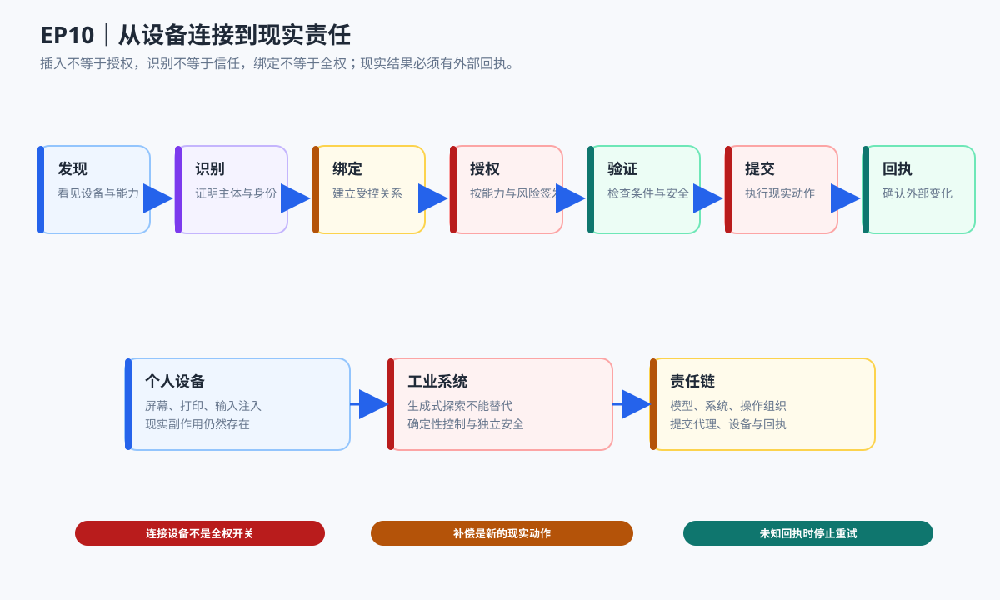

# Agent Computer 10｜Agent 走出电脑以后，谁对现实负责

> 本文是 **Agent Computer** 系列的第 10 篇（共 12 篇），整理自「顽皮的程序员」的 Agent Computer 系列直播。上一篇：[AI 记住你，不等于你拥有自己的记忆](https://0x00.community/zh-CN/blog/agent-computer-09-memory-sovereignty/)。本篇讲的是原则和目标架构，不是已经具备的能力。

Agent 在本地生成了一封邮件，界面上显示“发送成功”。这个“成功”指的是什么？可能只是本地程序把邮件放进了发送队列，可能是网络请求已经发出，可能是外部邮件服务返回了接收确认，也可能是发送过程超时了，系统其实不知道对方有没有收到。

再看一个设备动作。Agent 在沙箱里模拟把生产温度调到某个参数，仿真通过了。这并不说明真实设备已经被安全地改变。文件可以回撤，而邮件、付款、打印、输入注入、设备动作和生产参数的变化，不能靠恢复本地状态来撤销。

上一篇把智能主权拆成五个对象，最后一个是设备。Agent 一旦连接摄像头、屏幕、存储、串口设备、人机接口设备和执行器，问题就不再只是“模型能不能调用工具”。这一篇的核心判断是：

> **Agent 走出电脑以后，责任不能由模型一句“我执行了”来承担，它要由设备识别、绑定、授权、验证、提交、回执和组织责任共同构成。**

## 接上设备，不等于可以替你做事

传统系统往往把“设备已连接”当成“设备可用”。但连接只说明物理通道存在，不说明用户授权了什么，也不说明设备的身份可信。

更细地看，一台设备包含的是一组能力，各自的风险并不相同。摄像头可以只做只读传感；屏幕至少包括枚举、配置、提交画面、调节亮度和电源控制；存储设备有只读挂载、可写挂载、弹出和加密操作；人机接口设备可以读取输入，也可以注入输入；执行器可以仿真、待命和执行。显示画面会产生用户可见的变化，存储写入可能覆盖数据，执行器动作直接改变现实设备的状态。

其中最需要重视的是输入注入。它让 Agent 能以用户的身份向其他应用发送按键、鼠标或触控动作，实际上可能绕过那些应用原有的权限设计。模型接触现实的第一站多半不是工厂，而是用户身边的这些外设；屏幕显示、音频播放和打印都会改变用户能感知到的现实，同样属于现实副作用，不能因为“就在身边”就降级处理。用户必须能看到绑定关系，能暂停和解绑设备，并且知道下一步会产生什么现实影响。

> **设备是一个能力集合，不是一个全权开关。**

所以该问的是“这个具体的主体，在当前任务里，获得了这台设备的哪一项能力”。设备接入是一个事实，设备授权是一个决定，现实执行是一个结果，三者不能用同一个状态字段来代替。

## 三条边界

**插入不等于授权。** 用户把一个设备接到电脑上，只说明物理连接发生了。它不说明设备可以访问哪些数据、Agent 可以通过它执行哪些动作、权限可以保留多久。新设备应该先进入隔离区：系统可以在那里枚举、做健康检查、读取必要的身份信息，但不能让它直接获得任务权限、网络权限或现实执行权限。复合设备尤其要注意，一个设备可能同时暴露摄像头、麦克风、存储、网络和输入注入能力，授权了其中一项不代表其他几项也被授权。

**识别不等于信任。** 系统看到某厂商的某个型号，不代表设备已经证明了自己的身份。厂商标识、产品标识、序列号、固件版本和能力声明都由设备自己上报，恶意外设可以全部伪造；物理端口是主机一侧的观测，稍微可靠一些。把这些信号和行为特征综合起来，只能提高冒充的成本，不构成证明。密码学意义上的设备身份需要硬件信任根：设备持有不可导出的私钥，对主机发来的随机挑战签名，并出示可验证的证书链，USB Type-C Authentication、SPDM 和基于 TPM 的远程证明都属于这一类。没有这类能力的设备只能按“身份未证明”对待，留在隔离区或只开放低风险能力，不能因为“名字看起来对”就恢复历史授权。

**绑定不等于全权。** 把设备绑定到自己的 Agent Computer，只说明它进入了一种可治理的关系。数据读取、显示、控制、网络、存储和现实动作必须逐项授予、逐项审计、逐项撤销。一块被允许显示画面的屏幕不因此能读取用户文件，一个可以读取数据的传感器不因此可以改写设备参数。

长期绑定还要带复核时钟：上次复核是什么时候，下次什么时候，最长可以多久不复核。设备重新插入、固件变化、复合功能变化或物理端口变化，都应该触发重新评估，不能静默恢复旧的租约。长期授权如果没有复核，会随时间积累成用户自己都忘了的权限。

## 从发现到现实动作

把三条边界放进一条完整的链路，合理的流程是：

> 设备枚举与指纹 → 能力声明 → 绑定决定 → 能力租约 → 探索/仿真 → 提交验证 → 现实动作 → 现实回执

链路上的职责是分开的。设备代理负责识别、协议适配和健康检查；策略与租约组件负责授权；提交代理（External Effect Broker）负责动作与回执。设备代理不能因为看见了一台设备，就直接改写系统的访问规则。每个角色只写自己该写的状态，越权的写入应当直接失败。

模型在这条链路里能做的事不少：发现自己缺少某项能力，提出最小化的权限申请，说明必要性、影响范围、可逆性和替代方案，在探索域里生成动作候选。它不能自己写下“允许”的结论，不能把本地仿真的成功升级成现实状态，也不能把一次历史授权当作永久授权。[第 7 篇](https://0x00.community/zh-CN/blog/agent-computer-07-agentos-support/)讲的四权分离在设备上同样适用：模型发现和申请，独立的安全审查角色给出评估，批准来自用户本人或其预先配置的策略，签发只由确定性的租约组件完成。四种权力不隔离，就会出现模型自己申请、自己评估、自己批准、自己执行的情况，等于把一个概率模型当成了信任的根。

## 物理世界里的回执、未知与补偿

一个动作从探索域的候选走到“已生效”，中间隔着提交检查和回执；已提交、失败、未知（以及批次的部分提交）这几种状态和对账规则见[第 6 篇](https://0x00.community/zh-CN/blog/agent-computer-06-multiple-worlds/)。这里只说设备带来的不同。

现实状态的事实源是外部系统和设备本身。系统能拿到的是它们返回的回执，加上必要的独立可信观测，两者都是带时间戳的证据，Agent 的自述不在其中。设备的特殊之处在于，物理状态有时根本观测不到：执行器回报“指令已接收”，不等于阀门真的到了位。这时需要独立于执行通道的传感器来确认。如果回执缺失、相互冲突，或者没有可信的观测，系统应该进入“未知”：不自报成功，不把未知说成失败，也不盲目重发同一个动作，先去核对外部状态。

补偿在物理世界里也更难。打印出来的纸可以销毁，但它确实被打印过。设备可以执行反向动作，但反向动作本身可能失败，并且会留下新的记录。所以补偿是一个新的现实动作，要重新走授权，产生自己的回执，不抹去原动作的历史。

还要区分两种“停”。软件层的全局停止是停止准入：阻断新的任务准入、工具调用和现实动作，但已经发出去的动作仍然要继续对账，不能因为本地进程没了，现实状态就没人追踪。物理急停和安全联锁是另一回事，它们是独立于 AgentOS 的硬件安全功能，AgentOS 停不停都不影响它们生效。

## 谁对现实负责

“谁负责”不能简化成“模型负责”，也不能简化成“用户负责”。模型只是这条链上的一个环节：它可以发现、申请和建议，但不签发授权，也不产生回执。现实里需要的是一条可追溯的责任链，至少包括下面这些环节：

- 设备：识别的是哪一个具体实体，谁确认了它的身份，谁声明了它的能力；
- 授权：谁提交了权限申请，谁做了独立的安全审查，谁批准了这次现实提交，谁签发了能力租约；
- 控制系统：真正执行动作的是哪个组件，确定性的控制和安全保护由谁承担；
- 提交代理：动作通过哪个提交代理进入外部世界，外部系统返回了什么回执；
- 操作组织：谁提出了任务目标，谁批准了现实动作，事故发生后谁拥有对账、补偿和调查的权限。

责任链的作用是保证每个关键决定都有唯一的来源和审计记录，而不是把错误推给某一个角色。模型可能生成错误的候选，但如果系统允许模型自己签发权限，放大错误的是系统设计。用户可以批准一次动作，但如果界面没有呈现影响范围、不可逆性和回执状态，这次批准算不上知情。设备代理可以识别设备，但如果它能直接修改强制访问规则，职责边界就已经被突破了。

> **每个关键状态都要有唯一写入者、明确的前置条件、可验证的回执和可追溯的责任主体。**

## 工业智能：能力扩大，安全职责不能模糊

工业系统把同样的原则放大了：设备更复杂，状态更连续，副作用更大，责任链更长。合理的链路从目标与约束开始，经过候选工艺的生成、多世界线仿真、独立的工业验证关口、数字孪生、硬件在环（HIL）测试、影子模式和小范围试运行，最后由 PLC/DCS 这类确定性控制器来执行。

这里要把职责分清楚。生成式模型负责理解目标、生成候选、做诊断和提出优化建议；基本过程控制由确定性系统承担；安全仪表系统（SIS）、联锁和急停按各自独立的安全设计提供保护。生成式模型不进入要求确定扫描周期的基本过程控制闭环，也不在线改写安全逻辑。这样分工是因为两类系统对错误的容忍度和时间语义不同：开放探索可以带着概率、分支和不确定性，过程控制和安全保护则需要可预测、可验证、失败行为明确。

一个工艺在某台设备上验证通过，也不能默认复制到另一台同型号设备上。设备老化、原料差异、环境变化、传感器误差和固件版本，都可能让它在另一个现场失效。所以工艺能力需要封装成 Verified Process Capsule，可以把它理解成带签名和有效期的工艺配方，包含工艺 Spec、设备接口、参数窗口、证据、风险、禁止条件、回退逻辑、有效期和签名。局部的成功不能直接当成普遍规律。

需要说明的是，上面这条工业闭环属于目标架构，应当读作方法框架和安全边界，而不是就绪的工业方案。仿真通过不等于真实设备验证，影子模式通过不等于生产提交安全。早期的现实执行验证应该先选可模拟、可对账的受控连接器，高风险执行器和工业设备控制放在最后阶段。

## 操作设备之前的六个问题

当 Agent 要操作设备时，可以依次问：

1. 它识别的是哪一个具体设备，身份是被证明了，还是只是看起来对？
2. 当前授予的是哪一项能力，而不是“整台设备的权限”吗？
3. 动作是在探索域、提交域还是现实域？
4. 谁批准了这次动作，谁签发了租约，谁负责独立的安全审查？
5. 外部系统会返回什么回执，有没有独立的观测？回执缺失、冲突或无法观测时，系统会不会进入未知并暂停重试？
6. 如果动作不可逆，补偿和事故演练是否已经定义？

这六个问题答不上来，说明 Agent 也许已经连上了设备，但还没有建立起一条可以负责的现实执行链路。

## 结论

“谁对现实负责”的答案不是某一个主体，而是设备、授权、控制系统、提交代理和操作组织共同构成的一条责任链。模型在链上能发现、申请和建议，授权由别的角色批准和签发，结果由外部回执和可信观测确认，确认不了就如实报告未知。这条链成立的前提是每个环节都有唯一的写入者和审计记录；它留下的问题是，上面这些几乎都还是目标架构。

> **Agent 进入物理世界，要过的门是把能力、授权、验证、责任和回执逐项闭合，光能连上不算。**

一个不断承认自己还没被证明的系统，听起来不那么可靠。下一篇讨论的正是这个看似矛盾的问题。

下一篇：[一个还没被证明的系统，为什么反而更值得信任](https://0x00.community/zh-CN/blog/agent-computer-11-evidence-and-trust/)
