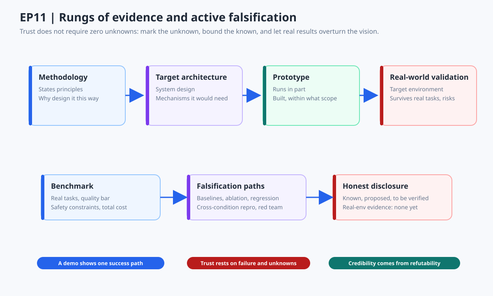

# Agent Computer 11: Why an unproven system can deserve more trust

> This is part 11 of 12 in the **Agent Computer** series, adapted from the Agent Computer live-stream series. Previous: [When an agent leaves the computer, who answers for reality?](https://0x00.community/blog/agent-computer-10-physical-responsibility/).

When a system is introduced to us, we usually get some mix of a white paper, an architecture diagram, a demo, a few performance numbers and a video. Each has value, but each proves something different. A white paper explains a methodology. A diagram shows a target structure. A demo shows that one controlled path ran. A number reports a result under one measurement setup. The trouble is that these materials are often compressed into a single sentence: "the system already has the full capability."

The previous post argued that once an agent's actions reach the real world, the state of reality cannot be reported by the agent itself. Only an external receipt and trusted observation can confirm it. The same standard should apply to what a system says about its own abilities: a capability claim cannot use self-description in place of evidence. The first ten posts proposed many principles and mechanisms. This one steps back to a more basic question: when a system describes what it can do, why should we believe it?

The core claim of this post:

> **A trustworthy system states what is known, what is only proposed, what is implemented and what is still to be verified, and gives others a way to prove it wrong.**

This does not mean a system without evidence is reliable by default. It means that honest disclosure puts a system in a state where it can be tested, while overclaiming leaves you with no idea where to start questioning it.

## Admitting what is unproven does not weaken trust

A common worry is that saying "not yet verified" over and over makes a product look weak. In the short term it does cost some promotional certainty. But users, partners and developers need to know under which conditions a capability can be used, what it depends on, which parts have evidence, which parts are design goals, what happens on failure, which test comes next, and how the system falls back if an assumption turns out to be false.

Without that information nobody can calibrate their risk. Call a simulation result a production capability and the system may be deployed where it does not belong. Call a prototype mature and an organization may skip acceptance testing it needed. Call a vision a fact and the problem surfaces only when it happens. A system that lists every goal as done looks complete, yet you cannot tell where it will fail.

Honesty is therefore part of risk control. It replaces "trust me" with four things: this is the evidence, this is the scope, this is what is unknown, and this is what could overturn the claim. With those four in hand, disclosure becomes the entry point to verifying the system and stops being a mere disclaimer.

## Four states a claim can be in

The white paper behind this methodology sorts its own content into four states, each with a different evidence requirement.

- **Methodological principles.** Judgments that guide the design, such as "a real-world outcome cannot be self-reported by the agent and can only be confirmed by an external receipt and trusted observation", "plugging in is not authorization", or "memory must distinguish forgetting, revocation and deletion". You do not need a finished product to discuss them, but they have to survive consistency checks and counterexamples.
- **Target architecture.** The objects, components and relationships the design hopes to build, such as the Spec Package, the Memory Broker (the component that carries the memory access path in part 9), the Capability Lease and the External Effect Broker, and the split into exploration domain, commit domain and reality domain. These describe a direction, not a completed implementation. A target architecture must at least come with criteria by which it can be accepted or falsified. Otherwise it is a list of concept names.
- **Current engineering capability.** The parts backed by an implementation, a demonstration or acceptance evidence, always with the type of evidence and its scope stated. A reference implementation may run only on a development adapter. A demo may cover one input and one path. An interface may pass contract tests without yet being connected to a real operating system or real hardware.
- **Hypotheses to be verified.** Claims that need real hardware, real workloads or user research, and cannot be used as conclusions. "Organized small models reach higher intelligence density than one large model at the same quality and safety bar" is a direction worth proposing, but it has to be checked with benchmarks, resource measurements and ablation.

One rule holds across the four states: nothing promotes itself.

> **A document does not become an implementation by being detailed. An implementation does not become validation in the target environment by running.**

## Four rungs of evidence

The four states above describe what kind of claim something is. From another angle, a claim passes four checkpoints on the way from being proposed to being proven. The methodology answers "why should it be designed this way?" The target architecture answers "which objects and mechanisms are meant to carry it?" A prototype answers "can one path run under controlled conditions?" Real-world validation answers "does it still hold in the target environment, with real faults, real resources and real risk?"

The rungs map onto the states like this: prototype evidence can move a claim to "current engineering capability", with its scope stated, and whatever lacks real-world validation stays a "hypothesis to be verified". The four checkpoints come in order, but none can stand in for another. Take device sovereignty from the previous post:

- "Plugging in is not authorization" is a methodological principle.
- The device broker, capability declaration, Capability Lease and commit broker (External Effect Broker) are target architecture.
- A simulator that shows a newly attached device entering quarantine first is prototype or simulation evidence.
- Connecting real devices from different vendors and failing closed correctly through firmware changes, reconnects, permission revocation and missing receipts is what starts to approach validation in the target environment.

Industrial settings follow the same pattern. "A generative model must not rewrite safety logic online" is a methodological and governance red line. "The model generates candidates, the PLC/DCS executes deterministically, and the safety instrumented system protects independently" is target architecture. Running one simulated chain in a digital twin is prototype evidence. Proving the boundaries on a real production line, with real feedstock, sensor error, aging equipment and incident drills, is the stronger validation. Compress those four steps into "the industrial loop is implemented" and the evidence obligations in the middle disappear.

## A demo is not system capability

Demos are useful. They help people understand the user path, inspect interfaces and spot interaction problems, and they do show that a local path runs under the given conditions. The problem is that we ask demos to prove things they did not prove. A passing demo usually tells you nothing about:

- how cancellation, timeouts, crashes and repeated execution are handled;
- whether a failure contaminates existing state;
- whether permissions are really controlled by an independent component;
- whether the real external system returned a receipt;
- whether it still holds across other users, devices and conditions;
- whether the organized approach has a net benefit over a simpler baseline.

So "did it run?" is only half the question. The other half is "when should it refuse to run?" Does it reject an expired permission? Does it re-evaluate a device that reconnects? Does it fall back to a more conservative path when evidence is thin? Does it enter an unknown state when external receipts conflict? These moments make poor demos, and they decide whether the system can be governed.

> **A demo shows one successful path. How far a system can be trusted depends more on how it handles everything outside that path.**

## What to say when there is no evidence yet from the real target environment

This is the most important rule of expression in this post. When there is no evidence yet from the real target environment, you may say:

- this is a methodological principle;
- this is target architecture;
- this is a runnable reference implementation;
- this is a result from a simulator or a development adapter;
- this is a hypothesis to be verified;
- there is currently no evidence from the real target environment.

You may not say that it has been validated in real production, that the system has a complete industrial loop, that an aggregate figure from a simulator is the capability of real hardware, or that the route has been proven by the market and by real users.

The white paper also lists several kinds of capability statement it treats as unacceptable: treating a language model as the arbiter of permissions or as the system's safety floor; describing copy-on-write, version restore or local rollback as able to roll back network, payment, email and device actions; presenting simulator results, theoretical aggregates or design targets as real hardware capability; and offering the number of agents, the number of worldlines or the parameter count as proof of effect in itself. These statements are more than exaggeration, because they change how a user judges risk. Performance data must therefore be labeled as `real_hardware`, `simulator`, `target` or `estimate`, and the four must not be mixed.

The rule applies to this series as well. Nearly everything discussed in the first ten posts is methodological principle or target architecture, and the posts themselves come with no reference implementation, contract test results, measured data or customer cases. The white paper reports document maturity, contract maturity, implementation maturity and evidence maturity separately, and where evidence from the real target environment is empty it says so. That makes the material look less forceful than a document that only describes a vision, but readers learn which parts they can lean on and which still need verification.

Two inferences are easy to get wrong here. Having no evidence does not mean a principle is wrong. It only means the principle or the target architecture cannot yet be promoted to a real capability. Nor does it mean the claim will hold in the future. A hypothesis to be verified stays a hypothesis, and agreeing with intuition is no reason to write it down as a conclusion. "Unknown" is neither failure nor success. It is a state that needs further observation and verification, and it belongs in plans and acceptance criteria, not papered over with wording.

## How to falsify yourself

A methodology that only collects supporting cases will not be very credible. What matters more is whether it designs ways for itself to fail.

1. **Compare against a simpler baseline.** Multiple worldlines against a single path, multiple agents against a single agent, organized small models against one large model. If the task gain from an added mechanism is smaller than its cost in loading, communication, context copying, acceptance and user choice, "a more advanced architecture" is no reason to keep it.
2. **Run ablations.** If the system adds a Memory Broker, independent review, worldlines or Adapters, remove them one at a time and watch how results, resources and safety metrics change. Otherwise you only know "the whole thing looks good", not which mechanism produced the gain, and you cannot tell causal contribution from correlation.
3. **Regress on a fixed workload, and reproduce across users and conditions.** A comparison means something only under the same task, the same quality bar and the same risk constraints. Success for one user, on one device, in one time window cannot be promoted to a general rule.
4. **Record failure boundaries and negative cases.** Conditioned experience should be stored together with its conditions of applicability and its counterexamples.
5. **Give acceptance and red teaming to independent roles.** The executing role cannot perform its own final acceptance. Red-team conclusions need review too, because a red-team conclusion can also outrun its evidence.
6. **Without a stable net benefit, scale back, simplify or delete.**

A benchmark is how these requirements land on a measurable task. Its job is to put a claim in an environment where it can be compared and repeated, and an attractive total score is beside the point. That requires stating the task goal, the inputs and environment, the hard constraints and risk constraints, the acceptance rules, the capabilities and budget allowed, and how failure and unknown are defined. To test whether organized small models beat one large model, token cost alone is not enough. Model loading, KV Cache, context copying, agent communication, independent acceptance, retries after failure and human intervention all have to be counted. To test whether memory helps, retrieval hit rate is not enough. Compare task success rate, correction cost and negative hits against a baseline with no memory. The evaluation also has to look at the whole trade-off. Fewer confirmations is more convenient, but it must not lower the approval standard for irreversible actions. More worldlines may improve exploration, or may only add resource use and decision load.

Evidence tiers change how organizations work too. Besides a feature list, a release should state the type of evidence, the scope and the boundary at which the system degrades. Besides document completion, progress should count contract tests and fault tests passed, decisions still open, and items of evidence from the real environment. That last number is usually the smallest and the most telling. The right to declare something done is split as well: the implementation team cannot on its own declare a prototype to be real-world validation, the person giving the demo cannot stand in for independent acceptance, and safety review cannot share a root of trust with the executing role.

## Six questions to ask of a capability claim

1. Which state is it in: methodological principle, target architecture, current engineering capability or hypothesis to be verified?
2. Does the evidence come from real hardware, real users, a simulator, a demo or a design target?
3. Was it compared against a simpler baseline?
4. Were ablations and counterexample checks done?
5. Are failure, unknown and "does not fit" reported as different things?
6. What evidence would make the author admit to being wrong?

If a system cannot answer the sixth question, it is more likely expressing a belief than making an engineering claim. A methodology that can be verified has to allow itself to be revised, scaled back or abandoned.

## Conclusion

An unproven system can deserve more trust, provided it draws the boundary of its evidence clearly and places itself where it can be proven wrong. That depends on two acts: labeling every claim with its state, and labeling every piece of evidence with its rung and scope, with neither allowed to promote itself. The question it leaves is a direct one: by this standard, most of this methodology is itself still on the first two rungs.

> **A system is credible not because it has no unknowns, but because it marks the unknown, bounds the known, and puts itself where it can be falsified.**

Under that constraint, the final post returns to the question of the whole series: if all we can honestly say is "known, proposed, to be verified", is Agent Computer the next generation of personal computing, and where should the route begin?

Next: [Is Agent Computer the next generation of personal computing?](https://0x00.community/blog/agent-computer-12-next-personal-computing/)
