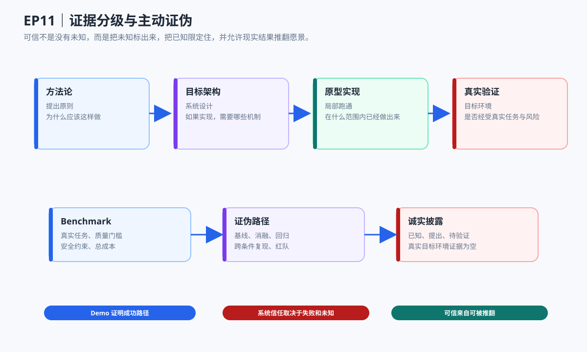

# Agent Computer 11｜一个还没被证明的系统，为什么反而更值得信任

> 本文是 **Agent Computer** 系列的第 11 篇（共 12 篇），整理自「顽皮的程序员」的 Agent Computer 系列直播。上一篇：[Agent 走出电脑以后，谁对现实负责](https://0x00.community/zh-CN/blog/agent-computer-10-physical-responsibility/)。

介绍一个系统时，我们手里通常有这样几种材料：一份白皮书、一张架构图、一个 Demo、几组性能数字、一段演示视频。它们各有价值，但证明的东西并不相同。白皮书说明的是一种方法论，架构图说明的是目标结构，Demo 说明某条受控路径跑通了，性能数字说明某个测量条件下的结果。麻烦在于，这些材料经常被压缩成一句话：“系统已经具备完整能力。”

上一篇讲到，Agent 的动作进入现实以后，现实状态不能由 Agent 自述，只能由外部回执和可信观测确认。同样的要求也应该落在系统对自身能力的描述上：能力宣称不能拿自述代替证据。前面十篇提出了不少原则和机制，这一篇退一步，问一个更基础的问题：一个系统介绍自己的能力时，我们凭什么相信它？

这一篇的核心判断是：

> **值得信任的系统，会明确说明什么已经知道、什么只是提出、什么已经实现、什么仍待验证，并给别人留下把它证伪的办法。**

这句话不是说没有证据的系统天然可靠。它的意思是：如实披露让系统进入了可以被检验的状态，过度宣称则让人连该从哪里开始质疑都不知道。

## 承认未证明，不是削弱信任

常见的担心是，反复强调“还没有验证”会让产品显得不够强。短期看，宣传上的确定感确实会少一些。但用户、合作方和开发者需要的是下面这些信息：这项能力在什么条件下可以用，需要什么前置依赖，哪些部分已有证据，哪些只是设计目标，失败时会怎样，下一步要通过什么测试，假设不成立时系统怎么退回。

缺了这些信息，使用者就没法校准风险。把模拟结果说成生产能力，系统可能被用到不适合的环境里；把原型说成成熟能力，组织可能跳过必要的验收；把愿景说成事实，问题要等真正发生时才暴露。一个把所有目标都写成已实现的系统，表面上很完整，实际上你无法判断它会在哪里失败。

所以诚实是风险控制的一部分。它把“相信我”换成了四样东西：这是证据，这是范围，这是未知，这是可能推翻我的条件。有了这四样，披露才是可验证性的入口，而不只是一段免责声明。

## 主张的四种状态

这套方法论的白皮书把自己的内容分成四种状态，每一种的证据要求不同。

- **方法论原则**：指导设计的判断，例如“现实结果不能由 Agent 自述，只能由外部回执和可信观测确认”“插入不等于授权”“记忆要区分遗忘、撤销和删除”。讨论这些原则不需要先有完整产品，但它们要经得起一致性检查和反例检验。
- **目标架构**：希望建设的对象、组件和它们之间的关系，例如 Spec Package、Memory Broker（第 9 篇里承担记忆访问链路的组件）、Capability Lease、External Effect Broker，以及探索域、提交域、现实域的划分。它们说明的是设计方向，不代表已经完整实现。目标架构至少要给出可验收、可证伪的判据，否则只是一组概念名词。
- **当前工程能力**：已经有实现、演示或验收证据支持的部分，并且必须注明证据类型和适用范围。一个参考实现可能只在开发适配器上运行，一个 Demo 可能只覆盖一种输入和一条路径，一个接口可能通过了契约测试但还没有接入真实操作系统和真实硬件。
- **待验证假设**：需要真实硬件、真实工作负载或用户研究才能证明的判断，不能当结论用。例如“组织化的小模型在同等质量和安全门槛下，比单体大模型有更高的智能密度”，这是一个可以提出的方向，但要靠基准测试（Benchmark）、资源测量和消融实验来验证。

四种状态之间有一条规则：不可自升级。

> **文档写得再详细，也不会自动变成实现；实现跑通，也不会自动变成目标环境验证。**

## 证据的四级阶梯

上面四种状态说的是一项主张的身份。换一个角度，一项主张从提出到被证明要过四关：方法论回答“为什么应该这样设计”；目标架构回答“准备由哪些对象和机制来承载”；原型回答“某条链路在受控条件下能不能运行”；真实验证回答“在目标环境、真实故障、真实资源和真实风险中，它是否仍然成立”。

阶梯和状态之间的对应是：原型证据能把一项主张推进到“当前工程能力”，并且要注明范围；没有真实验证的部分，留在“待验证假设”。四关有先后顺序，但不能互相替代。以上一篇的设备主权为例：

- “插入不等于授权”是方法论原则；
- 设备代理、能力声明、Capability Lease 和提交代理（External Effect Broker），是目标架构；
- 一个模拟器能展示设备接入后先进入隔离区，是原型或模拟层面的证据；
- 接入不同厂商的真实设备，在固件变化、断开重连、权限撤销和回执缺失的情况下都能正确地失败关闭，才接近目标环境验证。

工业场景也一样。“生成式模型不能在线改写安全逻辑”是方法论和治理红线；“模型负责生成候选，PLC/DCS 负责确定性执行，安全仪表系统独立保护”是目标架构；在数字孪生里跑通一条仿真链是原型证据；在真实产线、真实原料、传感器误差、设备老化和事故演练中证明边界，才是更强的验证。把这四步压成一句“工业闭环已实现”，中间最重要的证据责任就被抹掉了。

## Demo 不等于系统能力

Demo 有它的价值。它能让人理解用户路径、观察接口、发现交互问题，也能证明某条局部链路在给定条件下确实可以运行。问题出在我们常常让 Demo 去证明它没有证明的事情。一个 Demo 跑通，通常并不能说明：

- 取消、超时、崩溃和重复执行是怎么处理的；
- 失败会不会污染原有状态；
- 权限是不是真的由独立组件控制；
- 真实的外部系统有没有返回回执；
- 换了用户、设备和条件以后是否仍然成立；
- 组织化的方案相比更简单的基线，有没有净收益。

所以不能只看“它有没有跑通”，还要看“它在什么情况下不应该跑通”。权限过期时是否拒绝，设备重连时是否重新评估，证据不足时是否退到更保守的路径，外部回执互相冲突时是否进入未知状态，这些内容不太适合演示，却决定了系统能不能被治理。

> **Demo 展示的是一条成功路径；系统的可信程度更多取决于它如何处理成功之外的状态。**

## 还没有真实目标环境的证据时，应该怎样说

这是本篇最重要的一条表达纪律。还没有真实目标环境的证据时，可以说的是：

- 这是一个方法论原则；
- 这是目标架构；
- 这是可运行的参考实现；
- 这是模拟器或开发适配器上的结果；
- 这是待验证假设；
- 真实目标环境证据目前为空。

不能说的是：已经在真实生产环境验证；系统已经具备完整的工业闭环；模拟器的聚合值就是真实硬件的能力；这条路线已经被市场和真实用户证明。

白皮书还列出了几类不可接受的能力表达：把语言模型当成权限裁决器或系统安全底线；把写时复制（Copy-on-Write）、版本恢复或本地回撤，说成可以回滚网络、支付、邮件和设备动作；把模拟器结果、理论聚合值或设计目标写成真实硬件能力；把 Agent 数量、世界线数量或参数规模本身当成效果证明。这些说法的问题不只是夸张，它们会改变使用者对风险的判断。因此性能类数据必须标明来源是 `real_hardware`、`simulator`、`target` 还是 `estimate`，四者不能混用。

这条纪律对本系列自己同样适用。前面十篇讨论的绝大部分内容，属于方法论原则和目标架构；这些文章本身没有附带参考实现、契约测试结果、实测数据或客户案例。白皮书把文档成熟度、契约成熟度、实现成熟度和证据成熟度分开披露，其中真实目标环境证据一项为空，就明确写为空。这会让材料看起来不如只写愿景的文档“有力”，但读者由此知道哪里可以参考，哪里必须继续验证。

这里有两个容易混淆的推论。没有证据，不代表原则是错的，只代表现在还不能把原则或目标架构升级成真实能力。没有证据，也不代表它将来一定成立：待验证假设就是待验证假设，不能因为它符合直觉就提前写成结论。“未知”既不是失败也不是成功，它是一个需要继续观测和验证的状态，应该进入计划和验收，而不是被措辞盖过去。

## 如何证伪自己

一套方法论如果只收集支持自己的案例，可信度不会高。更重要的是它能不能主动设计让自己失败的方式。

1. **与更简单的基线比较。** 多世界线要和单路径比，多 Agent 要和单 Agent 比，组织化的小模型要和单体大模型比。如果新增机制带来的任务收益，小于它的装载、通信、上下文复制、验收和用户选择成本，就不应该因为“架构更先进”而保留。
2. **做消融实验。** 加入了 Memory Broker、独立审查、世界线或 Adapter，就要逐项移除，观察结果、资源和安全指标的变化。否则只知道“整体看起来不错”，不知道收益来自哪个机制，也分不清因果贡献和相关性。
3. **固定工作负载做回归，并跨用户、跨条件复现。** 同一任务、同一质量门槛、同一风险约束下的比较才有意义。某个用户、某台设备、某个时间窗口里的成功，不能直接升级成普遍规律。
4. **记录失败边界和负例。** 条件化的经验要带着适用条件和反例一起保存。
5. **让独立角色做验收和红队。** 执行角色不能给自己做最终验收。红队的结论本身也要接受复核，因为红队结论同样可能超出证据的强度。
6. **没有稳定净收益，就裁减、简化或删除。**

基准测试是把这些要求落到可测量任务上的方式。它的作用是让主张进入可比较、可重复的环境，而不是产出一个漂亮的总分，所以要先写清任务目标、输入与环境、硬约束和风险约束、验收规则、允许使用的能力和预算，以及失败和未知如何定义。验证“组织化小模型是否优于单体大模型”时，不能只比 Token 成本，模型装载、KV Cache、上下文复制、Agent 通信、独立验收、失败重试和人工干预都要算进去。验证“记忆有用”时，不能只看检索命中率，要和无记忆的基线比较任务成功率、纠正成本和负面命中。评价还要看整体的权衡：减少确认次数能提高便利性，但不能因此降低不可逆动作的审批标准；增加世界线可能带来探索收益，也可能只是增加了资源消耗和选择负担。

证据分级也会改变组织的做法。产品发布除了功能清单，还要写证据类型、适用范围和退化边界；研发进度除了文档完成度，还要看契约测试和故障测试通过了多少、哪些决策仍然开放，以及真实环境证据有多少条，最后一项通常最少，也最说明问题。谁有权“宣布完成”也要分开：实现团队不能单独把原型宣布为真实验证，做演示的人不能代替独立验收，安全审查不能和执行角色共用同一个信任根。

## 看到一项能力宣称时，问六个问题

1. 它处在哪种状态：方法论原则、目标架构、当前工程能力，还是待验证假设？
2. 证据来自真实硬件、真实用户、模拟器、演示，还是设计目标？
3. 有没有和更简单的基线比较？
4. 有没有做过消融和反例检查？
5. 失败、未知和不适配，是否被如实区分？
6. 什么证据出现以后，作者会承认自己错了？

如果一个系统回答不了第六个问题，它表达的更可能是信念，而不是工程主张。一套可验证的方法论，必须允许自己被修改、裁减或放弃。

## 结论

一个还没被证明的系统可能更值得信任，前提是它把证据的边界讲清楚，并且主动站到可以被证伪的位置。这依赖两个动作：给每项主张标明状态，给每条证据标明级别和范围，两者都不允许自行升级。它留下的问题也很直接：按这个标准，这套方法论自己目前大部分还停在前两级。

> **可信不是因为系统没有未知，而是因为它把未知标出来，把已知限定住，并把自己放在可被证伪的位置。**

带着这条约束，最后一篇回到全系列的总问题：在只能诚实地说“已知、提出、待验证”的前提下，Agent Computer 到底是不是下一代个人计算，以及路线应该从哪里走起。

下一篇：[Agent Computer 是不是下一代个人计算](https://0x00.community/zh-CN/blog/agent-computer-12-next-personal-computing/)
