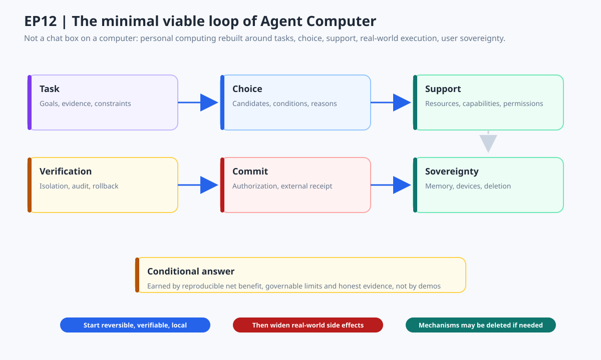

# Agent Computer 12: Is Agent Computer the next generation of personal computing?

> This is part 12 of 12 in the **Agent Computer** series, adapted from the Agent Computer live-stream series. Previous: [Why an unproven system can deserve more trust](https://0x00.community/blog/agent-computer-11-evidence-and-trust/).

Take one sentence: "fix this bug, test it and commit." What is the difference between giving it to a computer with a local model installed and giving it to what this series calls an Agent Computer? The first will probably edit the files and tell you it is done. The second is required to turn the sentence into a task with acceptance conditions, try it in an isolated workspace, let deterministic test results speak, lay out the candidates and their conditions for you to choose from, write to the repository only after you approve, and leave a record that can be checked later. The screen, keyboard and model can be identical. What differs is what the system treats as the object of computation and what it leaves for the user to decide.

So "is it the next generation?" cannot be answered from the shape of a product. The previous post left one constraint: methodology, target architecture, current capability and hypotheses to be verified must be stated separately. Under that constraint this post returns to the overall question. Its core claim:

> **Agent Computer is not "a computer plus AI". It is a proposal to rebuild the objects, boundaries and responsibility chain of personal computing around tasks, choice, support, real-world execution and user sovereignty.**

A boundary has to be added at once. For now this is a methodological judgment and a target direction. It is not a fact backed by validation in the real target environment, by the market or by production delivery.

## What each of the twelve posts answered

1. [AI keeps getting better at answers. Why is getting things done getting harder?](https://0x00.community/blog/agent-computer-01-answers-vs-tasks/): defines the problem. Open-ended tasks get compressed into one answer, one score and one path, and a one-sentence request starts executing before it has been given structure.
2. [Why a result is not the task](https://0x00.community/blog/agent-computer-02-results-are-not-tasks/): what a task should keep. A result is only one projection of the generative structure under particular conditions.
3. [Why AI always gives you one "standard answer"](https://0x00.community/blog/agent-computer-03-one-standard-answer/): how the choice space is generated and organized, through free-choice computing and conditioned candidates.
4. [The files you saved may all be "fakes"](https://0x00.community/blog/agent-computer-04-files-are-projections/): how results are stored in layers and reproduced at different levels, and why a file is not a complete task asset.
5. [A day in the life of an agent](https://0x00.community/blog/agent-computer-05-a-day-of-an-agent/): the task lifecycle that takes one job from a vague intent to a real-world receipt.
6. [Why an agent needs "multiple worlds"](https://0x00.community/blog/agent-computer-06-multiple-worlds/): why exploration, commit and reality are kept apart, and what rollback, compensation and reconciliation each cover.
7. [AgentOS is more than a runtime](https://0x00.community/blog/agent-computer-07-agentos-support/): what support and backstop the system has to give intelligence.
8. [On-device AI competes on intelligence density](https://0x00.community/blog/agent-computer-08-intelligence-density/): more parameters do not mean more delivered intelligence, and on the device the contest is effective task intelligence delivered reliably within limited resources.
9. [An AI that remembers you is not the same as owning your memory](https://0x00.community/blog/agent-computer-09-memory-sovereignty/): how memory comes under user sovereignty, and why forgetting, revocation and deletion have different meanings.
10. [When an agent leaves the computer, who answers for reality?](https://0x00.community/blog/agent-computer-10-physical-responsibility/): device sovereignty and the chain of real-world responsibility, and why real-world state can only be confirmed by external receipts and trusted observation.
11. [Why an unproven system can deserve more trust](https://0x00.community/blog/agent-computer-11-evidence-and-trust/): how evidence tiers and active falsification constrain the vision.
12. **Is Agent Computer the next generation of personal computing?** (this post): a route and a conditional judgment under those constraints.

Taken together, the methodology holds that the core objects of personal computing should move from files, applications and windows to tasks, choices, capabilities and real-world state. That is a proposal, not a description of where the industry is.

## Four paradigms compared

**The traditional computer** has files, programs, processes and devices as its main objects. Deterministic workflows dominate. For tasks with clear structure, stable rules and well-defined risk, a traditional program is often more reliable, faster and easier to verify against acceptance criteria than an agent.

**The phone** is centered on apps, notifications, sensors and personal identity, and it solved mobile access and constant connectivity. But task structure, permissions and long-term experience remain scattered across apps, and users can rarely see how one job was completed across them.

**The cloud agent** is centered on models and tool orchestration. Its strengths are remote compute, a rich set of tools and fast-improving models. Its weaknesses are structural: long-term private memory, on-device offline capability, cross-device authorization, the responsibility chain for real-world actions and the user's control over data may not close inside the user's own domain. The cloud can be an important collaborator for strong reasoning and unfamiliar tasks.

**Agent Computer** has the task generative structure, conditioned candidates, system-level support, private memory, real-world commit and user sovereignty at its core, carried jointly by on-device hardware, AgentOS and the organization of models. It differs from the other three in its objects of computation and its governance boundaries: a task goes from a piece of chat input to a system object that can be versioned, executed, verified, chosen, committed and reused.

The four complement each other. Agent Computer aims to fill what the traditional paradigms lack in open-ended tasks, long-term context, conditioned choice and organization across capabilities, and it does not do away with the traditional computer. The description of Agent Computer above is a goal, not an account of an existing product.

## The minimal viable loop: start with tasks that can be verified and rolled back

A route cannot begin with payments, email and industrial control. The minimal viable loop should be a task that exercises the core structure while keeping real-world side effects fairly contained. The white paper picks the example this post opened with, a local code fix:

> user goal → Task Spec → main line / shadow line → isolated workspace → capability lease → deterministic acceptance → candidate selection → user approval → atomic commit → record and reproduction

Each step of this chain was walked through in [part 5](https://0x00.community/blog/agent-computer-05-a-day-of-an-agent/). The task is small, yet it tests semantic compilation, worldlines, model execution, capability leases, the sandbox, acceptance, choice, reversible commit and reproduction all at once. It has one more important advantage: a mistake can be backed out. The atomic commit point here is the ref update of a single git commit. Checking out several files into the working tree is not atomic in itself, and after an interruption the ref is what recovery relies on.

By the standard of the previous post, the exit condition for this loop is not "the demo runs". It is that cancellation, timeouts, crashes, repeated execution and overreach all have defined behavior, the original repository is never contaminated, choice and commit are both recorded, and a new developer can reproduce the result independently. Until this loop holds reliably, email, payments, device control and industrial settings are out of reach.

## Staged route and order of priorities

The white paper splits the route into six stages. What follows is an order and an exit condition for each step. It is not a timetable and does not correspond to any release date.

1. **Freeze the objects and public contracts first.** Fix the objects shared across layers, such as the Task Spec, Capability Lease, worldline, candidate and real-world receipt, so that concepts do not drift whenever a component changes. The exit condition is that every area of responsibility can complete end-to-end interface integration through simulated adapters, with no ambiguity in data structures or state machines.
2. **Build a single-line safety loop.** Start with single-path execution, acceptance, cancellation, timeouts, crash handling, permissions and local commit. This step does not aim for maximum freedom. It only shows that errors do not contaminate reversible local state.
3. **Verify conditioned choice on a real workload.** Only after the single-line loop holds are a limited number of worldlines and conditioned candidates introduced. The exit condition is showing, on at least one real workload, that the gain in success rate or evidence from the extra worldlines exceeds their cost in resources and attention. If they only add to the user's burden of deciding, fall back to a single path.
4. **Verify that the organized approach has a net benefit.** Then bring in specialized agents, Adapters, independent acceptance and a role for counter-evidence. The exit condition is a stable improvement over a monolithic baseline, confirmed by ablation. Without a stable net benefit, scale back or delete.
5. **Build the OS-native backstop, the real-world commit gate and compensation.** This includes capability leases, file transactions, the commit broker (External Effect Broker), dry-run, prepare/commit in two steps, compensating transactions and the user authorization interface. The two steps here mean a pre-check followed by a commit on a single connector. They are not general distributed two-phase commit, and they promise no strong consistency across connectors.
6. **Extend last to the trusted device pool, industrial simulation and the Verified Process Capsule.** Real-world execution in industry is carried by deterministic control systems, and safety instrumented systems and equipment interlocks operate independently under their own safety designs.

The route compresses into one principle:

> **Verify the reversible loop before widening real-world side effects. Show system-level net benefit before adding organizational complexity.**

Email, payment, publishing, deletion and device control each have their own transaction semantics and means of compensation. Each class has to be verified separately, and "rollback will be supported later" does not cover it.

## The product boundary

A terminal that chats, calls applications and remembers preferences may be a more convenient entry point to AI, but it does not yet amount to a new paradigm. The product boundary depends on whether the following can be answered "yes":

- can tasks be structured, versioned and reused;
- do candidates keep their conditional differences and avoid being flattened into one answer early;
- is memory visible, correctable, revocable and deletable;
- are device capabilities authorized one by one;
- do real-world actions go through verification, authorization and an external receipt;
- do users, within the law and the system's safety floor, hold governance over data, memory, policy and devices;
- does the system fall back honestly to a more conservative behavior when it is uncertain.

It has equally clear boundaries in the other direction: not every task needs multiple worldlines, not every capability has to run on the device, not every real-world action can be rolled back, and not every part of the target architecture has been implemented.

The first of these matters most. Fixed format conversion, well-defined batch jobs, stable rule checks and process control with strict timing are deterministic, stable, high-frequency flows that still suit traditional workflows. The agent approach suits tasks where the goal is clear but the path is open, conditions change and a choice among candidates is needed, and the two can be mixed. Multiple worldlines, multiple agents, Adapters and a more complex Runtime have no inherent right to stay. Without system-level net benefit, the system should fall back to something simpler.

## Risks and unsolved problems

A roadmap must not cover up the following problems, none of which is solved today:

- **Memory contamination, expiry and deletion propagation.** Recall can reinforce a wrongly recorded memory again and again. Mechanisms for provenance, freshness, counterexamples and deletion propagation remain hard to implement across devices and agents.
- **Cross-device trust and permission decay.** Replacing a device must not widen permissions, but how permissions narrow monotonically by device, risk and task still needs an executable definition and validation in real environments.
- **Conflicting receipts and unknown states in real-world actions.** "Unknown" cannot be only a label in the interface. It has to block repeated execution, trigger reconciliation and keep the later compensation flow available.
- **The organizational cost and shared bias of multiple agents.** If several agents share one model, one data set and one mistaken assumption, more of them does not mean more independence.
- **On-device resources, power, tail latency and model updates.** The gains from organized small models and scheduling have to be shown by comparing resources and quality on real workloads.
- **Independent safety validation in industrial settings.** It cannot be proven by a model demo or a methodology document.
- **The distance between the target architecture and evidence from real environments.**
- **The boundary between user sovereignty and the system's safety floor.** Users should have the right to view, correct, revoke and delete, but "sovereignty" cannot be a reason to switch off safety protections that must not be overridden.

## Known, proposed, to be verified

Finally, the strength of each statement needs recalibrating. These three labels are not interchangeable.

**Known.** This splits into two columns. Facts: restoring local files does not undo real-world side effects; identifying, binding and authorizing a device are three different things; a result cannot fully represent the task structure that produced it. Principles: simple, stable flows suit deterministic workflows and should not take on complex organization without reason; complex mechanisms need to be compared against simpler baselines. The first column can be checked as fact, and the second is the set of engineering principles the methodology adopts.

**Proposed.** The Task Spec, Spec Package, worldlines, the validity gate and fit gate, the Memory Broker, Capability Lease, External Effect Broker, the split into exploration, commit and reality domains, intelligence density and the trusted device pool are target mechanisms proposed to carry those principles. They give an engineering direction and objects that can be falsified, but they do not automatically equal delivered capability.

**To be verified.** Whether Agent Computer produces a reproducible system-level net benefit on real tasks; whether it raises task success rate and output per unit of resource; whether it lowers the user's attention cost; whether multiple worldlines and multi-agent organization are worth their cost; whether private memory stays accurate, governable and deletable over long-term use; whether the real-world commit and device sovereignty chains fail closed under real faults; and whether the whole system can run stably and auditably in a real environment.

By the white paper's own disclosure, there is currently no evidence from the real target environment. The accurate reading of it is therefore "a method of computing waiting to be tested continuously by engineering evidence", not "all of these capabilities have been implemented".

## A conditional answer

Back to the question in the title. If Agent Computer only adds a chat entry point to a computer, calls a few applications, saves more chat history and uses a larger model to generate more content, it looks more like a layer of agent features on top of traditional computing. It is not the next generation of personal computing.

It has grounds to be called a new paradigm of personal computing only if all of the following hold:

- it makes the task a first-class object of computation and keeps the structure needed to generate results;
- it keeps candidates and the choice space open under reasonable conditions;
- it uses support, isolation, leases and a backstop to enlarge the space of safe exploration;
- it keeps data, memory, policy and devices within boundaries the user can govern;
- it places real-world actions behind verification, authorization, commit and an external receipt;
- it reports unknown, failed, unfit and unverified states as what they are.

And these claims have to add up to a reproducible system-level improvement on real tasks. So the answer to "is it?" can only be conditional today. The direction and the criteria have been proposed, and whether the name holds still awaits evidence. "New" here does not mean every underlying component is a fresh invention, and it does not mean traditional computers, phones and cloud models will be replaced. What is new is the way things are organized.

> **If Agent Computer is only a chat box added to a computer, it is not the next generation of personal computing. The name holds only when it reorganizes tasks, choice, support, real-world execution and user sovereignty, and real evidence shows a net benefit.**

## Conclusion

Whether the name holds will be decided by reproducible net benefit on real tasks, governable boundaries and honest evidence, not by naming or demos. Until that evidence appears, it should go on being called a methodology and a target direction. The methodology applies the same constraint to itself, and any mechanism, including the most central one, must be open to being overturned by real evidence. If multiple worldlines bring no net benefit, fall back to a single path. If multi-agent organization brings no net benefit, fall back to a single model. If memory recall adds errors, reduce recall and rework how it is governed. If real-world commits cannot be reconciled reliably, stay in simulation and shadow mode. If the target architecture has no real evidence, keep calling it target architecture. At this point in the series the question is no longer only what capability to add next. It is also which capabilities have proven worth keeping and which mechanisms should be scaled back or abandoned.

Start from the beginning: [AI keeps getting better at answers. Why is getting things done getting harder?](https://0x00.community/blog/agent-computer-01-answers-vs-tasks/)
