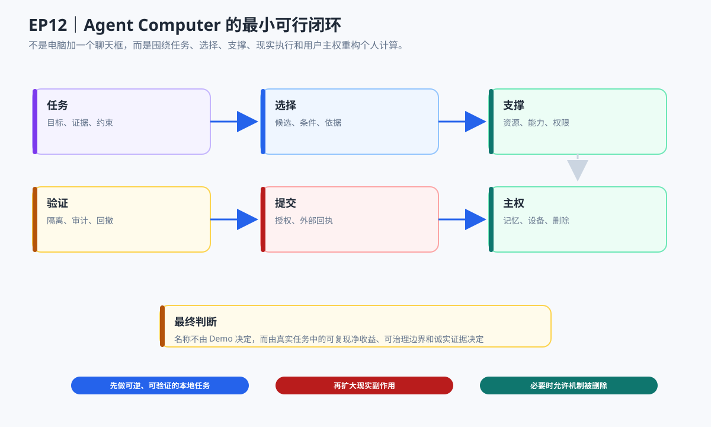

# Agent Computer 12｜Agent Computer 是不是下一代个人计算

> 本文是 **Agent Computer** 系列的第 12 篇（共 12 篇），整理自「顽皮的程序员」的 Agent Computer 系列直播。上一篇：[一个还没被证明的系统，为什么反而更值得信任](https://0x00.community/zh-CN/blog/agent-computer-11-evidence-and-trust/)。

同一句“帮我把这个 bug 修好，测完提交”，交给一台装了本地模型的电脑，和交给这个系列所说的 Agent Computer，差别在哪里？前者大概会直接改文件，然后告诉你改好了。后者被要求先把这句话变成带验收条件的任务，在隔离的工作区里试，拿确定性的测试结果说话，把候选和各自的条件摆给你选，经你批准才写进仓库，并且留下可以复查的记录。屏幕、键盘和模型可以完全一样，不一样的是系统把什么当作计算的对象、把什么留给用户决定。

所以“是不是下一代”这个问题，靠产品外形回答不了。上一篇留下了一条约束：方法论、目标架构、当前能力和待验证假设必须分开说。这一篇在这条约束之下回到总问题，核心判断是：

> **Agent Computer 不是“电脑+AI”，它是一种主张：围绕任务、选择、支撑、现实执行和用户主权，重构个人计算的对象、边界和责任链。**

这句话必须马上加上边界：它目前是一个方法论判断和目标方向，不是已经完成真实目标环境验证、市场验证或生产交付的事实。

## 十二篇各自回答了什么

1. [AI 越来越会回答，为什么越来越难把事办成](https://0x00.community/zh-CN/blog/agent-computer-01-answers-vs-tasks/)：定义问题。开放任务被压缩成了单答案、单评分和单路径，一句话的需求没有被整理成结构就开始执行。
2. [为什么结果不等于任务](https://0x00.community/zh-CN/blog/agent-computer-02-results-are-not-tasks/)：任务该保存什么。结果只是生成结构在特定条件下的一次投影。
3. [为什么 AI 总给你一个“标准答案”](https://0x00.community/zh-CN/blog/agent-computer-03-one-standard-answer/)：选择空间如何生成和组织，即自由选择计算与条件化候选。
4. [你存的文件可能都是“假货”](https://0x00.community/zh-CN/blog/agent-computer-04-files-are-projections/)：结果如何分层保存、分级复现，文件为什么不等于完整的任务资产。
5. [Agent 的一天](https://0x00.community/zh-CN/blog/agent-computer-05-a-day-of-an-agent/)：一件事从模糊意图走到现实回执，要经过怎样的任务生命周期。
6. [为什么 Agent 需要“多个世界”](https://0x00.community/zh-CN/blog/agent-computer-06-multiple-worlds/)：探索、提交和现实为什么要分开，回撤、补偿和对账各管什么。
7. [AgentOS 不只是一个运行环境](https://0x00.community/zh-CN/blog/agent-computer-07-agentos-support/)：系统要给智能提供什么样的支撑和兜底。
8. [端侧 AI 比的是智能密度](https://0x00.community/zh-CN/blog/agent-computer-08-intelligence-density/)：参数更大不等于交付更多智能，端侧比的是有限资源下稳定交付的有效任务智能。
9. [AI 记住你，不等于你拥有自己的记忆](https://0x00.community/zh-CN/blog/agent-computer-09-memory-sovereignty/)：记忆怎样进入用户主权，遗忘、撤销和删除为什么是不同的语义。
10. [Agent 走出电脑以后，谁对现实负责](https://0x00.community/zh-CN/blog/agent-computer-10-physical-responsibility/)：设备主权和现实责任链，现实状态为什么只能由外部回执和可信观测确认。
11. [一个还没被证明的系统，为什么反而更值得信任](https://0x00.community/zh-CN/blog/agent-computer-11-evidence-and-trust/)：怎样用证据分级和主动证伪约束愿景。
12. **Agent Computer 是不是下一代个人计算**（本文）：在上述约束下给出路线和有条件的判断。

合起来看，这套方法论主张个人计算的核心对象应当从文件、应用和窗口，转向任务、选择、能力和现实状态。这是一个主张，不是对行业现状的描述。

## 四种范式比较

**传统电脑**以文件、程序、进程和设备为主要对象。确定性工作流占主导。对结构清晰、规则稳定、风险明确的任务，传统程序往往比 Agent 更可靠、更快，也更容易验收。

**手机**以应用、通知、传感器和个人身份为中心，解决了移动入口和持续连接的问题。但任务结构、权限和长期经验仍然分散在各个应用里，用户很难看到一件事是怎样跨应用完成的。

**云端 Agent**以模型和工具编排为中心。它的强项是远端算力、丰富的工具和快速升级的模型，弱项是结构性的：长期私有记忆、端侧离线能力、跨设备授权、现实动作的责任链，以及用户对数据的控制，未必能在用户自己的域内闭合。云端可以是重要的协作者，承担强推理和陌生任务。

**Agent Computer**以任务生成结构、条件化候选、系统级支撑、私有记忆、现实提交和用户主权为核心，由端侧硬件、AgentOS 和模型组织共同承载。它和前三者的差别在计算对象和治理边界：任务从一段聊天输入，变成可以被版本化、执行、验证、选择、提交和复用的系统对象。

这四者是互补关系。Agent Computer 要补的是传统范式在开放任务、长期上下文、条件选择和跨能力组织上的不足，并不取消传统电脑。上面关于 Agent Computer 的描述是目标，不是对现有产品的说明。

## 最小可行闭环：先做可验证、可回撤的任务

谈路线，不能一上来就谈支付、邮件和工业控制。最小可行闭环应该选一个能验证核心结构、现实副作用又相对可控的任务。白皮书选的是开头那个例子，本地代码修复：

> 用户目标 → Task Spec → 主线/影子线 → 隔离工作区 → 能力租约 → 确定性验收 → 候选选择 → 用户批准 → 原子提交 → 记录与复现

这条链路的每一步在[第 5 篇](https://0x00.community/zh-CN/blog/agent-computer-05-a-day-of-an-agent/)里都走过一遍。这个任务不大，却同时检验了语义编译、世界线、模型执行、能力租约、沙箱、验收、选择、可逆提交和复现。它还有一个重要的优点：出了错可以退回去。这里的原子提交点是一次 git commit 的 ref 更新；工作区里多个文件的检出本身不是原子的，中断以后靠 ref 恢复。

按上一篇的标准，这个闭环的退出条件不是“Demo 能跑”，而是：取消、超时、崩溃、重复执行和越权都有确定的行为，原仓库不被污染，选择和提交都有记录，一位新开发者可以独立复现。这个闭环不能稳定成立之前，谈不上进入邮件、付款、设备控制或工业环境。

## 阶段路线与落地优先顺序

白皮书把路线拆成六个阶段。这里给出的是先后顺序和每一步的退出条件，不是时间表，也不对应任何发布日期。

1. **先冻结对象和公开契约。** 把 Task Spec、Capability Lease、世界线、候选、现实回执这些跨层共享的对象先定下来，避免组件一调整概念就漂移。退出条件是各责任面可以通过模拟适配器完成端到端的接口联调，数据结构和状态机没有歧义。
2. **建立单线安全闭环。** 先做单路径的执行、验收、取消、超时、崩溃处理、权限和本地提交。这一步不追求最大自由，只证明错误不会污染可逆的本地状态。
3. **在真实工作负载上验证条件选择。** 单线闭环成立以后，才引入有限的世界线和条件化候选。退出条件是至少在一个真实工作负载上证明，额外世界线带来的成功率或证据收益超过了资源和注意力成本；如果它只是增加了用户的裁决负担，就退回单路径。
4. **验证组织化方案是否有净收益。** 再引入专业 Agent、Adapter、独立验收和反证角色。退出条件是相对单体基线形成稳定的改善，并通过消融验证；没有稳定净收益就裁减或删除。
5. **建立 OS 原生兜底、现实提交门和补偿机制。** 包括能力租约、文件事务、提交代理（External Effect Broker）、dry-run 预演、prepare/commit 两步提交、补偿事务和用户授权界面。这里的两步提交指单个连接器上的预检加提交，不等于通用的分布式两阶段提交，也不承诺跨连接器的强一致。
6. **最后扩展可信设备池、工业仿真和 Verified Process Capsule。** 工业现实执行由确定性控制系统承担，安全仪表系统和设备联锁按各自的安全设计独立生效。

这条路线可以压成一条原则：

> **先验证可逆闭环，再扩大现实副作用；先证明系统级净收益，再增加组织复杂度。**

邮件、支付、发布、删除和设备控制各有不同的事务语义和补偿方式，要逐类验证，不能用一句“以后会支持回滚”带过。

## 产品边界

一个会聊天、会调用应用、会记住偏好的终端，可能是更方便的 AI 入口，但还不足以构成新的范式。产品边界要看下面这些问题能否回答“是”：

- 任务是否能被结构化、版本化和复用；
- 候选是否保留了条件差异，而不是提前被压成一个答案；
- 记忆是否可见、可纠正、可撤销、可删除；
- 设备能力是否逐项授权；
- 现实动作是否经过验证、授权和外部回执；
- 用户是否在法律和系统安全底线之内，拥有对数据、记忆、策略和设备的治理权；
- 系统在不确定时是否如实退到更保守的做法。

它也有同样明确的反向边界：不是所有任务都需要多世界线，不是所有能力都要在端侧完成，不是所有现实动作都能回滚，不是所有目标架构都已经实现。

尤其是第一条。固定格式转换、明确的批处理、稳定的规则校验、对时序要求严格的过程控制，这类确定、稳定、高频的流程仍然适合传统工作流。Agent 方法更适合目标清楚但路径开放、条件会变、需要在候选之间做选择的任务，两者可以混合。多世界线、多 Agent、Adapter 和更复杂的 Runtime 都没有天然的保留权，没有系统级净收益就应该退回更简单的方案。

## 风险与尚未解决的问题

路线图不能盖住下面这些问题，它们目前都没有被解决：

- **记忆污染、过期和删除传播。** 召回会让写错的记忆被反复强化；来源、时效、反例和删除传播这些机制，在多设备、多 Agent 场景下仍有实现难度。
- **跨设备信任与权限衰减。** 设备更换不能放大权限，但权限如何按设备、风险和任务单调收窄，还需要可执行的定义和真实环境验证。
- **现实动作的回执冲突和未知状态。** “未知”不能只是界面上的一个标签，它还要阻断重复执行、触发对账，并保留后续的补偿流程。
- **多 Agent 的组织成本与同源偏差。** 多个 Agent 如果共用同一个模型、同一份数据和同一个错误假设，数量增加并不等于独立性增加。
- **端侧资源、功耗、尾时延和模型更新。** 组织化小模型和调度的收益，要靠真实工作负载上资源与质量的对比来证明。
- **工业场景的独立安全验证。** 它不能由一个模型 Demo 或一份方法论文档证明。
- **目标架构与真实环境证据之间的距离。**
- **用户主权与系统安全底线的边界。** 用户应该拥有查看、纠正、撤销和删除的权利，但不能以“主权”为由关闭不可覆盖的安全保护。

## 已知、提出、待验证

最后把表达的强度重新校准一遍。这三种说法不能互换。

**已知。** 这里要再分两栏。事实：恢复本地文件不能撤销现实副作用；设备的识别、绑定和授权是三件不同的事；一个结果不能完整代表生成它的任务结构。原则：简单稳定的流程适合确定性工作流，不应该无理由地增加复杂组织；复杂机制需要和更简单的基线比较。前一栏是可以核对的事实，后一栏是这套方法论采纳的工程原则。

**提出。** Task Spec、Spec Package、世界线、有效性门和场景适配门、Memory Broker、Capability Lease、External Effect Broker、探索域、提交域、现实域的划分、智能密度和可信设备池，是为了承载上述原则而提出的目标机制。它们给出了工程化的方向和可以被证伪的对象，但不自动等于交付能力。

**待验证。** Agent Computer 是否在真实任务上形成可复现的系统级净收益；是否提高了任务成功率和单位资源产出；是否降低了用户的注意力成本；多世界线和多 Agent 组织是否值得它们的成本；私有记忆在长期使用中能否保持准确、可治理和可删除；现实提交和设备主权链在真实故障中能否失败关闭；以及整套系统能否在真实环境中稳定、可审计地运行。

按白皮书自己的披露，真实目标环境证据目前为空。所以对它准确的读法是“一套等待工程证据持续检验的计算方法”，而不是“这些能力已经全部实现”。

## 有条件的回答

回到标题的问题。如果 Agent Computer 只是在电脑里加一个聊天入口、调用几个应用、保存更多聊天历史、用更大的模型生成更多内容，那它更像传统计算上的一层 Agent 功能，不是下一代个人计算。

它要被称为一种新的个人计算范式，需要同时做到这些：

- 把任务作为第一类计算对象，保存生成结果所需的结构；
- 在合理条件下保留候选和选择空间；
- 用支撑、隔离、租约和兜底扩大安全的探索空间；
- 让数据、记忆、策略和设备处在用户可治理的边界之内；
- 把现实动作放在验证、授权、提交和外部回执之后；
- 在未知、失败、不适配和未验证时如实表达。

最后，这些主张还要在真实任务上形成可复现的系统级改善。所以对“是不是”的回答，今天只能是有条件的：方向和判据已经提出，名称是否成立还有待证据。这里的“新”不在于每个底层组件都是新发明，也不意味着传统电脑、手机和云端模型会被替代，新的是组织方式。

> **如果 Agent Computer 只是电脑上多了一个聊天框，它不是下一代个人计算；只有当它重新组织任务、选择、支撑、现实执行和用户主权，并经真实证据证明有净收益时，这个名称才成立。**

## 结论

这个名称是否成立，不由命名和 Demo 决定，由真实任务中可复现的净收益、可治理的边界和如实的证据决定；在这些证据出现之前，它应该继续被称为方法论和目标方向。这套方法论对自己也适用同一条约束，任何机制，包括最核心的机制，都必须允许被真实证据推翻：多世界线没有净收益就退回单路径，多 Agent 组织没有净收益就退回单体，记忆召回增加了错误就减少召回并重新设计治理方式，现实提交不能可靠对账就停留在模拟和影子模式，目标架构没有真实证据就继续称为目标架构。系列写到这里，接下来的问题已经不只是“还能增加什么能力”，还包括哪些能力已经证明值得保留，哪些机制应该被裁减或放弃。

从头读起：[AI 越来越会回答，为什么越来越难把事办成](https://0x00.community/zh-CN/blog/agent-computer-01-answers-vs-tasks/)
